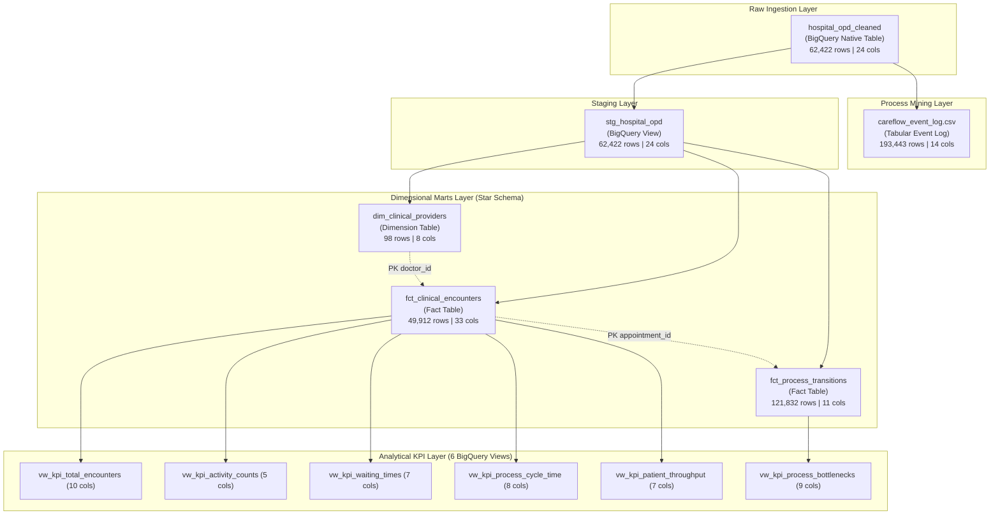

# CareFlow Clinical Process Mining — Data Dictionary

**Document Version:** 1.0.0  
**Effective Date:** 2 November 2026  
**Auditor / Data Engineer:** Member 3 (Data Engineering: Ingestion, SQL Validation, dbt Marts, KPI Views, Event-Log Preparation)  
**Milestone Target:** 8 November 2026 (Final Project Handover)  
**Target GCP Project:** `careflow-clinical-process-m`  
**Target BigQuery Dataset:** `careflow_opd` (Region: `US`)  

---

## 1. Overview & Data Architecture

This Data Dictionary provides the definitive, production-verified reference for all data assets, schemas, columns, constraints, and clinical definitions across the CareFlow Clinical Process Mining project.

Across the project architecture, exactly **11 Google Cloud BigQuery objects** (5 tables/marts and 6 analytical SQL views) containing **146 verified columns** are deployed in dataset `careflow_opd`. Together with the local process mining tabular event log ([`data/careflow_event_log.csv`](file:///c:/Users/user/Documents/careflow-clinical-process-mining/data/careflow_event_log.csv), 14 columns), this dictionary exhaustively defines **12 documented project entities** comprising **160 total column definitions**. Every schema definition, data type, and constraint has been confirmed against live BigQuery `INFORMATION_SCHEMA.COLUMNS` metadata and actual local CSV headers.

### 1.1 Architecture & Entity Summary



### 1.2 Entity Master Registry

| Entity Name | Asset Type | Storage Layer / Path | Granularity / Grain | Row Count | Primary Key | Foreign Keys |
| :--- | :--- | :--- | :--- | :---: | :--- | :--- |
| **`hospital_opd_cleaned`** | Native Table | BigQuery `careflow_opd` | One row per service transaction record | 62,422 | `record_no` | None |
| **`stg_hospital_opd`** | SQL View | BigQuery `careflow_opd` | One row per service transaction record | 62,422 | `record_no` | None |
| **`dim_clinical_providers`** | Native Table | BigQuery `careflow_opd` | One row per unique attending physician | 98 | `doctor_id` | None |
| **`fct_clinical_encounters`** | Native Table | BigQuery `careflow_opd` | One row per unique outpatient visit | 49,912 | `appointment_id` | `doctor_id` $\rightarrow$ `dim_clinical_providers` |
| **`fct_process_transitions`** | Native Table | BigQuery `careflow_opd` | One row per canonical stage-to-stage transition | 121,832 | `transition_id` | `appointment_id` $\rightarrow$ `fct_clinical_encounters` |
| **`careflow_event_log.csv`** | CSV File | `data/careflow_event_log.csv` | One row per discrete clinical activity lifecycle event | 193,443 | `(case_id, event_order)` | `source_record_no` $\rightarrow$ `hospital_opd_cleaned.record_no` |
| **`vw_kpi_total_encounters`** | SQL View | BigQuery `careflow_opd` | One row (department-level summary) | 1 | N/A (Summary) | N/A |
| **`vw_kpi_activity_counts`** | SQL View | BigQuery `careflow_opd` | One row per clinical pathway code | 7 | `flow_code` | N/A |
| **`vw_kpi_waiting_times`** | SQL View | BigQuery `careflow_opd` | One row per clinical waiting stage | 4 | `wait_stage` | N/A |
| **`vw_kpi_process_cycle_time`** | SQL View | BigQuery `careflow_opd` | One row per clinical pathway code | 7 | `flow_code` | N/A |
| **`vw_kpi_patient_throughput`** | SQL View | BigQuery `careflow_opd` | One row per Year-Month-DayOfWeek-Hour arrival bucket | 3,808 | Composite temporal | N/A |
| **`vw_kpi_process_bottlenecks`** | SQL View | BigQuery `careflow_opd` | One row per clinical stage transition pair | 15 | `(from_stage, to_stage)` | N/A |

---

## 2. Clinical & Operational Data Definitions

### 2.1 Core Clinical Identifiers

- **`patient_id` (INT64):**  
  De-identified surrogate identifier representing an individual patient. Patients may have multiple outpatient encounters over the dataset's 819-day timespan (average: 1.27 encounters/patient; range: 1–18 visits).
- **`appointment_id` (INT64):**  
  Unique encounter identifier representing a single outpatient department visit from check-in to final discharge. Used as the primary **Case ID** for encounter-level process mining and the primary key of [`fct_clinical_encounters`](#43-fact-table-fct_clinical_encounters).
- **`record_no` (INT64):**  
  Source-level sequential transaction counter (1 to 62,422). Represents a single service transaction line in the wide hospital dataset. When an encounter involves multiple lab tests or imaging scans, multiple `record_no` rows share the same `appointment_id`.
- **`prescription_doctor_id` / `doctor_id` (INT64):**  
  Unique identifier for the primary attending physician responsible for patient consultation and treatment orders. 98 distinct physicians are recorded.
- **`transition_id` (STRING):**  
  Deterministic surrogate key for encounter stage transitions, formatted as `<appointment_id>_step_<stage_seq>` (e.g., `1001_step_1`).
- **`service_id` (STRING / FLOAT64):**  
  Departmental order or line-item key corresponding to `prescription_order_id`, `lab_id`, `imaging_request_id`, or `pharmacy_sale_line_id`.

---

### 2.2 Clinical Milestones & Lifecycle Timestamps

All timestamps are stored in UTC/ISO-8601 format (`YYYY-MM-DD HH:MM:SS`) spanning the operational period **2024-04-25 11:12:00 to 2026-07-23 16:43:00** (819 days).

| Timestamp Field | Clinical Meaning | Department | Nullable Rate | Validation Rules & Clinical Significance |
| :--- | :--- | :--- | :---: | :--- |
| **`appointment_start_time`** | Patient arrival & reception check-in | OPD Front Desk | 0.00% (0 nulls) | Mandatory root timestamp for all encounters. Establishes the baseline $T_0$ for waiting time and cycle time calculations. |
| **`prescription_start_time`** | Patient called into examination room; consultation begins | Attending Clinic | 0.02% (12 nulls) | Marks end of reception waiting time and start of doctor engagement. 12 records lack this timestamp due to rapid walk-in or system bypass. |
| **`prescription_end_time`** | Consultation finished; doctor signs orders/prescriptions | Attending Clinic | 0.00% (1 null) | Marks end of physician examination and release of diagnostic/medication orders. |
| **`lab_start_time`** | Blood/specimen sample collected at laboratory phlebotomy | Laboratory | 71.12% (44,393 nulls) | Populated only if lab tests were ordered. 457 records exhibit sample collection prior to desk registration. |
| **`lab_end_time`** | Laboratory test analyzed, verified, and result signed off | Laboratory | 78.65% (49,095 nulls) | 4,702 lab orders have start time but no completion time (pending results at outpatient discharge). |
| **`imaging_start_time`** | Patient received in radiology suite; scan/X-ray initiated | Radiology | 91.15% (56,899 nulls) | Populated only if imaging was ordered. 295 records exhibit scan start prior to desk registration. |
| **`imaging_end_time`** | Radiologic study completed; images archived to PACS | Radiology | 91.17% (56,909 nulls) | 10 scans have start time but no completion time. |
| **`pharmacy_start_time`** | Prescription presented at hospital outpatient dispensary | Pharmacy | 99.52% (62,120 nulls) | Populated only for on-site pharmacy dispensations (302 records). |
| **`pharmacy_end_time`** | Medication packaged, verified by pharmacist, and dispensed | Pharmacy | 99.52% (62,120 nulls) | Final discharge milestone for pharmacy-inclusive pathways. |

---

### 2.3 Clinical Pathway Codes & Definitions

The dataset categorizes patient visits into 7 standard outpatient pathways (`flow_code` 1 through 7):

| Flow Code | Canonical Pathway Label | Clinical Description | Total Encounters | Share (%) | Mean Cycle Time |
| :---: | :--- | :--- | :---: | :---: | :---: |
| **1** | `Appointment → Prescription` | **Standard Consultation:** Routine follow-up, general review, or prescription refill requiring doctor consultation only. | 39,658 | 79.46% | 151.7 min (~2.5h) |
| **2** | `Appointment → Prescription → Lab` | **Consultation + Laboratory:** Patient examined by doctor, followed by diagnostic blood, urine, or pathology testing. | 4,824 | 9.67% | 796.1 min (~13.3h) |
| **3** | `Appointment → Prescription → Imaging` | **Consultation + Radiology:** Patient examined by doctor, followed by X-ray, ultrasound, CT, or MRI imaging scan. | 3,794 | 7.60% | 784.8 min (~13.1h) |
| **4** | `Appointment → Prescription → Pharmacy` | **Consultation + Internal Pharmacy:** Patient examined by doctor and fills medications directly at the hospital pharmacy. | 78 | 0.16% | 74.4 min (~1.2h) |
| **5** | `Appointment → Prescription → Lab + Imaging` | **Multi-Diagnostic Investigation:** Comprehensive clinical workup requiring both laboratory testing and radiological imaging. | 1,528 | 3.06% | 1,475.5 min (~24.6h) |
| **6** | `Appointment → Prescription → Lab + Pharmacy` | **Diagnostic Lab + Medication Dispensation:** Patient receives laboratory tests and internal medication fulfillment. | 22 | 0.04% | 585.5 min (~9.8h) |
| **7** | `Appointment → Prescription → Imaging + Pharmacy` | **Radiology + Medication Dispensation:** Patient receives imaging scan and internal medication fulfillment. | 8 | 0.02% | 114.8 min (~1.9h) |

---

### 2.4 Operational Measures & Quality Metrics

- **Waiting Times (Minutes):**  
  Elapsed duration from initial check-in (`appointment_start_time`) to the start timestamp of each downstream department:
  $$\text{wait\_to\_consultation} = \text{prescription\_start\_time} - \text{appointment\_start\_time}$$
  $$\text{wait\_to\_lab} = \text{lab\_start\_time} - \text{appointment\_start\_time}$$
  $$\text{wait\_to\_imaging} = \text{imaging\_start\_time} - \text{appointment\_start\_time}$$
  $$\text{wait\_to\_pharmacy} = \text{pharmacy\_start\_time} - \text{appointment\_start\_time}$$
- **Activity Durations (Minutes):**  
  Execution turnaround time (TAT) within a single clinical department:
  $$\text{duration} = T_{\text{complete}} - T_{\text{start}}$$
- **Total Process Cycle Time (Minutes):**  
  Total elapsed patient length of stay (LOS) in the outpatient department from registration to the latest service completion:
  $$\text{total\_cycle\_time} = \max(T_{\text{prescription\_end}}, T_{\text{lab\_end}}, T_{\text{imaging\_end}}, T_{\text{pharmacy\_end}}) - \text{appointment\_start\_time}$$
- **Bottleneck Threshold Flag (`is_bottleneck = 1`):**  
  Assigned when any stage-to-stage transition duration exceeds **120 minutes (2 hours)**.
- **Outlier Wait Flag (`is_outlier_wait = 1`):**  
  Assigned when reception-to-consultation waiting time exceeds **480 minutes (8 hours)**.
- **Timestamp Inversion Flag (`has_timestamp_inversion = 1` / `is_negative_transition = 1`):**  
  Assigned when a clinical activity's start timestamp precedes reception check-in, or completion timestamp precedes start timestamp.

---

## 3. Detailed Data Dictionaries: Source & Staging Layers

### 3.1 Raw Table: `careflow_opd.hospital_opd_cleaned`
- **Location:** Native BigQuery Table (`careflow-clinical-process-m.careflow_opd.hospital_opd_cleaned`)
- **Row Count:** 62,422 rows | **Column Count:** 24 columns
- **Grain:** One row per clinical order/service transaction record
- **Primary Key:** `record_no` (100% unique, 0 nulls)

| # | Column Name | BigQuery Data Type | Nullable | Null Count (%) | Key / Constraints | Description & Clinical Meaning | Sample Value |
|:-:|:--- |:--- |:---:|:---:|:---:|:--- |:--- |
| 1 | `record_no` | `INT64` | YES | 0 (0.00%) | **PK** | Sequential row counter in source dataset. | `1` |
| 2 | `patient_id` | `INT64` | YES | 0 (0.00%) | **FK** | Master patient index / longitudinal patient key. | `132644` |
| 3 | `appointment_id` | `INT64` | YES | 0 (0.00%) | **FK** | Outpatient visit / encounter identifier. | `1001` |
| 4 | `appointment_start_datetime` | `TIMESTAMP` | YES | 0 (0.00%) | Not Null | Patient arrival & reception check-in timestamp. | `2024-04-25 11:12:00 UTC` |
| 5 | `prescription_doctor_id` | `INT64` | YES | 0 (0.00%) | **FK** | Attending physician identifier. | `108` |
| 6 | `prescription_doctor_name` | `STRING` | YES | 0 (0.00%) | Domain text | Full name of attending physician. | `Dr. Smith` |
| 7 | `prescription_order_id` | `INT64` | YES | 0 (0.00%) | Unique order | Clinical prescription order key. | `50123` |
| 8 | `prescription_start_datetime` | `TIMESTAMP` | YES | 12 (0.02%) | Nullable TS | Consultation initiation timestamp. | `2024-04-25 11:35:00 UTC` |
| 9 | `prescription_end_datetime` | `TIMESTAMP` | YES | 1 (0.00%) | Nullable TS | Consultation completion timestamp. | `2024-04-25 11:42:00 UTC` |
| 10| `lab_id` | `INT64` | YES | 44,393 (71.12%) | Order key | Laboratory order key (null if no lab test). | `30421` |
| 11| `lab_name` | `STRING` | YES | 44,393 (71.12%) | Test label | Name of diagnostic laboratory test. | `Complete Blood Count` |
| 12| `lab_start_datetime` | `TIMESTAMP` | YES | 44,393 (71.12%) | Nullable TS | Specimen collection start timestamp. | `2024-04-25 12:05:00 UTC` |
| 13| `lab_end_datetime` | `TIMESTAMP` | YES | 49,095 (78.65%) | Nullable TS | Laboratory result verified timestamp. | `2024-04-25 13:45:00 UTC` |
| 14| `imaging_request_id` | `INT64` | YES | 56,899 (91.15%) | Request key | Radiology order requisition identifier. | `40102` |
| 15| `imaging_result_id` | `INT64` | YES | 56,899 (91.15%) | Result key | Radiology result report identifier. | `90102` |
| 16| `imaging_name` | `STRING` | YES | 56,899 (91.15%) | Modality | Name of radiological procedure/modality. | `Chest X-Ray PA View` |
| 17| `imaging_start_datetime` | `TIMESTAMP` | YES | 56,899 (91.15%) | Nullable TS | Radiology scan initiation timestamp. | `2024-04-25 12:30:00 UTC` |
| 18| `imaging_end_datetime` | `TIMESTAMP` | YES | 56,909 (91.17%) | Nullable TS | Radiology scan completion timestamp. | `2024-04-25 12:45:00 UTC` |
| 19| `pharmacy_sale_line_id` | `INT64` | YES | 62,120 (99.52%) | Line item | Pharmacy dispensation item identifier. | `70101` |
| 20| `medicine_name` | `STRING` | YES | 62,120 (99.52%) | Drug name | Dispensed pharmaceutical drug name. | `Paracetamol 500mg Tab` |
| 21| `pharmacy_start_datetime` | `TIMESTAMP` | YES | 62,120 (99.52%) | Nullable TS | Pharmacy prescription intake timestamp. | `2024-04-25 13:00:00 UTC` |
| 22| `pharmacy_end_datetime` | `TIMESTAMP` | YES | 62,120 (99.52%) | Nullable TS | Pharmacy medication handoff timestamp. | `2024-04-25 13:05:00 UTC` |
| 23| `flow_code` | `INT64` | YES | 0 (0.00%) | Code 1-7 | Numeric clinical pathway category. | `2` |
| 24| `flow_name` | `STRING` | YES | 0 (0.00%) | Pathway name | Human-readable pathway trajectory label. | `Appointment → Prescription → Lab` |

---

### 3.2 Staging View: `careflow_opd.stg_hospital_opd`
- **Location:** BigQuery SQL View (`careflow-clinical-process-m.careflow_opd.stg_hospital_opd`)
- **Source Model:** `{{ source('careflow_raw', 'hospital_opd_cleaned') }}`
- **Row Count:** 62,422 rows | **Column Count:** 24 columns
- **Grain:** One row per clinical transaction record
- **Primary Key:** `record_no`
- **Transformation Notes:** Explicit type casting (`CAST(x AS INT64)`, `CAST(x AS TIMESTAMP)`); standardizes datetime column suffixes from `_datetime` to `_time`.

| # | Column Name | BigQuery Type | Source Field | Transformation / Logic |
|:-:|:--- |:--- |:--- |:--- |
| 1 | `record_no` | `INT64` | `record_no` | `CAST(record_no AS INT64)` |
| 2 | `patient_id` | `INT64` | `patient_id` | `CAST(patient_id AS INT64)` |
| 3 | `appointment_id` | `INT64` | `appointment_id` | `CAST(appointment_id AS INT64)` |
| 4 | `appointment_start_time` | `TIMESTAMP` | `appointment_start_datetime` | `CAST(appointment_start_datetime AS TIMESTAMP)` |
| 5 | `prescription_doctor_id` | `INT64` | `prescription_doctor_id` | `CAST(prescription_doctor_id AS INT64)` |
| 6 | `prescription_doctor_name` | `STRING` | `prescription_doctor_name` | `CAST(prescription_doctor_name AS STRING)` |
| 7 | `prescription_order_id` | `INT64` | `prescription_order_id` | `CAST(prescription_order_id AS INT64)` |
| 8 | `prescription_start_time` | `TIMESTAMP` | `prescription_start_datetime` | `CAST(prescription_start_datetime AS TIMESTAMP)` |
| 9 | `prescription_end_time` | `TIMESTAMP` | `prescription_end_datetime` | `CAST(prescription_end_datetime AS TIMESTAMP)` |
| 10| `lab_id` | `INT64` | `lab_id` | `CAST(lab_id AS INT64)` |
| 11| `lab_name` | `STRING` | `lab_name` | `CAST(lab_name AS STRING)` |
| 12| `lab_start_time` | `TIMESTAMP` | `lab_start_datetime` | `CAST(lab_start_datetime AS TIMESTAMP)` |
| 13| `lab_end_time` | `TIMESTAMP` | `lab_end_datetime` | `CAST(lab_end_datetime AS TIMESTAMP)` |
| 14| `imaging_request_id` | `INT64` | `imaging_request_id` | `CAST(imaging_request_id AS INT64)` |
| 15| `imaging_result_id` | `INT64` | `imaging_result_id` | `CAST(imaging_result_id AS INT64)` |
| 16| `imaging_name` | `STRING` | `imaging_name` | `CAST(imaging_name AS STRING)` |
| 17| `imaging_start_time` | `TIMESTAMP` | `imaging_start_datetime` | `CAST(imaging_start_datetime AS TIMESTAMP)` |
| 18| `imaging_end_time` | `TIMESTAMP` | `imaging_end_datetime` | `CAST(imaging_end_datetime AS TIMESTAMP)` |
| 19| `pharmacy_sale_line_id` | `INT64` | `pharmacy_sale_line_id` | `CAST(pharmacy_sale_line_id AS INT64)` |
| 20| `medicine_name` | `STRING` | `medicine_name` | `CAST(medicine_name AS STRING)` |
| 21| `pharmacy_start_time` | `TIMESTAMP` | `pharmacy_start_datetime` | `CAST(pharmacy_start_datetime AS TIMESTAMP)` |
| 22| `pharmacy_end_time` | `TIMESTAMP` | `pharmacy_end_datetime` | `CAST(pharmacy_end_datetime AS TIMESTAMP)` |
| 23| `flow_code` | `INT64` | `flow_code` | `CAST(flow_code AS INT64)` |
| 24| `flow_name` | `STRING` | `flow_name` | `CAST(flow_name AS STRING)` |

---

## 4. Detailed Data Dictionaries: Dimensional Marts Layer

### 4.1 Dimension Table: `careflow_opd.dim_clinical_providers`
- **Location:** Native BigQuery Table (`careflow-clinical-process-m.careflow_opd.dim_clinical_providers`)
- **Row Count:** 98 rows | **Column Count:** 8 columns | **Storage:** 7.5 KB
- **Grain:** One row per unique attending physician (`doctor_id`)
- **Primary Key:** `doctor_id` (100% unique, 0 nulls, dbt test verified)

| # | Column Name | BigQuery Data Type | Nullable | Key / Constraints | Description & Business Logic | Sample Value |
|:-:|:--- |:--- |:---:|:---:|:--- |:--- |
| 1 | `doctor_id` | `INT64` | YES | **PK** | Attending physician identifier. | `101` |
| 2 | `doctor_name` | `STRING` | YES | Unique text | Attending clinician full name. | `Dr. Evelyn Reed` |
| 3 | `total_appointments` | `INT64` | YES | Metric $\ge 1$ | Distinct count of outpatient visits attended (`COUNT(DISTINCT appointment_id)`). | `512` |
| 4 | `total_encounter_records` | `INT64` | YES | Metric $\ge 1$ | Total transaction line items authored (`COUNT(*)`). | `638` |
| 5 | `total_patients_treated` | `INT64` | YES | Metric $\ge 1$ | Distinct patients examined (`COUNT(DISTINCT patient_id)`). | `480` |
| 6 | `first_consultation_time` | `TIMESTAMP` | YES | Timestamp | Earliest recorded consultation timestamp for this doctor. | `2024-04-25 11:35:00 UTC` |
| 7 | `last_consultation_time` | `TIMESTAMP` | YES | Timestamp | Most recent recorded consultation timestamp for this doctor. | `2026-07-23 15:40:00 UTC` |
| 8 | `avg_consultation_duration_minutes` | `FLOAT64` | YES | Metric $\ge 0$ | Average doctor consultation examination duration in minutes. | `4.62` |

---

### 4.2 Fact Table: `careflow_opd.fct_clinical_encounters`
- **Location:** Native BigQuery Table (`careflow-clinical-process-m.careflow_opd.fct_clinical_encounters`)
- **Row Count:** 49,912 rows | **Column Count:** 33 columns | **Storage:** 10.12 MB
- **Grain:** One row per unique outpatient encounter visit (`appointment_id`)
- **Primary Key:** `appointment_id` (100% unique, 0 nulls, dbt test verified)
- **Foreign Keys:** `doctor_id` $\rightarrow$ `dim_clinical_providers.doctor_id` (0 orphans verified)

| # | Column Name | BigQuery Type | Nullable | Key / Constraints | Description & Calculation Logic | Sample Value |
|:-:|:--- |:--- |:---:|:---:|:--- |:--- |
| 1 | `appointment_id` | `INT64` | YES | **PK** | Unique visit identifier / Case ID. | `1001` |
| 2 | `patient_id` | `INT64` | YES | **FK** | Patient surrogate key. | `132644` |
| 3 | `doctor_id` | `INT64` | YES | **FK** | Primary clinician ID (`ARRAY_AGG(doctor_id ORDER BY record_no)[OFFSET(0)]`). | `108` |
| 4 | `doctor_name` | `STRING` | YES | Text | Clinician name paired to primary `doctor_id`. | `Dr. Evelyn Reed` |
| 5 | `appointment_start_time` | `TIMESTAMP` | YES | Not Null | Patient reception check-in timestamp (`MIN(appointment_start_time)`). | `2024-04-25 11:12:00 UTC` |
| 6 | `prescription_start_time` | `TIMESTAMP` | YES | Nullable TS | Doctor consultation start (`MIN(prescription_start_time)`). | `2024-04-25 11:35:00 UTC` |
| 7 | `prescription_end_time` | `TIMESTAMP` | YES | Nullable TS | Doctor consultation complete (`MAX(prescription_end_time)`). | `2024-04-25 11:42:00 UTC` |
| 8 | `lab_start_time` | `TIMESTAMP` | YES | Nullable TS | Laboratory specimen draw start (`MIN(lab_start_time)`). | `2024-04-25 12:05:00 UTC` |
| 9 | `lab_end_time` | `TIMESTAMP` | YES | Nullable TS | Laboratory results sign-off (`MAX(lab_end_time)`). | `2024-04-25 13:45:00 UTC` |
| 10| `imaging_start_time` | `TIMESTAMP` | YES | Nullable TS | Radiology scan start (`MIN(imaging_start_time)`). | `NULL` |
| 11| `imaging_end_time` | `TIMESTAMP` | YES | Nullable TS | Radiology scan complete (`MAX(imaging_end_time)`). | `NULL` |
| 12| `pharmacy_start_time` | `TIMESTAMP` | YES | Nullable TS | Pharmacy prescription drop-off (`MIN(pharmacy_start_time)`). | `NULL` |
| 13| `pharmacy_end_time` | `TIMESTAMP` | YES | Nullable TS | Pharmacy medication checkout (`MAX(pharmacy_end_time)`). | `NULL` |
| 14| `flow_code` | `INT64` | YES | Accepted 1-7 | Maximum pathway flow code reached in visit (`MAX(flow_code)`). | `2` |
| 15| `flow_name` | `STRING` | YES | Text | Pathway description label paired to maximum `flow_code`. | `Appointment → Prescription → Lab` |
| 16| `total_records` | `INT64` | YES | Metric $\ge 1$ | Number of source transactions condensed for this encounter (`COUNT(*)`). | `2` |
| 17| `has_lab` | `INT64` | YES | Flag 0/1 | 1 if visit ordered laboratory diagnostics, else 0. | `1` |
| 18| `has_imaging` | `INT64` | YES | Flag 0/1 | 1 if visit ordered radiological imaging, else 0. | `0` |
| 19| `has_pharmacy` | `INT64` | YES | Flag 0/1 | 1 if visit utilized outpatient pharmacy, else 0. | `0` |
| 20| `total_lab_orders` | `INT64` | YES | Metric $\ge 0$ | Count of distinct laboratory test orders (`COUNT(DISTINCT lab_id)`). | `2` |
| 21| `total_imaging_orders` | `INT64` | YES | Metric $\ge 0$ | Count of distinct radiology orders (`COUNT(DISTINCT imaging_request_id)`). | `0` |
| 22| `total_pharmacy_lines` | `INT64` | YES | Metric $\ge 0$ | Count of distinct medication items dispensed (`COUNT(DISTINCT pharmacy_sale_line_id)`).| `0` |
| 23| `wait_to_consultation_minutes`| `INT64` | YES | Duration min | Elapsed minutes from check-in to consultation start. | `23` |
| 24| `consultation_duration_minutes`| `INT64`| YES | Duration min | Examination duration in minutes (`end - start`). | `7` |
| 25| `wait_to_lab_minutes` | `INT64` | YES | Duration min | Elapsed minutes from check-in to laboratory start. | `53` |
| 26| `lab_duration_minutes` | `INT64` | YES | Duration min | Turnaround time for laboratory results in minutes (`end - start`). | `100` |
| 27| `wait_to_imaging_minutes` | `INT64` | YES | Duration min | Elapsed minutes from check-in to radiology scan start. | `NULL` |
| 28| `imaging_duration_minutes` | `INT64` | YES | Duration min | Turnaround time for radiology scan completion in minutes. | `NULL` |
| 29| `wait_to_pharmacy_minutes`| `INT64` | YES | Duration min | Elapsed minutes from check-in to pharmacy service start. | `NULL` |
| 30| `pharmacy_duration_minutes`| `INT64` | YES | Duration min | Turnaround time for pharmacy dispensing in minutes. | `NULL` |
| 31| `total_cycle_time_minutes`| `INT64` | YES | Metric $\ge 0$ | Full journey duration: `TIMESTAMP_DIFF(GREATEST(endpoints), checkin, MINUTE)`.| `153` |
| 32| `has_timestamp_inversion` | `INT64` | YES | Flag 0/1 | 1 if any service started prior to check-in or end < start, else 0. | `0` |
| 33| `is_outlier_wait` | `INT64` | YES | Flag 0/1 | 1 if wait to consultation exceeds 480 minutes (8 hours), else 0. | `0` |

---

### 4.3 Fact Table: `careflow_opd.fct_process_transitions`
- **Location:** Native BigQuery Table (`careflow-clinical-process-m.careflow_opd.fct_process_transitions`)
- **Row Count:** 121,832 rows | **Column Count:** 11 columns | **Storage:** 13.52 MB
- **Grain:** One row per sequential stage-to-stage process transition within an encounter
- **Primary Key:** `transition_id` (100% unique, 0 nulls, dbt test verified)
- **Foreign Keys:** `appointment_id` $\rightarrow$ `fct_clinical_encounters.appointment_id` (0 orphans verified)

| # | Column Name | BigQuery Data Type | Nullable | Key / Constraints | Description & Analytical Meaning | Sample Value |
|:-:|:--- |:--- |:---:|:---:|:--- |:--- |
| 1 | `transition_id` | `STRING` | YES | **PK** | Surrogate key: `CONCAT(appointment_id, '_step_', stage_seq)`. | `1001_step_1` |
| 2 | `appointment_id` | `INT64` | YES | **FK** | Outpatient visit key. | `1001` |
| 3 | `patient_id` | `INT64` | YES | **FK** | Patient key. | `132644` |
| 4 | `transition_step` | `INT64` | YES | 1-based index | Step number within this encounter's canonical pathway. | `1` |
| 5 | `from_stage` | `STRING` | YES | Stage name | Source milestone: `Registration`, `Consultation Start`, `Consultation Complete`, etc. | `Registration` |
| 6 | `from_timestamp` | `TIMESTAMP` | YES | Not Null | Timestamp when source milestone occurred. | `2024-04-25 11:12:00 UTC` |
| 7 | `to_stage` | `STRING` | YES | Stage name | Destination milestone in canonical sequence. | `Consultation Start` |
| 8 | `to_timestamp` | `TIMESTAMP` | YES | Not Null | Timestamp when destination milestone occurred. | `2024-04-25 11:35:00 UTC` |
| 9 | `duration_minutes` | `INT64` | YES | Duration min | Elapsed duration between milestones (`to_timestamp - from_timestamp`). | `23` |
| 10| `is_negative_transition` | `INT64` | YES | Flag 0/1 | 1 if `to_timestamp < from_timestamp` (captures genuine sequence inversions). | `0` |
| 11| `is_bottleneck` | `INT64` | YES | Flag 0/1 | 1 if `duration_minutes > 120` (transition takes $>2$ hours). | `0` |

---

## 5. Detailed Data Dictionary: Process Mining Event Log

### 5.1 Tabular Event Log: `data/careflow_event_log.csv`
- **Location:** Local Project Workspace (`data/careflow_event_log.csv`)
- **Row Count:** 193,443 rows | **Column Count:** 14 columns | **File Size:** 34.7 MB (33.05 MiB)
- **Cases:** 49,912 unique cases (`case_id`) | **Patients:** 39,442 unique patients (`patient_id`)
- **Completeness:** 0 nulls across all 14 columns (100.00% complete)
- **Primary Composite Key:** `(case_id, event_order)`

| # | Column Name | Type | Nullable | Key / Constraints | Process Mining Standard Role | Description & Formatting Rules | Sample Value |
|:-:|:--- |:--- |:---:|:---:|:--- |:--- |:--- |
| 1 | `case_id` | `int64` | NO | **Case ID** | Primary Process Instance ID | Outpatient visit identifier (maps to `appointment_id`). | `1001` |
| 2 | `patient_id` | `int64` | NO | Trace attribute | Longitudinal Patient Key | Patient identifier for multi-visit trace mining. | `132644` |
| 3 | `activity` | `string` | NO | **Activity** | Concept:Name | Standardized clinical activity event name (9 unique). | `Appointment Registration` |
| 4 | `activity_category` | `string` | NO | Event attribute | Departmental Category | Broad clinical domain: `Registration`, `Consultation`, `Laboratory`, `Imaging`, `Pharmacy`. | `Registration` |
| 5 | `lifecycle` | `string` | NO | Lifecycle | Lifecycle Transition | Standard lifecycle state: `start` or `complete`. | `complete` |
| 6 | `timestamp` | `string` | NO | **Timestamp** | Time:Timestamp | Standard ISO-8601 formatted datetime string (`YYYY-MM-DD HH:MM:SS`). | `2024-04-25 11:12:00` |
| 7 | `resource` | `string` | NO | **Resource** | Org:Resource | Attending doctor name or servicing department facility. | `Reception / OPD Clinic` |
| 8 | `service_id` | `float64`| NO | Event attribute | Clinical Order ID | Order/line ID (`appointment_id`, `lab_id`, `imaging_request_id`, etc.). | `1001` |
| 9 | `service_name` | `string` | NO | Event attribute | Procedure/Drug Label | Detailed clinical test, procedure, or drug name (306 unique). | `OPD Registration` |
| 10| `flow_code` | `int64` | NO | Trace attribute | Clinical Pathway Code | Encounter pathway code (1 through 7). | `2` |
| 11| `flow_name` | `string` | NO | Trace attribute | Clinical Pathway Name | Descriptive pathway name. | `Appointment → Prescription → Lab` |
| 12| `source_record_no` | `int64` | NO | Provenance link | Source Traceability Key | Original `record_no` in source dataset (0 orphan references; 62,262 distinct source rows directly referenced; 160 duplicate order lines consolidated). | `1` |
| 13| `timestamp_anomaly_flag`| `bool` | NO | Quality flag | Data Quality Tag | `True` if activity timestamp strictly precedes reception check-in. | `False` |
| 14| `event_order` | `int64` | NO | Sequence order | Intra-case Event Rank | Chronological rank of the event within its `case_id` (1 to 57). | `1` |

---

## 6. Detailed Data Dictionaries: Analytical KPI Views

### 6.1 View: `careflow_opd.vw_kpi_total_encounters`
- **Grain:** Department-wide summary aggregate (1 row)
- **Source Fact:** `fct_clinical_encounters`

| # | Column Name | BigQuery Data Type | Description & Formula |
|:-:|:--- |:--- |:--- |
| 1 | `total_encounters` | `INT64` | Total distinct outpatient visits (`COUNT(DISTINCT appointment_id)`). Value: **49,912**. |
| 2 | `total_unique_patients` | `INT64` | Total distinct patients treated (`COUNT(DISTINCT patient_id)`). Value: **39,442**. |
| 3 | `encounters_per_patient` | `FLOAT64` | Re-visit rate (`total_encounters / total_unique_patients`). Value: **1.27**. |
| 4 | `encounters_with_lab` | `INT64` | Visits requiring laboratory diagnostics (`COUNTIF(has_lab = 1)`). Value: **6,368**. |
| 5 | `pct_with_lab` | `FLOAT64` | Percentage of encounters utilizing lab services. Value: **12.76%**. |
| 6 | `encounters_with_imaging` | `INT64` | Visits requiring radiology scans (`COUNTIF(has_imaging = 1)`). Value: **5,322**. |
| 7 | `pct_with_imaging` | `FLOAT64` | Percentage of encounters utilizing radiology services. Value: **10.66%**. |
| 8 | `encounters_with_pharmacy` | `INT64` | Visits utilizing internal hospital pharmacy. Value: **108**. |
| 9 | `pct_with_pharmacy` | `FLOAT64` | Percentage of encounters utilizing internal pharmacy. Value: **0.22%**. |
| 10| `total_source_records` | `INT64` | Sum of underlying transactional line items (`SUM(total_records)`). Value: **62,422**. |

---

### 6.2 View: `careflow_opd.vw_kpi_activity_counts`
- **Grain:** One row per clinical pathway code (`flow_code`, 7 rows)
- **Source Fact:** `fct_clinical_encounters`

| # | Column Name | BigQuery Data Type | Description |
|:-:|:--- |:--- |:--- |
| 1 | `flow_code` | `INT64` | Numeric clinical pathway code (1 through 7). |
| 2 | `flow_name` | `STRING` | Descriptive clinical pathway trajectory label. |
| 3 | `total_appointments` | `INT64` | Count of unique outpatient visits following this pathway. |
| 4 | `total_records` | `INT64` | Total transaction line items across visits in this pathway. |
| 5 | `pathway_share_pct` | `FLOAT64` | Percentage share of total hospital outpatient encounters. |

---

### 6.3 View: `careflow_opd.vw_kpi_waiting_times`
- **Grain:** One row per clinical waiting stage (4 rows)
- **Source Fact:** `fct_clinical_encounters`

| # | Column Name | BigQuery Data Type | Description |
|:-:|:--- |:--- |:--- |
| 1 | `wait_stage` | `STRING` | Waiting stage description: `Registration to Consultation`, `Registration to Lab Start`, `Registration to Imaging Start`, `Registration to Pharmacy Start`. |
| 2 | `valid_encounters` | `INT64` | Number of visits with non-null start timestamps for this department. |
| 3 | `avg_wait_minutes` | `FLOAT64` | Average waiting time in minutes from reception check-in. |
| 4 | `min_wait_minutes` | `INT64` | Minimum recorded waiting time in minutes (negative indicates pre-registration service). |
| 5 | `max_wait_minutes` | `INT64` | Maximum recorded waiting time in minutes. |
| 6 | `outlier_wait_gt_8hr` | `INT64` | Encounters where waiting time exceeded 480 minutes (8 hours). |
| 7 | `negative_inversion_count`| `INT64` | Encounters where department service was initiated prior to reception registration. |

---

### 6.4 View: `careflow_opd.vw_kpi_process_cycle_time`
- **Grain:** One row per clinical pathway code (`flow_code`, 7 rows)
- **Source Fact:** `fct_clinical_encounters`

| # | Column Name | BigQuery Data Type | Description |
|:-:|:--- |:--- |:--- |
| 1 | `flow_code` | `INT64` | Clinical pathway code (1 to 7). |
| 2 | `flow_name` | `STRING` | Descriptive clinical pathway label. |
| 3 | `total_encounters` | `INT64` | Total visit count traversing this pathway. |
| 4 | `avg_cycle_time_minutes` | `FLOAT64` | Average end-to-end outpatient length of stay in minutes. |
| 5 | `min_cycle_time_minutes` | `INT64` | Minimum end-to-end encounter duration in minutes. |
| 6 | `max_cycle_time_minutes` | `INT64` | Maximum end-to-end encounter duration in minutes. |
| 7 | `cycle_time_gt_8hr` | `INT64` | Count of encounters exceeding 8 hours total duration. |
| 8 | `cycle_time_under_2hr` | `INT64` | Count of encounters discharged within 2 hours of arrival. |

---

### 6.5 View: `careflow_opd.vw_kpi_patient_throughput`
- **Grain:** Temporal aggregation by Year, Month, Day of Week, and Hour of Day
- **Source Fact:** `fct_clinical_encounters`

| # | Column Name | BigQuery Data Type | Description |
|:-:|:--- |:--- |:--- |
| 1 | `arrival_year` | `INT64` | Calendar year of patient check-in (`2024`, `2025`, `2026`). |
| 2 | `arrival_month` | `INT64` | Calendar month of patient check-in (1 to 12). |
| 3 | `day_of_week_num` | `INT64` | Day of week integer index (1 = Sunday, 2 = Monday, ..., 7 = Saturday). |
| 4 | `day_of_week_name` | `STRING` | Name of day of week (`Sunday` through `Saturday`). |
| 5 | `arrival_hour` | `INT64` | Hour of arrival in 24-hour clock format (0 to 23). |
| 6 | `total_encounter_throughput`| `INT64` | Total visit arrivals within this temporal window. |
| 7 | `unique_patient_throughput` | `INT64` | Distinct patient count arriving within this temporal window. |

---

### 6.6 View: `careflow_opd.vw_kpi_process_bottlenecks`
- **Grain:** One row per clinical transition stage pair (`from_stage`, `to_stage`)
- **Source Fact:** `fct_process_transitions`

| # | Column Name | BigQuery Data Type | Description |
|:-:|:--- |:--- |:--- |
| 1 | `from_stage` | `STRING` | Origin clinical milestone in canonical pathway order. |
| 2 | `to_stage` | `STRING` | Destination clinical milestone in canonical pathway order. |
| 3 | `total_transitions` | `INT64` | Count of transitions occurring between this stage pair. |
| 4 | `avg_duration_minutes` | `FLOAT64` | Average elapsed time in minutes between stage milestones. |
| 5 | `min_duration_minutes` | `INT64` | Minimum recorded duration between stages. |
| 6 | `max_duration_minutes` | `INT64` | Maximum recorded duration between stages. |
| 7 | `bottleneck_count_gt_2hr` | `INT64` | Count of transitions where duration exceeded 120 minutes (2 hours). |
| 8 | `bottleneck_rate_pct` | `FLOAT64` | Percentage of transitions qualifying as operational bottlenecks ($>120$ min). |
| 9 | `negative_inversion_count` | `INT64` | Count of transitions where `to_timestamp < from_timestamp`. |

---

## 7. Automated Data Quality Tests & Constraints

All models in the BigQuery warehouse are continuously audited via 24 automated dbt schema tests:

```
Automated Test Pass Rate: 24 / 24 (100.00% Pass Rate | 0 Warnings | 0 Failures)
```

1. **Primary Key Uniqueness:**
   - `stg_hospital_opd.record_no` $\rightarrow$ UNIQUE [PASS]
   - `dim_clinical_providers.doctor_id` $\rightarrow$ UNIQUE [PASS]
   - `fct_clinical_encounters.appointment_id` $\rightarrow$ UNIQUE [PASS]
   - `fct_process_transitions.transition_id` $\rightarrow$ UNIQUE [PASS]
2. **Mandatory Not-Null Constraints:**
   - Verified 0 nulls across all core surrogate keys, patient IDs, registration timestamps, and transition timestamps.
3. **Foreign Key Referential Integrity:**
   - `fct_clinical_encounters.doctor_id` $\rightarrow$ `dim_clinical_providers.doctor_id` [0 ORPHANS - PASS]
   - `fct_process_transitions.appointment_id` $\rightarrow$ `fct_clinical_encounters.appointment_id` [0 ORPHANS - PASS]
4. **Domain Value Validity:**
   - Accepted values `[1, 2, 3, 4, 5, 6, 7]` validated across all `flow_code` fields in staging and fact models.
