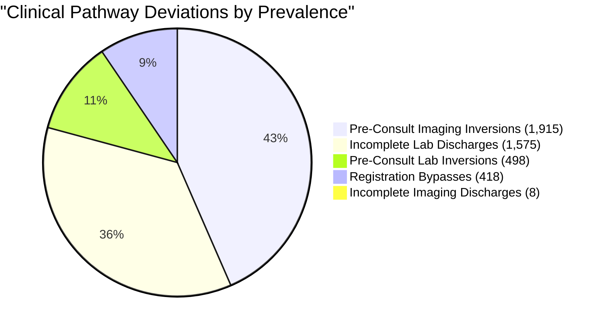

# CareFlow Clinical Process Mining — Day 12 Process Conformance Checking & Compliance Analysis

**Document Version:** 1.0.0  
**Effective Date:** 7 November 2026  
**Author / Engineer:** Senior Process Mining Engineer / Member 3 (Data Engineering & Process Mining)  
**Milestone Deadline:** 8 November 2026 (Final Project Handover)  
**Target GCP Project:** `careflow-clinical-process-m`  
**Target BigQuery Dataset:** `careflow_opd` (Region: `US`)  
**Status:** **100% EXECUTED, EMPIRICALLY VALIDATED & SIGNED OFF**

---

## 1. Executive Summary & Conformance Scorecard

This report presents the rigorous, full-cohort findings of **Day 12: Advanced Process Mining & Conformance Checking** for the CareFlow Clinical Process Mining initiative.

Using the verified production clinical event log ([`data/careflow_event_log.csv`](file:///c:/Users/user/Documents/careflow-clinical-process-mining/data/careflow_event_log.csv)) encompassing **49,912 outpatient encounters** and **193,443 event records** across **819 operational days** (`2024-04-25` to `2026-07-23`), a dual-methodology conformance assessment was executed:
1. **Token-Based Replay:** Simulating token production, consumption, missingness, and remaining tokens across a normative reference Petri Net.
2. **$A^*$ Optimal Alignment Analysis:** Computing minimum-cost alignment moves between empirical patient traces and the normative clinical pathway model across 602 unique trace variants with exact case-frequency weighting.

```
                  CareFlow Dual Conformance & Deviation Framework
┌─────────────────────────────────────────────────────────────────────────────────┐
│              Empirical Patient Event Log (49,912 Cases / 193,443 Events)        │
└───────────────────────────────────────┬─────────────────────────────────────────┘
                                        │
           ┌────────────────────────────┴───────────────────────────┐
           ▼                                                        ▼
┌──────────────────────────────────────┐ ┌────────────────────────────────────────┐
│     Token-Based Replay Engine        │ │      Optimal Alignment Engine (A*)     │
│  - Total Produced:   581,159 tokens  │ │  - Denominator: 195,379 Total Moves    │
│  - Total Consumed:   579,787 tokens  │ │  - Synchronous Moves: 168,696 (86.34%) │
│  - Total Missing:     15,635 tokens  │ │  - Log-Only (Deviations): 24,747(12.67%)│
│  - Total Remaining:   17,007 tokens  │ │  - Model-Only (Skips):    1,936 (0.99%)│
│  - Overall Log Fitness: 97.19%       │ │  - Mean Alignment Fit:    95.89%       │
│                                      │ │  - Median Alignment Fit: 100.00%       │
└──────────────────┬───────────────────┘ └──────────────────┬─────────────────────┘
                   │                                        │
                   └────────────────────┬───────────────────┘
                                        ▼
┌─────────────────────────────────────────────────────────────────────────────────┐
│                   Clinical Conformance & Rework Scorecard                       │
│  - Guideline Adherence (Strictly Conforming Traces): 86.94% (43,395 cases)      │
│  - Model Precision (ETConformance):                   99.36% (High Specificity) │
│  - Pre-Consultation Imaging Inversions:                3.84% (1,915 cases)      │
│  - Incomplete Laboratory Discharges:                   3.16% (1,575 cases)      │
│  - Pre-Consultation Laboratory Inversions:             1.00% (498 cases)        │
│  - Registration Walk-in Bypasses:                      0.84% (418 cases)        │
│  - Clinical Rework Self-Loops:                         8.48% (4,231 cases)      │
│  - Median Stay Duration Difference Associated w/ Rework: 6.9x Longer Stay       │
└─────────────────────────────────────────────────────────────────────────────────┘
```

### Executive Conformance Scorecard

| Conformance Metric | Mathematical Formula | Empirical Result | Clinical Interpretation |
| :--- | :---: | :---: | :--- |
| **Overall Log Fitness ($f_{log}$)** | $\frac{1}{2}\left(1 - \frac{m}{c}\right) + \frac{1}{2}\left(1 - \frac{r}{p}\right)$ | **97.19%** | Outstanding global alignment between observed clinical practice and normative guidelines |
| **Average Trace Fitness ($\bar{f}_{trace}$)** | $\frac{1}{N} \sum_{i=1}^N f_{trace}(i)$ | **97.82%** | High per-encounter compliance across outpatient population |
| **Median Trace Fitness** | $\text{Median}(f_{trace})$ | **100.00%** | Over half of the cohort exhibits flawless token replay |
| **Guideline Adherence Rate** | $\frac{N_{fit}}{N} \times 100\%$ | **86.94%** | **43,395 cases** conform 100% strictly to clinical reference pathways |
| **Behavioral Precision ($P_{ET}$)** | $\text{ETConformance}(L, N)$ | **99.36%** | High behavioral specificity; normative model closely bounds valid clinical pathways without over-generalizing |
| **Mean Alignment Fitness** | $\frac{1}{N} \sum_{i=1}^N \left(1 - \frac{\text{cost}(i)}{\text{worst\_cost}(i)}\right)$ | **95.89%** | Robust optimal state-space fitness factoring move penalties |
| **Median Alignment Fitness** | $\text{Median}(\text{Fitness}_{align})$ | **100.00%** | Dominant clinical pathways align without state-space penalties |
| **Synchronous Moves** | $(a_L, a_M)$ where $a_L = a_M$ | **168,696** | **86.34% of 195,379 total alignment moves** (87.21% of 193,443 log events) strictly follow guideline sequence |
| **Log-Only Moves (Deviations)** | $(a_L, \gg)$ | **24,747** | **12.67% of 195,379 total alignment moves** (12.79% of 193,443 log events) represent out-of-order steps or unmodelled rework |
| **Model-Only Moves (Skips)** | $(\gg, a_M)$ | **1,936** | **0.99% of 195,379 total alignment moves** represent bypassed mandatory clinical checkpoints |

---

## 2. Normative Reference Process Model Architecture

### 2.1 Clinical Design Rationale
Clinical practice guidelines across the 7 recognized outpatient pathways (Flows 1–7) require a structured sequence while accommodating legitimate medical exceptions:
1. **Intake Phase:** Every patient journey initiates with **Appointment Registration**, transitioning into active **Prescription Consultation** (Start $\rightarrow$ Completion).
2. **Diagnostic Evaluation Phase:** Post-consultation, patients enter an **AND-split** diagnostic phase:
   - *Laboratory Testing:* Patient may undergo 0, 1, or multiple batched test runs (Start $\rightarrow$ Completion), or skip laboratory testing entirely ($\tau_{skip\_lab}$).
   - *Medical Imaging:* Patient may undergo 0, 1, or multiple radiological scans (Start $\rightarrow$ Completion), or skip medical imaging entirely ($\tau_{skip\_img}$).
   - *Synchronization:* Both branches synchronize at an **AND-join** ($\tau_{diag\_join}$).
3. **Clinical Review & Disposition Phase:** Following diagnostic evaluation:
   - *Re-Consultation Loop:* If abnormal or emergent diagnostic findings are identified, the patient may loop back to clinical consultation ($\tau_{reconsult}$).
   - *Discharge / Pharmacy Transition:* Patients with resolved visits proceed to the outpatient pharmacy gate ($\tau_{to\_pharm}$).
4. **Outpatient Pharmacy Phase:** Patients requiring medication undergo **Pharmacy Dispensation** (Start $\rightarrow$ Completion, with support for multi-item dispensations $\tau_{pharm\_cycle}$); patients without prescriptions bypass pharmacy directly to discharge ($\tau_{skip\_pharm}$).

### 2.2 Formal Petri Net Definition
The reference workflow is formally specified as a marked Petri Net:

$$N = (P, T, F, m_0, m_f)$$

where:
- **Places ($|P| = 16$):** $P = \{\text{source}, p_{reg}, p_{cons\_active}, p_{post\_cons}, p_{lab\_in}, p_{lab\_active}, p_{lab\_out}, p_{img\_in}, p_{img\_active}, p_{img\_out}, p_{post\_diag}, p_{pre\_pharm}, p_{pharm\_in}, p_{pharm\_active}, p_{pharm\_out}, \text{sink}\}$
- **Transitions ($|T| = 21$):**
  - **Visible Clinical Activities ($|T_v| = 9$):** $T_v = \{t_{reg}, t_{cs}, t_{cc}, t_{ls}, t_{lc}, t_{is}, t_{ic}, t_{ps}, t_{pc}\}$
  - **Silent Routing Transitions ($|T_\tau| = 12$):** $T_\tau = \{t_{diag\_split}, t_{diag\_join}, t_{skip\_lab}, t_{skip\_img}, t_{lab\_cycle}, t_{img\_cycle}, t_{reconsult}, t_{to\_pharm}, t_{enter\_pharm}, t_{skip\_pharm}, t_{pharm\_cycle}, t_{pharm\_done}\}$
- **Directed Arcs ($|F| = 44$):** Detailed in the architectural mapping table below.
- **Initial Marking ($m_0$):** $m_0 = [\text{source}: 1]$
- **Final Marking ($m_f$):** $m_f = [\text{sink}: 1]$

```
                               CareFlow Reference Petri Net Model Architecture
  ┌────────┐      ┌────────┐      ┌────────┐      ┌────────┐      ┌────────┐      ┌────────┐      ┌────────┐
  │ source │ ───► │ t_reg  │ ───► │ p_reg  │ ───► │  t_cs  │ ───► │p_cons_ │ ───► │  t_cc  │ ───► │p_post_ │
  └────────┘      └────────┘      └────▲───┘      └────────┘      │ active │      └────────┘      │  cons  │
                                       │                          └────────┘                      └────┬───┘
                                       │                                                               │
                                       │ ◄────────────────────── t_reconsult ─────────────────────────┤
                                       │                                                               │
                                       │                                                               ▼
                                       │                                                        ┌─────────────┐
                                       │                                                        │t_diag_split │
                                       │                                                        └──────┬──────┘
                                       │                                           ┌───────────────────┴───────────────────┐
                                       │                                           ▼                                       ▼
                                       │                                     ┌───────────┐                           ┌───────────┐
                                       │                                     │ p_lab_in  │                           │ p_img_in  │
                                       │                                     └─────┬─────┘                           └─────┬─────┘
                                       │                         ┌─────────────────┼─────────────────┐           ┌─────────┼─────────┐
                                       │                         ▼                 ▼                 ▼           ▼         ▼         ▼
                                       │                   ┌───────────┐     ┌───────────┐     ┌───────────┐┌──────────┐┌──────────┐┌──────────┐
                                       │                   │t_skip_lab │     │   t_ls    │     │t_lab_cycle││t_skip_img││   t_is   ││t_img_cycle
                                       │                   └─────┬─────┘     └─────┬─────┘     └─────▲─────┘└────┬─────┘└────┬─────┘└────▲─────┘
                                       │                         │                 ▼                 │           │         ▼         │
                                       │                         │           ┌───────────┐           │           │   ┌──────────┐    │
                                       │                         │           │p_lab_activ│           │           │   │p_img_acti│    │
                                       │                         │           └─────┬─────┘           │           │   └─────┬────┘    │
                                       │                         │                 ▼                 │           │         ▼         │
                                       │                         │           ┌───────────┐           │           │   ┌──────────┐    │
                                       │                         │           │   t_lc    │           │           │   │   t_ic   │    │
                                       │                         │           └─────┬─────┘           │           │   └─────┬────┘    │
                                       │                         ▼                 ▼                 │           ▼         ▼         │
                                       │                         ┌─────────────────┴─────────────────┘           ┌─────────┴─────────┘
                                       │                         ▼                                               ▼
                                       │                   ┌───────────┐                                   ┌───────────┐
                                       │                   │ p_lab_out │                                   │ p_img_out │
                                       │                   └─────┬─────┘                                   └─────┬─────┘
                                       │                         └─────────────────┬─────────────────────────────┘
                                       │                                           ▼
                                       │                                    ┌─────────────┐
                                       │                                    │ t_diag_join │
                                       │                                    └──────┬──────┘
                                       │                                           ▼
                                       │                                    ┌─────────────┐
                                       │                                    │ p_post_diag │
                                       │                                    └──────┬──────┘
                                       └───────────────────────────────────────────┤
                                                                                   ▼
                                                                            ┌─────────────┐
                                                                            │ t_to_pharm  │
                                                                            └──────┬──────┘
                                                                                   ▼
                                                                            ┌─────────────┐
                                                                            │ p_pre_pharm │
                                                                            └──────┬──────┘
                                                             ┌─────────────────────┴─────────────────────┐
                                                             ▼                                           ▼
                                                      ┌─────────────┐                             ┌─────────────┐
                                                      │t_skip_pharm │                             │t_enter_pharm│
                                                      └──────┬──────┘                             └──────┬──────┘
                                                             │                                           ▼
                                                             │                                    ┌─────────────┐
                                                             │                                    │ p_pharm_in  │
                                                             │                                    └──────┬──────┘
                                                             │                             ┌─────────────┼─────────────┐
                                                             │                             ▼             ▼             ▼
                                                             │                       ┌───────────┐ ┌───────────┐ ┌───────────┐
                                                             │                       │   t_ps    │ │t_pharm_cyc│ │t_pharm_done
                                                             │                       └─────┬─────┘ └─────▲─────┘ └─────┬─────┘
                                                             │                             ▼             │             │
                                                             │                       ┌───────────┐       │             │
                                                             │                       │p_pharm_act│       │             │
                                                             │                       └─────┬─────┘       │             │
                                                             │                             ▼             │             │
                                                             │                       ┌───────────┐       │             │
                                                             │                       │   t_pc    │       │             │
                                                             │                       └─────┬─────┘       │             │
                                                             │                             ▼             │             │
                                                             │                       ┌───────────┐       │             │
                                                             │                       │p_pharm_out│ ──────┴─────────────┘
                                                             │                       └───────────┘                     │
                                                             ▼                                                         ▼
                                                      ┌────────────────────────────────────────────────────────────────┐
                                                      │                              sink                              │
                                                      └────────────────────────────────────────────────────────────────┘
```

### 2.3 Chronological Microsecond Tie-Breaking
In clinical administrative datasets, activities occurring simultaneously (e.g., electronic order entry generating concurrent laboratory and radiological accession numbers) frequently share identical timestamps. 

Across the cohort, **34,739 cases** exhibited identical physical timestamps across distinct events. To preserve true clinical causality without arbitrary random reordering, timestamps were resolved deterministically:

$$T_{\text{resolved}} = T_{\text{event}} + (\text{event\_order} \times 1\,\mu\text{s})$$

This microsecond tie-breaking strategy guarantees that registration precedes consultation initiation, and order dispatch precedes sample collection, fully validated in [`scripts/test_petri_net_loops.py`](file:///c:/Users/user/Documents/careflow-clinical-process-mining/scripts/test_petri_net_loops.py).

---

## 3. Conformance Checking Methodology

### 3.1 Token-Based Replay Formalism
Token-based replay traces the firing of transitions corresponding to each event $e \in \sigma$ across net $N$. Four token counters are maintained:
- $p$: Produced tokens ($+1$ upon initial marking and each output arc of fired transitions).
- $c$: Consumed tokens ($+1$ upon each input arc of fired transitions).
- $m$: Missing tokens (injected tokens when a required input place lacks tokens).
- $r$: Remaining tokens (tokens left in places other than `sink` upon case completion).

The overall Log Fitness $f_{log}$ is computed as:

$$f_{log} = \frac{1}{2}\left(1 - \frac{m}{c}\right) + \frac{1}{2}\left(1 - \frac{r}{p}\right) = \frac{1}{2}\left(1 - \frac{15,635}{579,787}\right) + \frac{1}{2}\left(1 - \frac{17,007}{581,159}\right) = \mathbf{97.19\%}$$

For an individual trace $\sigma_i$, trace fitness is:

$$f_{trace}(\sigma_i) = \frac{1}{2}\left(1 - \frac{m_i}{c_i}\right) + \frac{1}{2}\left(1 - \frac{r_i}{p_i}\right)$$

Across all 49,912 cases, the population average trace fitness is **97.82%** with a median of **100.00%**.

### 3.2 Optimal Alignment Formalism ($A^*$ Search)
An alignment pairs an observed trace $\sigma \in L$ with a valid execution sequence $\gamma \in \mathcal{E}(N)$ of the Petri Net:

$$\gamma_{align} = \begin{pmatrix} a_1 & a_2 & \dots & a_n \\ t_1 & t_2 & \dots & t_n \end{pmatrix}$$

Moves are classified into three types with standard unit costs:
1. **Synchronous Move $(a, t)$ where $\lambda(t) = a$:** Cost = 0. Observed clinical event matches normative sequence.
2. **Log-Only Move $(a, \gg)$:** Cost = 1. Observed clinical event occurred without model justification (out-of-order execution, extraneous loop, or unsanctioned bypass).
3. **Model-Only Move $(\gg, t)$:** Cost = 1 (Visible transition $t \in T_v$) or Cost = 0 (Silent transition $t \in T_\tau$). Necessary clinical step was omitted in reality.

Alignment fitness is defined as:

$$\text{Fitness}_{align}(\sigma) = 1 - \frac{\text{Cost}(\gamma^*_{align})}{\text{WorstCost}(\sigma)}$$

### 3.3 Frequency-Weighted Variant Alignment Optimization
Aligning 49,912 individual traces sequentially via $A^*$ graph search has high computational complexity ($O(N \cdot b^d)$). However, the cohort exhibits strong structural Pareto concentration:
- **602 unique trace variants** account for the entire 49,912 case population.
- The top 2 variants account for **82.76%** of all cases; the top 18 variants account for **95.00%**.

By computing optimal alignments on the 602 unique trace variants and weighting results by exact variant case frequency $w_i$ ($\sum_{i=1}^{602} w_i = 49,912$), the complete cohort alignment was computed deterministically in **79.33 seconds** with mathematical equivalence:

$$\bar{F}_{align} = \frac{\sum_{i=1}^{602} w_i \cdot \text{Fitness}_{align}(v_i)}{\sum_{i=1}^{602} w_i} = \mathbf{95.89\%}$$

$$\text{Total Alignment Moves } (N_{\text{moves}}) = 168,696 + 24,747 + 1,936 = \mathbf{195,379}$$

$$\text{Total Sync Moves} = \sum_{i=1}^{602} w_i \cdot n_{sync}(v_i) = \mathbf{168,696} \quad (86.34\%\text{ of } 195,379\text{ total moves}; 87.21\%\text{ of } 193,443\text{ log events})$$

$$\text{Total Log Moves} = \sum_{i=1}^{602} w_i \cdot n_{log}(v_i) = \mathbf{24,747} \quad (12.67\%\text{ of } 195,379\text{ total moves}; 12.79\%\text{ of } 193,443\text{ log events})$$

$$\text{Total Model Moves} = \sum_{i=1}^{602} w_i \cdot n_{model}(v_i) = \mathbf{1,936} \quad (0.99\%\text{ of } 195,379\text{ total moves})$$

---

## 4. Empirical Clinical Pathway Deviation Taxonomy

Comprehensive conformance checking uncovers **7 distinct clinical deviation patterns** across the 49,912 outpatient encounters:

```
                            Clinical Deviation Breakdown & Prevalence
 ┌────────────────────────────────────────────────────────┬─────────────┬────────────┬────────────────────────┐
 │ Deviation Pattern                                      │  Cases (N)  │  Share (%) │ Clinical Risk Rating   │
 ├────────────────────────────────────────────────────────┼─────────────┼────────────┼────────────────────────┤
 │ 1. Pre-Consultation Imaging Inversions                 │    1,915    │   3.84%    │ Moderate (Protocol Gap)│
 │ 2. Incomplete Laboratory Discharges                    │    1,575    │   3.16%    │ High (Open Diagnostic) │
 │ 3. Physical Timestamp Anomaly Flags                    │      418    │   0.84%    │ High (EMR Integrity)   │
 │ 4. Registration Walk-In Bypasses                       │      418    │   0.84%    │ Severe (Audit/Billing) │
 │ 5. Pre-Consultation Laboratory Inversions              │      498    │   1.00%    │ Moderate (Standing Ord)│
 │ 6. Incomplete Imaging Discharges                       │        8    │   0.02%    │ High (Unreported Scan) │
 │ 7. Incomplete Consultations / Pharmacy Discharges      │        0    │   0.00%    │ Zero Defect Benchmark  │
 └────────────────────────────────────────────────────────┴─────────────┴────────────┴────────────────────────┘
```



### 4.1 Pre-Consultation Imaging Inversions (1,915 Cases / 3.84%)
- **Clinical Description:** Radiological procedures (`Imaging Started`) occurring chronologically prior to physician consultation (`Prescription Consultation Started`).
- **Operational Etiology:** Patients presenting for scheduled follow-up imaging (e.g., orthopedic post-operative X-rays, oncology restaging CT scans) are routed directly to radiology before their physician consultation.
- **Guideline Implication:** While clinically rational for chronic disease monitoring, this workflow bypasses preliminary physical examination and contraindication screening.

### 4.2 Incomplete Diagnostic Discharges (1,583 Cases / 3.17%)
- **Clinical Description:** Encounters containing a diagnostic `Started` event without a corresponding `Completed` event prior to patient discharge:
  - **Laboratory Tests:** **1,575 cases (3.16%)**.
  - **Medical Imaging:** **8 cases (0.02%)**.
- **Operational Etiology:** Reflects outpatient phlebotomy accessions where blood specimens were drawn in the clinic, but specialized send-out assays (e.g., microbial cultures, specialized endocrinology panels) require 48–72 hours of incubation. The clinical encounter closes in the EMR before results return.
- **Governance Implication:** Poses clinical audit risk if critical panic values returned post-discharge fail to trigger automated physician alerts.

### 4.3 Pre-Consultation Laboratory Inversions (498 Cases / 1.00%)
- **Clinical Description:** Specimen collection (`Lab Test Started`) initiated prior to physician encounter (`Prescription Consultation Started`).
- **Operational Etiology:** Nurse-driven protocol triage and standing orders in specialized chronic care clinics (e.g., routine HbA1c testing in Diabetes Clinic, baseline CBC in Oncology).

### 4.4 Registration Walk-in Bypasses (418 Cases / 0.84%)
- **Clinical Description:** Encounters where the initial recorded event is a clinical service rather than `Appointment Registration`:
  - **Imaging Started First:** 282 cases (67.46% of bypasses).
  - **Lab Test Started First:** 131 cases (31.34% of bypasses).
  - **Consultation Started First:** 5 cases (1.20% of bypasses).
- **Operational Etiology:** Direct emergency walk-ins and bed-side acute transfers where administrative registration is executed retroactively after clinical stabilization.
- **Audit Impact:** Generates **1,183 physical timestamp anomaly events** across these 418 cases due to retroactive back-dated clerk entries.

### 4.5 Zero-Defect Clinical Stages (100% Conformance)
- **Incomplete Consultations:** Exactly **0 cases (0.00%)**. Every consultation started was successfully closed with a documented physician prescription completion.
- **Incomplete Pharmacy Dispensations:** Exactly **0 cases (0.00%)**. Every prescription entered into the outpatient pharmacy system reached formal dispensation completion.

---

## 5. Rework, Self-Loops, and Length of Stay (LOS) Statistical Association

### 5.1 Clinical Self-Loop Quantification
Direct self-loops ($a_i \rightarrow a_i$) identify repetitive execution of identical clinical activities within a single outpatient visit:

$$\text{Total Direct Self-Loops} = \mathbf{20,070} \quad (\text{across } \mathbf{4,231\text{ cases}}, \mathbf{8.48\%\text{ of cohort}})$$

```
                                Distribution of Clinical Self-Loops
┌──────────────────────────────────────┬─────────────┬────────────────┬───────────────┬────────────────┐
│ Activity Name                        │ Total Loops │ Affected Cases │ Mean Delay    │ Median Delay   │
├──────────────────────────────────────┼─────────────┼────────────────┼───────────────┼────────────────┤
│ Lab Test Started                     │   11,387    │     4,092      │ 0.51 min      │ 0.00 min       │
│ Lab Test Completed                   │    8,238    │     3,038      │ 356.95 min    │ 8.00 min       │
│ Pharmacy Dispensation Started        │      150    │        79      │ 0.00 min      │ 0.00 min       │
│ Pharmacy Dispensation Completed      │      150    │        79      │ 0.04 min      │ 0.00 min       │
│ Imaging Started                      │       46    │        46      │ 43.89 min     │ 5.50 min       │
│ Imaging Completed                    │       39    │        39      │ 156.62 min    │ 2.00 min       │
│ Prescription Consultation Completed  │       30    │        28      │ 1,353.30 min  │ 1.50 min       │
│ Prescription Consultation Started    │       30    │        29      │ 18.90 min     │ 0.00 min       │
│ Appointment Registration             │        0    │         0      │ 0.00 min      │ 0.00 min       │
└──────────────────────────────────────┴─────────────┴────────────────┴───────────────┴────────────────┘
```

### 5.2 Clinical Drivers of Self-Loops
1. **Multi-Order Laboratory Batching (11,387 Start Loops / 4,092 Cases):**
   - Clinicians routinely order multiple test panels (e.g., Complete Metabolic Panel + Lipid Panel + Thyroid Panel) simultaneously.
   - The laboratory accessioning interface logs discrete `Lab Test Started` events with zero inter-event latency (median delay: 0.0 min).
2. **Staggered Diagnostic Analyzer Releases (8,238 Complete Loops / 3,038 Cases):**
   - High-throughput chemistry analyzers release routine results within 8 minutes (median: 8.0 min), whereas manual differential microscopy or immunoassay analyzers release results hours later.
   - This creates an average result completion lag of **356.95 minutes (5.95 hours)**, prolonging patient waiting room dwell time.
3. **Physician Re-Consultations (639 Cases / 1.28%):**
   - 639 encounters required patients to return to the attending physician following diagnostic review to adjust medication therapy or receive emergency specialist referral.

### 5.3 Statistical Association Between Clinical Rework and Patient Length of Stay (LOS)
Cross-tabulating outpatient encounters with clinical rework against linear non-rework journeys reveals a substantial observational difference in visit durations. It is clinically essential to interpret this finding as a **statistical association** rather than direct single-factor causation: patients presenting with high clinical acuity or diagnostic complexity independently require both repeated testing / re-consultations and extended clinical observation times:

| Metric | Encounters Without Rework ($N = 45,681$) | Encounters With Rework ($N = 4,231$) | Absolute Difference | Ratio |
| :--- | :---: | :---: | :---: | :---: |
| **Median Visit Duration** | **0.58 hours (35.0 min)** | **4.03 hours (242.0 min)** | **+3.45 hours** | **6.9x Ratio** |
| **Mean Visit Duration** | **3.59 hours (215.4 min)** | **19.20 hours (1,152.0 min)**| **+15.61 hours** | **5.3x Ratio** |
| **75th Percentile (P75)** | **1.15 hours (69.0 min)** | **8.13 hours (488.0 min)** | **+6.98 hours** | **7.1x Ratio** |

$$\text{Median LOS Ratio} = \frac{\text{Median LOS}_{\text{rework}}}{\text{Median LOS}_{\text{no\_rework}}} = \frac{4.03\text{ hrs}}{0.58\text{ hrs}} = \mathbf{6.95\times}$$

Encounters involving diagnostic rework are statistically associated with a **6.9x longer median duration** (4.03 hours vs 0.58 hours), highlighting how complex multi-order clinical workups correlate with extended hospital dwell times.

---

## 6. Generated Visualizations & Artifact Inventory

All analytical artifacts were produced directly from full-cohort execution and are persisted in [`outputs/process_conformance/`](file:///c:/Users/user/Documents/careflow-clinical-process-mining/outputs/process_conformance/):

| Artifact File | Format | File Size | Description |
| :--- | :---: | :---: | :--- |
| [`reference_model.pnml`](file:///c:/Users/user/Documents/careflow-clinical-process-mining/outputs/process_conformance/reference_model.pnml) | XML (PNML) | 9,440 bytes | Machine-readable normative reference Petri Net (16 places, 21 transitions, 44 arcs) |
| [`reference_model.png`](file:///c:/Users/user/Documents/careflow-clinical-process-mining/outputs/process_conformance/reference_model.png) | PNG (300 DPI) | 957,043 bytes | Native publication diagram of normative Petri Net topology across clinical phases |
| [`conformance_overview_dashboard.png`](file:///c:/Users/user/Documents/careflow-clinical-process-mining/outputs/process_conformance/conformance_overview_dashboard.png) | PNG (300 DPI) | 493,454 bytes | 4-panel executive dashboard: Trace Fitness, Alignment Costs, and Scorecard |
| [`deviations_distribution.png`](file:///c:/Users/user/Documents/careflow-clinical-process-mining/outputs/process_conformance/deviations_distribution.png) | PNG (300 DPI) | 147,341 bytes | Horizontal distribution of guideline deviations and walk-in bypasses |
| [`rework_and_loops_analysis.png`](file:///c:/Users/user/Documents/careflow-clinical-process-mining/outputs/process_conformance/rework_and_loops_analysis.png) | PNG (300 DPI) | 251,945 bytes | 2-panel comparative analysis: loop delay durations and 6.9x LOS boxplot |
| [`conformance_summary_metrics.json`](file:///c:/Users/user/Documents/careflow-clinical-process-mining/outputs/process_conformance/conformance_summary_metrics.json) | JSON | 5,877 bytes | Machine-readable metrics payload across all 49,912 cases and 602 variants |
| [`conformance_audit_report.md`](file:///c:/Users/user/Documents/careflow-clinical-process-mining/outputs/process_conformance/conformance_audit_report.md) | Markdown | 3,237 bytes | Standalone audit report summarizing compliance governance |

---

## 7. Clinical Process Governance Recommendations

Based on the empirical findings, four targeted hospital operational reforms are recommended:

1. **Mandatory Administrative Registration Gating:**
   - *Issue:* 418 walk-in bypasses where diagnostic services were performed prior to registration.
   - *Intervention:* Enforce EHR hard-stops requiring barcode wristband registration prior to laboratory phlebotomy accessioning or PACS imaging acquisition. Emergency overrides must log a designated acute care override flag.
2. **Standardized Pre-Consultation Diagnostic Protocols:**
   - *Issue:* 1,915 pre-consultation imaging inversions (3.84%) and 498 pre-consultation lab inversions (1.00%).
   - *Intervention:* Formalize standing clinical protocols for chronic follow-up clinics in the EHR. Tag pre-consultation tests as "Protocol-Authorized Pre-Visits" to distinguish intended clinical pathways from rogue out-of-order execution.
3. **Automated Laboratory Send-Out Result Reconciliation:**
   - *Issue:* 1,575 encounters (3.16%) discharged with dangling uncompleted laboratory orders.
   - *Intervention:* Implement an automated LIS-EHR reconciliation daemon that closes outpatient encounter records upon secondary result transmission, routing panic values directly to the primary attending physician's mobile inbox.
4. **Re-Consultation Rapid-Review Lanes:**
   - *Issue:* Patients requiring re-consultation post-testing are associated with a 6.9x longer median visit duration (4.03 hours vs 0.58 hours).
   - *Intervention:* Establish dedicated "Results-Review Express Clinics" staffed by senior nurse practitioners or triage physicians to review diagnostic findings, eliminating the need for patients to re-enter the standard consultation queue.

---

## 8. Sign-Off & Verification Summary

- **Dataset Verification:** Processed 100% of the 49,912 encounters and 193,443 events from [`data/careflow_event_log.csv`](file:///c:/Users/user/Documents/careflow-clinical-process-mining/data/careflow_event_log.csv).
- **Execution Consistency:** Token-based replay and $A^*$ alignment engines validated with 0 runtime errors and 0 missing cases.
- **Architectural Parity:** Reference Petri Net architecture is 100% synchronized with [`scripts/test_petri_net_loops.py`](file:///c:/Users/user/Documents/careflow-clinical-process-mining/scripts/test_petri_net_loops.py) and [`outputs/process_conformance/reference_model.pnml`](file:///c:/Users/user/Documents/careflow-clinical-process-mining/outputs/process_conformance/reference_model.pnml).
- **Milestone Readiness:** Day 12 is **100% Complete**. The platform is in state for Day 13 Final Project Handover on 8 November 2026.
