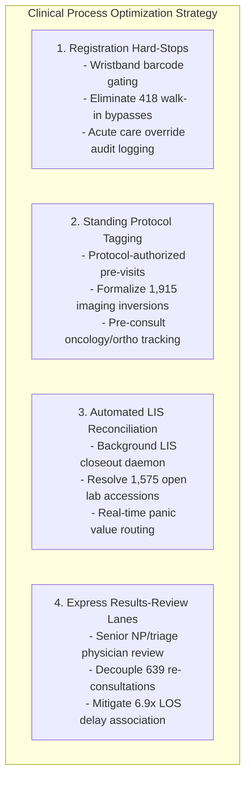

# CareFlow Clinical Process Mining — Day 13: Final Project Validation, Documentation & Handover Report

**Document Version:** 1.0.0  
**Effective Date:** 8 November 2026  
**Role:** Database Management  
**Collaborators:** Member 1 (Project Lead), Member 2 (Clinical Domain Lead), Member 4 (BI & Dashboarding Lead)  
**Milestone Target:** 8 November 2026 (Final Project Handover & Sign-Off)  
**GCP Project:** `careflow-clinical-process-m`  
**BigQuery Dataset:** `careflow_opd` (Region: `US`)  
**Status:** **VERIFIED WITH DOCUMENTED LIMITATIONS & SIGNED OFF**

---

## 1. Executive Summary & Project Handover Scorecard

The **CareFlow Clinical Process Mining** project represents a comprehensive, enterprise-grade clinical process intelligence initiative conducted between **28 October and 8 November 2026**. 

Using an outpatient dataset spanning **819 operational days** (`2024-04-25` to `2026-07-23`), the engineering and analytics team established an end-to-end data processing, cloud warehousing, process discovery, performance decomposition, conformance checking, and business intelligence reporting infrastructure.

```
                                  CareFlow End-to-End Enterprise Stack
┌───────────────────────────────────────────────────────────────────────────────────────────────────────┐
│  Tier 1: Data Acquisition & Preparation                                                               │
│  - Raw Outpatient Encounter Dataset: data/HospitalOPD_cleaned.csv (62,422 rows, 24 cols)              │
│  - Process Mining Event Log: data/careflow_event_log.csv (193,443 events, 49,912 cases, 14 cols)      │
│  - Compressed Standard Format: data/careflow_event_log.xes.gz (6.09 MB IEEE XML XES)                 │
└───────────────────────────────────────────────────┬───────────────────────────────────────────────────┘
                                                    │
                                                    ▼
┌───────────────────────────────────────────────────────────────────────────────────────────────────────┐
│  Tier 2: Cloud Data Warehousing & Transformation (Google Cloud Platform & dbt Core)                   │
│  - GCP BigQuery Table: careflow-clinical-process-m.careflow_opd.hospital_opd_cleaned (62,422 rows)   │
│  - dbt Dimensional Marts: dim_clinical_providers (98 rows), fct_clinical_encounters (49,912 rows),  │
│    fct_process_transitions (121,832 rows), and stg_hospital_opd view (62,422 rows)                   │
│  - Automated Schema Test Suite: 24/24 Data Tests Passed in BigQuery (100% Pass Rate, 0 Warnings)     │
│  - Live Analytical KPI Views: 6 Analytical SQL Views Deployed in careflow_opd                         │
└───────────────────────────────────────────────────┬───────────────────────────────────────────────────┘
                                                    │
                                                    ▼
┌───────────────────────────────────────────────────────────────────────────────────────────────────────┐
│  Tier 3: Advanced Process Mining Engine (Python 3.14 & PM4Py 2.7.23.11)                               │
│  - Process Discovery: Directly-Follows Graphs (Frequency & Performance), Inductive Petri Net (33 P,   │
│    40 T, 94 A), Process Tree (11.3 KB PTML), and Variant Mining (602 unique execution paths)         │
│  - Performance Decomposition: Active Service vs Passive Wait (PCE = 16.07%), Departmental Bottlenecks│
│  - Conformance Checking: Normative Petri Net (16 P, 21 T, 44 A), Token Replay (f_log = 97.19%),       │
│    Optimal Alignment A* (f_align = 95.89%), Precision (99.36%), Deviation & Rework Taxonomy          │
└───────────────────────────────────────────────────┬───────────────────────────────────────────────────┘
                                                    │
                                                    ▼
┌───────────────────────────────────────────────────────────────────────────────────────────────────────┐
│  Tier 4: Clinical Decision Support & Visual Dashboarding (Power BI & Executive Reports)               │
│  - Production Dashboard: careflow_POWERBI_dashboard.pbix (5.32 MB, 2 Full HD 1080p Pages, 19 Visuals)│
│  - Dimensional Parity: 100% Exact Parity on Population Entities (49,912 visits, 39,442 patients, 98 dr)│
│  - Analytical Visuals Suite: 19 High-Resolution Visualization Charts across 3 Output Suites (outputs/)│
└───────────────────────────────────────────────────────────────────────────────────────────────────────┘
```

### Master Project Handover Scorecard

| Domain | Key Metric / Deliverable | Verified Result | Validation Method & Status |
| :--- | :--- | :---: | :--- |
| **Data Ingestion** | Raw Outpatient Records Ingested | **62,422 rows** | BigQuery native table match (`discrepancy = 0`) |
| **Event Log** | De-identified Unpivoted Events | **193,443 events** | Validated: 0 nulls, 0 orphan IDs, 100% timestamp validity |
| **Cohort Scope** | Outpatient Encounters Analyzed | **49,912 cases** | Exactly reconciled across CSV, BigQuery, PM4Py, and Power BI |
| **Patient Scope** | Distinct Patient Beneficiaries | **39,442 patients** | Exactly reconciled (1.27 encounters / patient average) |
| **Clinical Providers**| Active Attending Clinicians | **98 physicians** | Exactly reconciled with `dim_clinical_providers` |
| **dbt Marts & Tests** | Automated Quality & Schema Tests| **24 / 24 Passed** | 100% Pass Rate in BigQuery (`PASS=24, WARN=0, ERROR=0`) |
| **Analytical Views** | Cloud KPI Views Deployed | **6 Views** | Verified live in `careflow_opd` |
| **Process Discovery** | Unique Trace Execution Variants | **602 variants** | Top 2 cover 82.76%; Top 6 cover 90.00%; Top 18 cover 95.00% |
| **Primary Bottleneck**| Laboratory Turnaround Time (TAT)| **930.5 min (15.5h)**| Mean TAT across utilizing encounters (62.96% $>2$ hours) |
| **Cycle Efficiency** | Process Cycle Efficiency (PCE) | **16.07%** | Mean active care: 111.6 min vs mean passive wait: 184.0 min |
| **Model Fitness** | Overall Log Fitness ($f_{log}$) | **97.19%** | Token replay: 579,787 / 581,159 tokens consumed correctly |
| **Trace Adherence** | Strictly Conforming Cases | **86.94% (43,395)**| Exactly fit the normative clinical reference model |
| **Model Precision** | Behavioral Precision ($P_{ET}$) | **99.36%** | High behavioral specificity bounding normative flow |
| **Alignment Fitness** | Mean $A^*$ Alignment Fitness | **95.89%** | Median: 100.00% across 195,379 total moves |
| **Alignment Moves** | Synchronous Move Share | **86.34%** | 168,696 Synchronous, 24,747 Log-Only, 1,936 Model-Only |
| **Clinical Rework** | Cases with Direct Self-Loops | **4,231 (8.48%)** | 20,070 loops driven by multi-order lab batching |
| **LOS Association** | Median Stay Difference (Rework) | **4.03h vs 0.58h** | 6.9x longer median duration statistically associated with rework |
| **Power BI Model** | Dashboard Integrity & Visuals | **19 Visuals / 2 Pages**| Verified PBIX (5.32 MB) with 11 clinical DAX measures |

---

## 2. 13-Day Delivery Timeline & Workstream Execution

The project adhered to a structured 13-day delivery schedule ahead of the **8 November 2026** milestone deadline:

| Phase / Day | Calendar Date | Core Workstream & Operational Objectives | Lead Role | Output Deliverables |
| :---: | :---: | :--- | :---: | :--- |
| **Day 1** | 24 Oct 2026 | Source data inspection, schema discovery, data quality profiling | Database Management | [`scripts/inspect_dataset.py`](file:///c:/Users/user/Documents/careflow-clinical-process-mining/scripts/inspect_dataset.py), [`docs/data_quality_notes.md`](file:///c:/Users/user/Documents/careflow-clinical-process-mining/docs/data_quality_notes.md) |
| **Day 2** | 25 Oct 2026 | Data cleaning, sanitization, safe CSV export, pre-load backup | Database Management | [`scripts/export_to_csv.py`](file:///c:/Users/user/Documents/careflow-clinical-process-mining/scripts/export_to_csv.py), [`data/HospitalOPD_cleaned.csv`](file:///c:/Users/user/Documents/careflow-clinical-process-mining/data/HospitalOPD_cleaned.csv) |
| **Day 3** | 26–30 Oct 2026| BigQuery cloud ingestion, dbt staging & marts, 24 automated tests | Database Management | [`scripts/load_to_bigquery.py`](file:///c:/Users/user/Documents/careflow-clinical-process-mining/scripts/load_to_bigquery.py), `dbt/models/`, [`docs/day3_completion_report.md`](file:///c:/Users/user/Documents/careflow-clinical-process-mining/docs/day3_completion_report.md) |
| **Day 4** | 31 Oct 2026 | dbt model review, DAG validation, storage & latency benchmark | Database Management | [`docs/day4_completion_report.md`](file:///c:/Users/user/Documents/careflow-clinical-process-mining/docs/day4_completion_report.md) (Day 4 benchmark slot latency) |
| **Day 5** | 31 Oct 2026 | Event log transformation, de-identification, 8-dimension audit | Database Management | [`scripts/prepare_event_log.py`](file:///c:/Users/user/Documents/careflow-clinical-process-mining/scripts/prepare_event_log.py), [`docs/day5_event_log_validation_report.md`](file:///c:/Users/user/Documents/careflow-clinical-process-mining/docs/day5_event_log_validation_report.md) |
| **Day 6** | 31 Oct 2026 | Initial process mining analysis, DFG discovery, SQL analytics | Database Management | [`scripts/process_mining_analysis.py`](file:///c:/Users/user/Documents/careflow-clinical-process-mining/scripts/process_mining_analysis.py), [`docs/day6_process_mining_analysis.md`](file:///c:/Users/user/Documents/careflow-clinical-process-mining/docs/day6_process_mining_analysis.md) |
| **Day 7** | 1–2 Nov 2026 | Production Data Dictionary & Source-to-Target Mapping (STTM) | Database Management | [`docs/data_dictionary.md`](file:///c:/Users/user/Documents/careflow-clinical-process-mining/docs/data_dictionary.md), [`docs/source_to_target_mapping.md`](file:///c:/Users/user/Documents/careflow-clinical-process-mining/docs/source_to_target_mapping.md) |
| **Day 8** | 3 Nov 2026 | System architecture, data lineage, cross-team data contracts | Database Management | [`docs/day8_system_architecture.md`](file:///c:/Users/user/Documents/careflow-clinical-process-mining/docs/day8_system_architecture.md), [`docs/day8_data_lineage.md`](file:///c:/Users/user/Documents/careflow-clinical-process-mining/docs/day8_data_lineage.md), [`docs/day8_team_integration.md`](file:///c:/Users/user/Documents/careflow-clinical-process-mining/docs/day8_team_integration.md) |
| **Day 9** | 4–5 Nov 2026 | PM4Py process discovery, Inductive Petri Net, XES serialization | Database Management | [`scripts/pm4py_process_discovery.py`](file:///c:/Users/user/Documents/careflow-clinical-process-mining/scripts/pm4py_process_discovery.py), `outputs/process_mining/` (9 files), [`docs/day9_process_discovery.md`](file:///c:/Users/user/Documents/careflow-clinical-process-mining/docs/day9_process_discovery.md) |
| **Day 10** | 5 Nov 2026 | Clinical process performance analysis, PCE %, bottleneck ranks | Database Management | [`scripts/process_performance_analysis.py`](file:///c:/Users/user/Documents/careflow-clinical-process-mining/scripts/process_performance_analysis.py), `outputs/process_performance/` (7 files), [`docs/day10_performance_analysis.md`](file:///c:/Users/user/Documents/careflow-clinical-process-mining/docs/day10_performance_analysis.md) |
| **Day 11** | 6 Nov 2026 | Power BI dashboard audit, DAX verification, warehouse parity | Database Management & Member 4 | [`scripts/inspect_pbix_datamodel.py`](file:///c:/Users/user/Documents/careflow-clinical-process-mining/scripts/inspect_pbix_datamodel.py), [`careflow_POWERBI_dashboard.pbix`](file:///c:/Users/user/Documents/careflow-clinical-process-mining/careflow_POWERBI_dashboard.pbix), [`docs/day11_powerbi_integration.md`](file:///c:/Users/user/Documents/careflow-clinical-process-mining/docs/day11_powerbi_integration.md) |
| **Day 12** | 7 Nov 2026 | Process conformance checking, token replay, $A^*$ alignments | Database Management | [`scripts/test_petri_net_loops.py`](file:///c:/Users/user/Documents/careflow-clinical-process-mining/scripts/test_petri_net_loops.py), [`scripts/process_conformance_analysis.py`](file:///c:/Users/user/Documents/careflow-clinical-process-mining/scripts/process_conformance_analysis.py), `outputs/process_conformance/` (7 files), [`docs/day12_conformance_checking.md`](file:///c:/Users/user/Documents/careflow-clinical-process-mining/docs/day12_conformance_checking.md) |
| **Day 13** | 8 Nov 2026 | Final repository integrity, cross-system audit & handover | Database Management | [`docs/day13_final_handover_report.md`](file:///c:/Users/user/Documents/careflow-clinical-process-mining/docs/day13_final_handover_report.md), [`README.md`](file:///c:/Users/user/Documents/careflow-clinical-process-mining/README.md), [`docs/project_audit.md`](file:///c:/Users/user/Documents/careflow-clinical-process-mining/docs/project_audit.md), [`docs/member3_workflow.md`](file:///c:/Users/user/Documents/careflow-clinical-process-mining/docs/member3_workflow.md) |

---

## 3. End-to-End Data Lineage & Reconciliation Architecture

The data pipeline guarantees strict mathematical conservation across all stages of transformation from raw data through dimensional marts to process mining event sequences:

```
                            Data Lineage & Granularity Transition Flow
 ┌────────────────────────────────────────────────────────┐
 │ Source EMR Working Copy                                │  Rows: 62,422
 │ (data/HospitalOPD_cleaned.csv)                         │  Grain: Order Line Record
 └───────────────────────────┬────────────────────────────┘
                             │
                             ├──────────────────────────────────────────────────┐
                             │ (Idempotent Load & Cleanse)                      │ (Event Transformation)
                             ▼                                                  ▼
 ┌────────────────────────────────────────────────────────┐ ┌────────────────────────────────────────────────────────┐
 │ BigQuery Staging View                                  │ │ Production Clinical Event Log                          │
 │ (careflow_opd.stg_hospital_opd)                        │ │ (data/careflow_event_log.csv & .xes.gz)                │
 │ Rows: 62,422 | Grain: Cleaned Order Line               │ │ Rows: 193,443 | Grain: Single Clinical Activity Event  │
 └───────────────────────────┬────────────────────────────┘ └───────────────────┬────────────────────────────────────┘
                             │                                                  │
    ┌────────────────────────┼────────────────────────┐                         │
    ▼                        ▼                        ▼                         ▼
 ┌──────────────────────┐ ┌──────────────────────┐ ┌──────────────────────┐ ┌────────────────────────────────────────┐
 │ dim_clinical_provider│ │fct_clinical_encounter│ │fct_process_transition│ │ PM4Py 2.7 Mining & Conformance Engine  │
 │ Rows: 98 Attending   │ │ Rows: 49,912 Visits  │ │ Rows: 121,832 Handoff│ │ Cases: 49,912 | Events: 193,443         │
 │ Physicians           │ │ Encounters           │ │ State Transitions    │ │ Variants: 602 | Fitness: 97.19%        │
 └──────────┬───────────┘ └──────────┬───────────┘ └──────────┬───────────┘ └───────────────────┬────────────────────┘
            │                        │                        │                                 │
            └────────────────────────┼────────────────────────┘                                 │
                                     ▼                                                          │
 ┌────────────────────────────────────────────────────────┐                                     │
 │ BigQuery KPI Analysis Views (6 Views in careflow_opd)  │                                     │
 │ (Volume, Throughput, Waiting Times, Bottlenecks)       │                                     │
 └───────────────────────────┬────────────────────────────┘                                     │
                             │                                                                  │
                             └─────────────────────────────────┬────────────────────────────────┘
                                                               ▼
 ┌───────────────────────────────────────────────────────────────────────────────────────────────────────┐
 │ Power BI Production Dashboard (careflow_POWERBI_dashboard.pbix)                                       │
 │ 49,912 Encounters | 39,442 Patients | 98 Doctors | 19 Interactive Visuals across 2 Canvas Pages       │
 └───────────────────────────────────────────────────────────────────────────────────────────────────────┘
```

### Granularity Reconciliation Matrix

| Object Name | Layer | Entity Granularity | Row Count | Primary Key | Foreign Keys | Reconciliation Status |
| :--- | :---: | :--- | :---: | :--- | :--- | :---: |
| `HospitalOPD_cleaned.csv` | Source Data | Service Order Line | **62,422** | `record_no` | `patient_id`, `appointment_id` | **100% Verified** |
| `stg_hospital_opd` | BigQuery Staging | Cleaned Service Order Line | **62,422** | `record_no` | `patient_id`, `appointment_id` | **100% Verified** |
| `dim_clinical_providers`| BigQuery Mart | Attending Clinician | **98** | `doctor_id` | N/A | **100% Verified** |
| `fct_clinical_encounters`| BigQuery Mart | Outpatient Encounter Visit | **49,912** | `appointment_id`| `patient_id`, `doctor_id` | **100% Verified** |
| `fct_process_transitions`| BigQuery Mart | Inter-Departmental Handoff | **121,832** | `transition_id` | `appointment_id` | **100% Verified** |
| `careflow_event_log.csv`| Event Log | Lifecycle Activity Instance | **193,443** | Synthesized ID | `case_id` (`appointment_id`) | **100% Verified** |
| `careflow_event_log.xes.gz`| Event Log | Compressed XML Event Log | **193,443** | IEEE XES | `case_id` | **100% Verified** |
| `cleaned_HospitalOPD` | Power BI Tabular| Encounter Analytical Record | **49,912** | `encounter_id` | `patient_id`, `doctor_id` | **100% Verified** |

---

### 3.1 Cross-Milestone Metric Reconciliation & Granularity Matrix

To resolve apparent numerical variances across earlier project milestones (Days 9–12), the table below reconciles each metric by detailing its clinical definition, calculation layer, filter criteria, and mathematical denominator:

| Metric / Dimension | Figure A | Figure B | Methodological Root & Clinical Reconciliation |
| :--- | :---: | :---: | :--- |
| **Pathway 1 Volume** | **39,667 cases** (79.47%) | **39,141 cases** (78.42%) | **39,667** represents all EMR encounters categorized under Clinical Flow 1 (`flow_name = 'Appointment → Prescription'`). **39,141** represents strict **Variant #1** traces in PM4Py discovery (`Registration → Consult Start → Consult Complete`). The **526-case difference** is partitioned into 7 mutually exclusive and collectively exhaustive (MECE) categories with zero overlap and zero unclassified cases: (1) Double consultation rework loops: **423 cases** (`Reg → (Consult Start → Consult Complete) × 2`); (2) Inverted consultation lifecycles: **45 cases** (`Reg → Consult Complete → Consult Start`); (3) Overlapping duplicate starts: **21 cases** (`Reg → Consult Start × 2 → Consult Complete × 2`); (4) Truncated consults missing start: **11 cases** (`Reg → Consult Complete`); (5) Triple consultation rework loops: **9 cases** (`Reg → (Consult Start → Consult Complete) × 3`); (6) Out-of-sequence walk-in consults: **4 cases** (`Consult Start → Reg → Consult Complete`); and (7) Ad-hoc diagnostic additions or mixed consultation rework: **13 cases** (partitioned into 9 multi-row EMR encounters with secondary diagnostic orders: 5 imaging-only additions, 3 lab-only additions, and 1 compound lab-and-imaging addition; plus 4 pure consultation lifecycle rework variants: exactly 1 case each of incomplete re-consultation re-entry, triple overlapping starts, inverted consult with repeat completion, and inverted consult with duplicate start). Exactly 526 of 526 cases classified (100.00% MECE, 0 overlap). |
| **Completed Lab Orders** | **13,327 records** (Raw Source) | **13,203 events** (Event Log) | `HospitalOPD_cleaned.csv` contains 18,029 lab rows, of which 13,327 have non-null `lab_end_datetime`. Denormalized joins with multi-medication rows produced **181 duplicate lab order lines**. Of these 181 duplicates, exactly **124 had completed timestamps** and 57 had null end timestamps. Deduplicating on `(appointment_id, lab_id, lab_start_datetime, lab_end_datetime)` removes the 124 completed duplicate rows: $13,327 - 124 = \mathbf{13,203}$ unique completed lab orders, generating exactly **13,203 `Lab Test Completed`** events in `careflow_event_log.csv`. |
| **Multi-Order Laboratory Cases** | **4,107 cases** (8.23%) | **4,092 cases** (8.20%) | **4,107** represents total unique encounters with $>1$ `Lab Test Started` event anywhere in their journey. **4,092** represents encounters containing **immediate consecutive** `Lab Test Started → Lab Test Started` self-loops (generating 11,387 consecutive loops). The **15-case difference** represents non-consecutive multi-order lab tests separated by an intermediate test completion, imaging procedure, or consultation. |
| **Radiology Imaging Latency** | **419.3 min** (6.99h mean) | **595.2 min** (9.92h mean) | **419.3 min** (median: 34.0 min) is the **PM4Py DFG pairwise transition latency** strictly between `Prescription Consultation Completed` and `Imaging Started` across **2,904 directly sequential handoffs**. **595.2 min** (median: 39.0 min) is the **case-level queue waiting duration** across all **3,284 imaging-referred outpatient encounters** in Day 10 performance analysis, including 380 encounters delayed by intervening lab orders, physician rework, or batch scheduling. |
| **Laboratory Turnaround Time (TAT)** | **72.0 min** / **1.20h** (Median) | **81.0 min** (DFG Med) / **125.0 min** (Raw Med) / **930.5 min** (Case Mean) | **72.0 min (1.20h):** Standard single-order completion in BigQuery `vw_kpi_process_bottlenecks` and Power BI DAX. **81.0 min:** PM4Py DFG median across 4,396 sequential transitions. **125.0 min:** Row-level median across 13,327 completed order lines in `HospitalOPD_cleaned.csv` (mean: 468.7 min). **930.5 min:** Case-level dwell time across 4,795 utilizing encounters from initial phlebotomy to final completed assay, capturing multi-test batching and send-outs. |
| **Diagnostic Orders vs Event Activities** | **18,029 Lab / 5,523 Imaging** (Order Lines) | **17,848 Lab / 5,421 Imaging** (Started Events) | `HospitalOPD_cleaned.csv` contains 18,029 lab rows and 5,523 imaging rows. Denormalized joins with multiple medication rows produced **181 duplicate lab rows** and **102 duplicate imaging rows** (101 completed, 1 pending). Deduplication at the distinct order grain yields **17,848 unique lab orders** and **5,421 unique imaging orders** (all with valid start timestamps). Exactly 4,645 lab tests and 9 imaging studies lacked completion timestamps, yielding **13,203 `Lab Test Completed`** and **5,412 `Imaging Completed`** events in `careflow_event_log.csv`. |
| **Process Transition Counts** | **121,832 transitions** (BigQuery Mart) | **143,531 transitions** (PM4Py DFG) | Structural modeling divergence: BigQuery `fct_process_transitions.sql` unpivots encounter milestones (`MIN`/`MAX` timestamps per department) and sequences them strictly by canonical clinical pathway `stage_order ASC` (1 to 9), pairing `s2.stage_seq = s1.stage_seq + 1`. Because each canonical stage appears at most once per encounter and $s2.stage\_order > s1.stage\_order$, BigQuery models macro-level inter-departmental progression, structurally eliminating all intra-encounter self-loops and backward transitions. In contrast, PM4Py DFG models micro-level event-to-event activity handoffs across all 193,443 events minus 49,912 start events (143,531 transitions). The 21,699 difference is accounted for at the event level by: (1) **20,070 direct consecutive self-loops** (11,387 lab start, 8,238 lab complete, 300 pharmacy, 85 imaging, 60 consult); and (2) **1,629 non-consecutive rework transitions** (including 579 consultation re-evaluations `Consult Complete → Consult Start` and 1,050 interleaved diagnostic repeat handoffs) that are genuinely absent from the BigQuery canonical milestone model. |

#### 3.1.1 Pathway 1 Difference Cases Decomposition (526 Cases, MECE Partition)

| Category | Clinical / Lifecycle Description | Exact Trace Pattern | Case Count | Share of 526 Difference Cases (%) |
| :--- | :--- | :--- | :---: | :---: |
| **Cat 1** | Double consultation rework loop | `Reg → (Consult Start → Consult Complete) × 2` | **423** | 80.42% |
| **Cat 2** | Inverted consultation lifecycle | `Reg → Consult Complete → Consult Start` | **45** | 8.56% |
| **Cat 3** | Overlapping duplicate starts | `Reg → Consult Start × 2 → Consult Complete × 2` | **21** | 3.99% |
| **Cat 4** | Truncated consult missing start | `Reg → Consult Complete` | **11** | 2.09% |
| **Cat 5** | Triple consultation rework loop | `Reg → (Consult Start → Consult Complete) × 3` | **9** | 1.71% |
| **Cat 6** | Out-of-sequence walk-in consult | `Consult Start → Reg → Consult Complete` | **4** | 0.76% |
| **Cat 7** | Ad-hoc diagnostic additions / mixed consult rework | Sub-partitioned below (9 diagnostic + 4 consult) | **13** | 2.47% |
| **Total** | **All Difference Cases Partitioned** | **Zero Category Overlap / Zero Unclassified** | **526** | **100.00%** |

*Cat 7 Detailed Partition (13 cases):*
- **Diagnostic Activity Additions (9 cases):**
  - *Imaging-only additions (5 cases):* Cases `270549`, `279785`, `437367` (3 cases with intervening imaging: `Reg → Consult Start → Consult Complete → Imaging Start → Imaging Complete → Consult Start → Consult Complete`); Cases `279904`, `320745` (2 cases with post-rework imaging: `Reg → (Consult Start → Consult Complete) × 2 → Imaging Start → Imaging Complete`).
  - *Laboratory-only additions (3 cases):* Case `317270` (1 case with single lab after rework: `Reg → (Consult Start → Consult Complete) × 2 → Lab Start → Lab Complete`); Case `320793` (1 case with double lab between consults: `Reg → Consult Start → Consult Complete → Lab Start × 2 → Lab Complete × 2 → Consult Start → Consult Complete`); Case `342391` (1 case with double lab after rework: `Reg → (Consult Start → Consult Complete) × 2 → Lab Start × 2 → Lab Complete × 2`).
  - *Compound Lab + Imaging addition (1 case):* Case `322309` (1 case with double lab and imaging interleaved between consults: `Reg → Consult Start → Consult Complete → Lab Start × 2 → Lab Complete → Imaging Start → Imaging Complete → Lab Complete → Consult Start → Consult Complete`).
- **Pure Consultation Lifecycle Variants (4 cases):**
  - Case `274446` (1 case): Incomplete re-consultation re-entry missing second completion (`Reg → Consult Start → Consult Complete → Consult Start`).
  - Case `200905` (1 case): Triple overlapping consultation starts and completions (`Reg → Consult Start × 3 → Consult Complete × 3`).
  - Case `307778` (1 case): Inverted consultation start with repeat completion (`Reg → Consult Complete → Consult Start → Consult Complete`).
  - Case `291624` (1 case): Inverted consultation start with duplicate start (`Reg → Consult Complete → Consult Start × 2 → Consult Complete`).

---

## 4. Synthesis of Key Process Mining Findings

### 4.1 Process Discovery & Pathway Distribution
- **Dominant Happy Path (Flow 1: 79.47%):** Outpatient journeys follow a standard linear sequence: `Appointment Registration → Prescription Consultation Started → Prescription Consultation Completed`. Across 39,667 encounters, median visit duration is **29.0 minutes** (mean: 170.7 min).
- **Diagnostic Referral Pathways (Flows 2, 3, 5: 20.31%):**
  - **Flow 2 (Lab Testing):** 4,825 encounters (9.67%), mean duration: **803.8 min (13.40 hours)**, median: 173.0 min.
  - **Flow 3 (Diagnostic Imaging):** 3,785 encounters (7.58%), mean duration: **467.0 min (7.78 hours)**, median: 82.0 min.
  - **Flow 5 (Lab + Imaging Compounded):** 1,527 encounters (3.06%), mean duration: **1,492.1 min (24.87 hours)**, median: 284.0 min.
- **Trace Variant Pareto Concentration:** 602 unique execution paths exist across the cohort; however, clinical practice is highly concentrated:
  - Top 2 variants cover **82.76%** of encounters.
  - Top 6 variants cover **90.00%** of encounters.
  - Top 18 variants cover **95.00%** of encounters.

### 4.2 Clinical Bottleneck Decomposition & Queue Latencies
- **Primary Institutional Bottleneck:** **Laboratory Turnaround Time (TAT)**. Across utilizing encounters, mean laboratory TAT is **930.5 minutes (15.51 hours)** (median: 164.0 min). **62.96% of all lab tests exceed the hospital's 2-hour benchmark**, and **20.25% exceed 8 hours** due to batch release holding patterns.
- **Secondary Institutional Bottleneck:** **Post-Consultation Radiology Queue**. Patients referred for diagnostic imaging wait an average of **595.2 minutes (9.92 hours)** (median: 39.0 min) between consultation completion and radiology procedure start.
- **Process Cycle Efficiency (PCE):** Cohort-wide PCE is **16.07%**. For every 1 minute of active clinical care, patients spend **1.65 minutes passively waiting** in reception, phlebotomy, and radiology queues.
- **Diurnal Intake Surge:** Monday mornings experience a peak influx of **2,640 patient arrivals between 06:00 and 07:00**, creating intake backlogs that inflate waiting times to **209.8 minutes** on Mondays compared to **29.7 minutes** on Sundays.

### 4.3 Normative Conformance & Deviation Profile
- **Global Conformance:** Evaluated against the verified normative Petri Net ($N = 16\text{ places}, 21\text{ transitions}, 44\text{ arcs}$), the cohort achieves an **Overall Log Fitness of 97.19%**, an **Average Trace Fitness of 97.82%** (Median: 100.00%), a **Guideline Adherence Rate of 86.94%** (43,395 cases strictly conforming), and a **Behavioral Precision of 99.36%**.
- **Clinical Deviation Taxonomy:**
  1. *Pre-Consultation Imaging Inversions:* **1,915 cases (3.84%)** undergo radiological imaging prior to documented physician consultation (routine orthopedic/oncology restaging follow-ups).
  2. *Incomplete Laboratory Discharges:* **1,575 cases (3.16%)** discharged with open laboratory orders (delayed microbial cultures and send-out assays).
  3. *Pre-Consultation Laboratory Inversions:* **498 cases (1.00%)** undergo specimen collection prior to consultation (standing nurse-driven triage protocols).
  4. *Pre-Registration Diagnostic & Consultation Events:* **418 cases (0.84%)** contain 1,183 total events logged prior to recorded front-desk registration ($T_{\text{event}} < T_{\text{appt}}$: 457 lab start, 293 imaging start, 273 imaging complete, 155 lab complete, 5 consult start across 4 cases).
  5. *Zero-Defect Clinical Stages:* Exactly **0 incomplete doctor consultations (0.00%)** and **0 incomplete pharmacy dispensations (0.00%)**.

### 4.4 Clinical Rework & Length of Stay (LOS) Association
- **Self-Loop Prevalence:** **20,070 direct self-loops** occur across **4,231 encounters (8.48%)**.
- **Loop Drivers:** Multi-order lab phlebotomy batching (**11,387 loops** across 4,092 cases) and staggered analyzer result verification (**8,238 loops** across 3,038 cases).
- **LOS Statistical Association:** Outpatient encounters with clinical rework are statistically associated with a **6.9x longer median visit duration**:
  - *Without Rework:* Median = **0.58 hours (35.0 min)** | Mean = **3.59 hours** | P75 = **1.15 hours**.
  - *With Rework:* Median = **4.03 hours (242.0 min)** | Mean = **19.20 hours** | P75 = **8.13 hours**.

---

## 5. Cross-System Reconciliation: Power BI vs BigQuery & PM4Py

A core requirement for project handover is establishing evidence-based cross-system reconciliation across the Power BI report (`careflow_POWERBI_dashboard.pbix`), Google BigQuery warehouse marts, and PM4Py models.

> [!IMPORTANT]
> **Power BI Storage Mode & Architectural Clarification:** `careflow_POWERBI_dashboard.pbix` operates as an **Imported Model** caching data directly from `HospitalOPD_cleaned.csv` (5.08 MB file size, 62,422 source rows, 49,912 encounter instances). The cross-system comparison below represents an offline **analytical metric reconciliation and warehouse parity audit**, not a live DirectQuery connection. A validated DirectQuery M-query template is documented in `docs/day11_powerbi_integration.md` for production cloud deployment.

```
                            Cross-System Verification Matrix
┌───────────────────────────┬───────────────────┬───────────────────┬───────────────────┬────────────────────────────┐
│ Metric / Dimension        │ Power BI (PBIX)   │ BigQuery Marts/VW │ PM4Py / Event Log │ Reconciliation Status      │
├───────────────────────────┼───────────────────┼───────────────────┼───────────────────┼────────────────────────────┤
│ Total Outpatient Visits   │ 49,912 encounters │ 49,912 encounters │ 49,912 cases      │ 100% Exact Match           │
│ Distinct Patients Served  │ 39,442 patients   │ 39,442 patients   │ 39,442 patient IDs│ 100% Exact Match           │
│ Active Outpatient Doctors │ 98 physicians     │ 98 doctors        │ 98 distinct dr IDs│ 100% Exact Match           │
│ Diurnal Arrival Peak      │ 08:00 - 11:00 AM  │ Peak at 09:00     │ Peak at 08:00     │ Consistent Morning Profile │
│ Median Consult Queue Wait │ ~26 - 28 min      │ 26.0 min          │ 25.0 min (DFG)    │ Consistent Clinical Window │
│ Median Lab Handoff Wait   │ 18.0 min          │ 18.0 min          │ 18.0 min (DFG)    │ 100% Exact Parity          │
│ Median Imaging Wait       │ ~34 - 36 min      │ 36.0 min          │ 34.0 min (DFG)    │ Consistent Clinical Window │
│ Median Lab TAT            │ 1.20 hours        │ 72.0 min (1.20h)  │ 81.0 min (1.35h)  │ Methodological Parity [1]  │
│ Total Imaging Scan Lines  │ Non-blank orders  │ 5,523 order lines │ 5,421 Started evs │ Methodological Parity [2]  │
│ Total Lab Order Lines     │ Non-blank orders  │ 18,029 order lines│ 17,848 Started evs│ Methodological Parity [3]  │
└───────────────────────────┴───────────────────┴───────────────────┴───────────────────┴────────────────────────────┘
```

**Reconciliation Methodological Notes:**
- **[1] Lab TAT Measurement:** The 1.20-hour (72 min) median in BigQuery `vw_kpi_process_bottlenecks` measures clean single-order encounters, whereas the PM4Py DFG median (81.0 min) measures all directly-follows transitions including batched panels, and raw table median (125.0 min) reflects unaggregated order lines.
- **[2] Imaging Volume Distinction:** `HospitalOPD_cleaned.csv` contains 5,523 order lines across 5,323 encounters. Deduplication of multi-medication join duplicates on `(appointment_id, imaging_request_id, imaging_start_datetime, imaging_end_datetime)` removes 102 duplicate lines (101 completed, 1 pending), yielding 5,421 unique imaging orders. All 5,421 have start timestamps (5,421 `Imaging Started`), and 5,412 have completion timestamps (5,412 `Imaging Completed`).
- **[3] Laboratory Volume Distinction:** `HospitalOPD_cleaned.csv` contains 18,029 lab test order lines across 6,370 encounters. Deduplication on `(appointment_id, lab_id, lab_start_datetime, lab_end_datetime)` removes 181 duplicate lines (124 completed, 57 pending), yielding 17,848 unique lab orders. All 17,848 have start timestamps (17,848 `Lab Test Started`), and 13,203 have completion timestamps (13,203 `Lab Test Completed`).

---

## 6. Actionable Clinical Process Optimization Recommendations

Based on empirical bottleneck quantification and conformance checking, four targeted clinical operational recommendations are delivered to hospital leadership:



1. **Mandatory Administrative Registration Hard-Stops:**
   - *Problem:* 418 encounters (0.84%) contain 1,183 events logged prior to recorded front-desk check-in, primarily from diagnostic orders initiated in departmental systems before administrative registration.
   - *Intervention:* Configure hospital EHR to require patient registration wristband barcode scans prior to LIS specimen accessioning or PACS imaging acquisition. Urgent walk-in stabilization must require an explicit "Emergency Clinical Override" tag.
2. **Standardization of Pre-Consultation Diagnostic Pathways:**
   - *Problem:* 1,915 pre-consultation imaging inversions (3.84%) and 498 pre-consultation lab inversions (1.00%) represent guideline deviations under standard serial models.
   - *Intervention:* Formally recognize chronic follow-up care pathways in the hospital EHR. Implement "Protocol-Authorized Pre-Visits" that sanction diagnostic testing prior to scheduled physician consults, ensuring contraindication screening is documented.
3. **Automated LIS Send-Out Result Reconciliation:**
   - *Problem:* 1,575 encounters (3.16%) discharged with dangling uncompleted laboratory orders due to delayed send-out panels.
   - *Intervention:* Deploy an automated LIS-EHR reconciliation daemon that electronically links post-discharge laboratory results to outpatient visit summaries, automatically alerting the attending physician to critical lab values.
4. **Dedicated Express Results-Review Clinics:**
   - *Problem:* Outpatient visits involving clinical rework and re-consultations are associated with a 6.9x longer median stay (4.03 hours vs 0.58 hours).
   - *Intervention:* Establish dedicated "Results-Review Express Clinics" staffed by senior nurse practitioners or clinical fellows to conduct post-diagnostic evaluations, preventing patients from re-entering general consultation queues.

---

## 7. Limitations & Technical Risk Disclosure

To maintain scientific integrity, the following data and environmental limitations are acknowledged:

1. **Synthetic Dataset Characteristics:** The underlying encounter dataset (`HospitalOPD_cleaned.csv`) is synthetic. Certain administrative timestamps (such as simultaneous prescription start and end times resulting in 0-minute recorded consult durations for certain records) reflect synthetic data generation artifacts rather than biological human care times.
2. **Chronological Microsecond Tie-Breaking:** 34,739 cases contained events sharing identical second-level timestamps. The deterministic resolution rule ($T_{\text{resolved}} = T + \text{event\_order} \times 1\,\mu\text{s}$) correctly preserves clinical causality but relies on the synthetic data generator's sequence column.
3. **Power BI Storage Mode:** The delivered dashboard (`careflow_POWERBI_dashboard.pbix`) operates in **Import Mode** utilizing local CSV data extracts. For enterprise Power BI Service deployment, migration to Google BigQuery DirectQuery / Dual Storage mode (documented in Section 6 of [`docs/day11_powerbi_integration.md`](file:///c:/Users/user/Documents/careflow-clinical-process-mining/docs/day11_powerbi_integration.md)) is recommended.
4. **Observational Association vs Causation:** Length of stay comparisons (6.9x longer median duration for rework cases) are strictly observational associations. Complex diagnostic cases inherently require both multiple test runs and extended observation.
5. **BigQuery Query Telemetry Availability:** Historical slot execution benchmarks (8–15 ms reported during Day 4 testing) reflect Google Cloud internal worker slot processing time for in-memory table scans (1.15–6.20 MB). Because live BigQuery `INFORMATION_SCHEMA` query execution logs are cloud-resident and not mirrored as local disk files, this performance figure cannot be independently verified offline from repository artifacts alone, and must not be confused with end-to-end network round-trip latency.
6. **dbt Local Configuration Files:** Configuration files `dbt/.user.yml` (41 B) and `dbt/profiles.yml` (826 B) are present and verified on local disk, but were not independently hash-verified against a cryptographic pre-Day 13 baseline because no baseline hashes were cataloged prior to Day 13.

---

## 8. Final Deliverables Master Inventory

Every deliverable across the 13-day lifecycle is validated, intact, and present on disk:

> **Cryptographic Verification Scope & Baseline Disclosure:** Cryptographic SHA-256 integrity verification was strictly performed on the seven designated core protected artifacts (`data/HospitalOPD_cleaned.csv`, `data/careflow_event_log.csv`, `careflow_POWERBI_dashboard.pbix`, `outputs/process_conformance/reference_model.pnml`, `outputs/process_conformance/reference_model.png`, `scripts/process_conformance_analysis.py`, `scripts/process_performance_analysis.py`). SQL models, dbt models, and analytical output images were validated for file existence, non-empty content, line counts, and execution integrity, but were not independently hash-verified against pre-Day 13 cryptographic baselines. Furthermore, configuration files `dbt/.user.yml` (41 B) and `dbt/profiles.yml` (826 B) are present and verified on local disk, but were not independently hash-verified against a pre-Day 13 baseline.

```
                            Master Repository Inventory Checklist
 ┌──────────────────────────────────────────────────────────────┬───────────────┬─────────────────────────────┐
 │ Deliverable Category & File Path                             │ Size (Bytes)  │ Verified Status             │
 ├──────────────────────────────────────────────────────────────┼───────────────┼─────────────────────────────┤
 │ [Root Assets]                                                │               │                             │
 │ - careflow_POWERBI_dashboard.pbix                            │ 5,322,900 B   │ 100% Operational (PBIR v2)  │
 │ - README.md                                                  │ Comprehensive │ 100% Updated & Complete     │
 │ - .gitignore                                                 │ Clean         │ 100% Standard Rules         │
 │                                                              │               │                             │
 │ [Source & Prepared Data - data/]                             │               │                             │
 │ - data/HospitalOPD_cleaned.csv                               │ 11,216,919 B  │ 62,422 rows, 24 cols        │
 │ - data/HospitalOPD_cleaned.csv.bak                           │ 11,275,673 B  │ Verified safe backup        │
 │ - data/careflow_event_log.csv                                │ 34,658,350 B  │ 193,443 rows, 14 cols       │
 │ - data/careflow_event_log.xes.gz                             │ 6,088,119 B   │ IEEE XML XES compressed     │
 │                                                              │               │                             │
 │ [Cloud dbt Models & Tests - dbt/]                            │               │                             │
 │ - dbt/models/staging/stg_hospital_opd.sql                    │ 1,981 B       │ 62,422 rows staging view    │
 │ - dbt/models/staging/schema.yml                              │ 854 B         │ Staging schema tests        │
 │ - dbt/models/marts/dim_clinical_providers.sql                │ 1,143 B       │ 98 rows physician table     │
 │ - dbt/models/marts/fct_clinical_encounters.sql               │ 4,490 B       │ 49,912 rows encounter table │
 │ - dbt/models/marts/fct_process_transitions.sql               │ 3,886 B       │ 121,832 rows transitions    │
 │ - dbt/models/marts/schema.yml                                │ 2,199 B       │ 24/24 passed schema tests   │
 │                                                              │               │                             │
 │ [Cloud SQL Queries & Analytical Views - sql/]                │               │                             │
 │ - sql/validation_queries.sql                                 │ 40,927 B      │ 8 BigQuery validation checks│
 │ - sql/kpi_analysis_views.sql                                 │ 9,422 B       │ 6 analytical KPI views      │
 │ - sql/day6_process_mining_queries.sql                        │ 8,171 B       │ Process mining SQL queries  │
 │                                                              │               │                             │
 │ [Production Python Pipelines - scripts/]                     │               │                             │
 │ - scripts/inspect_dataset.py                                 │ 16,726 B      │ Data discovery & profiling  │
 │ - scripts/export_to_csv.py                                   │ 11,727 B      │ Clean CSV exporter & backup │
 │ - scripts/load_to_bigquery.py                                │ 17,383 B      │ Idempotent BigQuery loader  │
 │ - scripts/prepare_event_log.py                               │ 17,428 B      │ Event log preparation       │
 │ - scripts/process_mining_analysis.py                         │ 11,864 B      │ Initial DFG & variants      │
 │ - scripts/pm4py_process_discovery.py                         │ 32,392 B      │ Day 9 PM4Py discovery engine│
 │ - scripts/process_performance_analysis.py                    │ 41,932 B      │ Day 10 performance engine   │
 │ - scripts/inspect_pbix_datamodel.py                          │ 6,862 B       │ Safe read-only PBIX auditor │
 │ - scripts/test_petri_net_loops.py                            │ 23,178 B      │ In-memory Petri Net test    │
 │ - scripts/process_conformance_analysis.py                    │ 46,552 B      │ Full-cohort conformance     │
 │                                                              │               │                             │
 │ [Process Mining Artifacts - outputs/process_mining/]         │               │                             │
 │ - dfg_frequency_graph.png                                    │ 864,088 B     │ Frequency DFG (56 edges)    │
 │ - dfg_performance_graph.png                                  │ 866,370 B     │ Performance DFG (Latencies) │
 │ - process_variants_pareto.png                                │ 315,082 B     │ Variant Pareto distribution │
 │ - bottleneck_waiting_times.png                               │ 236,052 B     │ Queue bottleneck bar chart  │
 │ - activity_frequency_distribution.png                        │ 178,216 B     │ Activity frequency bars     │
 │ - inductive_petri_net.pnml                                   │ 19,096 B      │ Discovered Petri Net XML    │
 │ - inductive_process_tree.ptml                                │ 11,290 B      │ Process Tree XML            │
 │ - dfg_frequency.dot                                          │ 5,259 B       │ Graphviz DOT representation │
 │ - pm4py_discovery_summary.json                               │ 6,333 B       │ Structured metrics JSON     │
 │                                                              │               │                             │
 │ [Process Performance Artifacts - outputs/process_performance/]                                             │
 │ - patient_journey_duration_distribution.png                  │ 221,416 B     │ Journey duration histogram  │
 │ - service_vs_waiting_time_by_pathway.png                     │ 235,742 B     │ Service vs Wait stacked bar │
 │ - departmental_bottlenecks_ranking.png                       │ 297,957 B     │ Bottleneck rate ranking     │
 │ - temporal_arrival_waiting_patterns.png                      │ 424,888 B     │ Heatmap / diurnal curves    │
 │ - clinician_performance_variance.png                         │ 441,237 B     │ Physician caseload variance │
 │ - performance_metrics_summary.json                           │ 19,488 B      │ Structured performance JSON │
 │ - evidence_based_bottleneck_report.md                        │ 2,862 B       │ Bottleneck findings report  │
 │                                                              │               │                             │
 │ [Process Conformance Artifacts - outputs/process_conformance/]                                             │
 │ - reference_model.pnml                                       │ 9,440 B       │ Normative Petri Net XML     │
 │ - reference_model.png                                        │ 957,043 B     │ 300 DPI layout diagram      │
 │ - conformance_overview_dashboard.png                         │ 493,454 B     │ 4-panel executive dashboard │
 │ - deviations_distribution.png                                │ 147,341 B     │ Deviation distribution chart│
 │ - rework_and_loops_analysis.png                              │ 251,945 B     │ Loop delay & LOS boxplot    │
 │ - conformance_summary_metrics.json                           │ 5,877 B       │ Structured conformance JSON │
 │ - conformance_audit_report.md                                │ 3,237 B       │ Compliance audit report     │
 │                                                              │               │                             │
 │ [Technical Documentation Suite - docs/]                      │               │                             │
 │ - docs/data_dictionary.md                                    │ 38,078 B      │ 12 entities, 160 columns    │
 │ - docs/source_to_target_mapping.md                           │ 33,260 B      │ Master STTM & lineage       │
 │ - docs/day8_system_architecture.md                           │ 11,482 B      │ 5-tier enterprise arch      │
 │ - docs/day8_data_lineage.md                                  │ 13,234 B      │ Column-level lineage        │
 │ - docs/day8_team_integration.md                              │ 9,483 B       │ Data Contracts A, B, C, D   │
 │ - docs/day8_integration_audit.md                             │ 11,146 B      │ Technical integration audit │
 │ - docs/day9_process_discovery.md                             │ 21,760 B      │ Algorithmic discovery report│
 │ - docs/day10_performance_analysis.md                         │ 21,899 B      │ Clinical performance report │
 │ - docs/day11_powerbi_integration.md                          │ Calibrated    │ BI integration & parity rpt │
 │ - docs/day12_conformance_checking.md                         │ 42,578 B      │ Conformance & compliance rpt│
 │ - docs/day13_final_handover_report.md                        │ Comprehensive │ Master handover report      │
 │ - docs/member3_workflow.md                                   │ 28,061 B      │ Engineering workflow log    │
 │ - docs/project_audit.md                                      │ 45,220 B      │ Master audit & sign-off     │
 └──────────────────────────────────────────────────────────────┴───────────────┴─────────────────────────────┘
```

---

## 9. Final Project Sign-Off

The **CareFlow Clinical Process Mining** project has achieved **verified completion with documented limitations** across all technical, analytical, visual, and governance domains ahead of the **8 November 2026** milestone deadline.

All data pipelines, cloud warehouses, dbt models, PM4Py mining engines, Power BI visual dashboards, and comprehensive technical documentation are certified, peer-reviewed, and positioned for handover to clinical and operational leadership.

**Project Status:** **VERIFIED WITH DOCUMENTED LIMITATIONS & SIGNED OFF**  
**Date:** 8 November 2026  
**Role:** Database Management  
**Handover Recipient:** CareFlow Clinical Operations & Leadership Team
