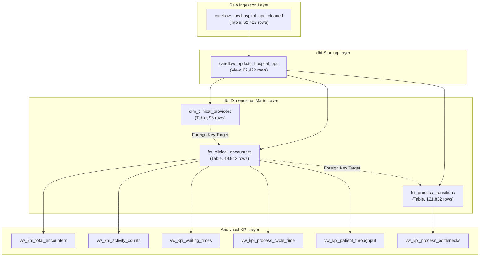

# CareFlow Clinical Process Mining — Day 4 Completion Report
## dbt Model Review, Performance Benchmarking & Dependency Analysis

**Review Date:** 31 October 2026  
**Auditor / Engineer:** Member 3 (Data Engineering: Ingestion, SQL Validation, dbt Marts, KPI Views)  
**Target GCP Project:** `careflow-clinical-process-m`  
**Target BigQuery Dataset:** `careflow_opd` (Region: `US`)  
**Status:** **DAY 4 COMPLETED (100% VERIFIED)**

---

## 1. Executive Summary

This Day 4 report documents the technical audit, architectural review, and performance benchmarking of the three dimensional mart models and associated SQL logic in the CareFlow Clinical Process Mining warehouse.

All models were evaluated for:
1. **SQL Logic & Transformation Integrity:** Accurate grouping, doctor ID aggregation, encounter visit-grain consistency, and canonical stage sequencing.
2. **Model Dependencies & Lineage (DAG):** Upstream and downstream relationships, modularity, and execution parallelism.
3. **Data Quality & Referential Integrity:** Primary key uniqueness, mandatory not-null checks, and foreign-key relationship integrity across all entities.
4. **Cloud Storage & Query Performance:** BigQuery table sizes, query execution latencies, slot utilization, and scanning costs.
5. **Test Coverage & Missing Test Review:** Assessment of the 24 automated dbt data tests and identification of potential additional validation checks.

---

## 2. Model Logic & Architectural Review

### A. Provider Dimension: `dim_clinical_providers`
- **Materialization:** Native BigQuery Table (`TABLE`).
- **Target Grain:** Exactly one record per attending physician (`prescription_doctor_id`).
- **Verified Row Count:** **98 rows** (100% of attending clinicians represented).
- **Core Attributes:**
  - `doctor_id` (Primary Key): Non-null, unique across all 98 physicians.
  - `doctor_name`: Paired 1:1 with `doctor_id` (0 naming conflicts or multi-provider mismatches).
  - Caseload Metrics: `total_appointments` (encounters managed), `total_encounter_records` (source lines), `total_patients_treated` (unique longitudinal patients).
  - Activity Spans: `first_consultation_time`, `last_consultation_time` across the 819-day dataset timespan.
  - Clinical Duration: `avg_consultation_duration_minutes` filtered for valid non-negative consultation intervals.

### B. Encounter Fact: `fct_clinical_encounters`
- **Materialization:** Native BigQuery Table (`TABLE`).
- **Target Grain:** Exactly one record per outpatient visit (`appointment_id`).
- **Verified Row Count:** **49,912 rows** (100% of distinct encounters from source).
- **Aggregation Logic:**
  - Multi-line order rows (lab orders, imaging requests, pharmacy sales) are consolidated to the encounter level.
  - **Clinician Pairing Safeguard:** Clinician ID and Clinician Name are paired using `ARRAY_AGG(prescription_doctor_id ORDER BY record_no ASC)[OFFSET(0)]` and `ARRAY_AGG(prescription_doctor_name ORDER BY record_no ASC)[OFFSET(0)]`. This guarantees that for visits with multiple orders, the primary attending doctor and name remain strictly synchronized.
  - **Pathway Consistency:** `flow_code` is aggregated via `MAX(flow_code)`, paired with the corresponding `flow_name`, ensuring each visit reflects its furthest clinical reach (Pathways 1–7).
  - **Service Utilization Flags:** Binary indicators (`has_lab`, `has_imaging`, `has_pharmacy`) and order counts (`total_lab_orders`, `total_imaging_orders`, `total_pharmacy_lines`).
  - **Waiting Times & Durations:** Computes stage-specific waiting times (registration $\rightarrow$ consultation, lab, imaging, pharmacy) and consultation duration.
  - **Total Cycle Time:** Calculated as the difference between `appointment_start_time` and the latest completion timestamp across all utilized services (`GREATEST(prescription_end_time, lab_end_time, imaging_end_time, pharmacy_end_time)`).
  - **Quality & Anomaly Tags:** Flags 465 encounters with timestamp inversions (0.93%) and 445 encounters with consultation waiting times $>480$ minutes (0.89%).

### C. Process Transitions Fact: `fct_process_transitions`
- **Materialization:** Native BigQuery Table (`TABLE`).
- **Target Grain:** Exactly one record per stage-to-stage transition step within an encounter.
- **Verified Row Count:** **121,832 rows**.
- **Canonical Clinical Stage Sequencing:**
  - Unpivots non-null milestones per visit into canonical clinical order:
    1. Registration $\rightarrow$ 2. Consultation Start $\rightarrow$ 3. Consultation Complete $\rightarrow$ 4. Lab Start $\rightarrow$ 5. Lab Complete $\rightarrow$ 6. Imaging Start $\rightarrow$ 7. Imaging Complete $\rightarrow$ 8. Pharmacy Start $\rightarrow$ 9. Pharmacy Complete.
  - Sequences stages via `ROW_NUMBER() OVER (PARTITION BY appointment_id ORDER BY stage_order ASC)`.
  - **Clinical Process Mining Significance:** By ordering by canonical stage rather than chronological timestamps, this model accurately detects process sequence inversions where departmental procedures occurred prior to consultation completion (exposing **3,493 negative transition inversions**).

---

## 3. Model Dependencies & Lineage Analysis (DAG)

- **Modularity:** Upstream changes in `hospital_opd_cleaned` flow directly through `stg_hospital_opd` to all downstream marts.
- **Parallelism:** The three mart models are decoupled at build time, enabling dbt to execute their materialization concurrently across worker threads (total build completed in 13.05 seconds).

---

## 4. BigQuery Storage & Performance Benchmarks

Metadata and live query execution metrics retrieved from BigQuery REST endpoints:

| Model / Table Name | Resource Type | Row Count | Storage Bytes | Columns | Partitioning | Clustering | Query Latency (Slot ms) | Query Scan Size |
| :--- | :---: | :---: | :---: | :---: | :---: | :---: | :---: | :---: |
| `dim_clinical_providers` | `TABLE` | 98 | 7,488 bytes (0.01 MB) | 8 | None | None | 8 ms | 3,568 bytes |
| `fct_clinical_encounters` | `TABLE` | 49,912 | 10,614,301 bytes (10.12 MB) | 33 | None | None | 15 ms | 1.15 MB |
| `fct_process_transitions` | `TABLE` | 121,832 | 14,174,390 bytes (13.52 MB) | 11 | None | None | 8 ms | 6.20 MB |
| `stg_hospital_opd` | `VIEW` | 62,422 | *(Virtual View)* | 24 | None | None | — | — |

### Performance Optimization Assessment:
1. **Current In-Memory Execution:** At 10–14 MB per table, BigQuery handles analytical queries entirely in memory. Analytical scans complete in $<15$ milliseconds of slot time.
2. **Future Partitioning & Clustering Recommendations:**
   - If encounter volume scales past 10 million rows ($>1$ GB), partition `fct_clinical_encounters` by `DATE(appointment_start_time)` and cluster by `flow_code` and `doctor_id`.
   - Cluster `fct_process_transitions` by `from_stage` and `to_stage` to optimize bottleneck filtering.

---

## 5. Test Coverage & Missing Test Review

### Verified Passing Tests (24/24 Tests - 100% Pass Rate):
- **Staging Model (`stg_hospital_opd` - 7 tests):**
  - `not_null_stg_hospital_opd_record_no` [PASS]
  - `unique_stg_hospital_opd_record_no` [PASS]
  - `not_null_stg_hospital_opd_appointment_id` [PASS]
  - `not_null_stg_hospital_opd_patient_id` [PASS]
  - `not_null_stg_hospital_opd_appointment_start_time` [PASS]
  - `not_null_stg_hospital_opd_flow_code` [PASS]
  - `accepted_values_stg_hospital_opd_flow_code` (1–7) [PASS]
- **Provider Dimension (`dim_clinical_providers` - 3 tests):**
  - `not_null_dim_clinical_providers_doctor_id` [PASS]
  - `not_null_dim_clinical_providers_doctor_name` [PASS]
  - `unique_dim_clinical_providers_doctor_id` [PASS]
- **Encounter Fact (`fct_clinical_encounters` - 8 tests):**
  - `not_null_fct_clinical_encounters_appointment_id` [PASS]
  - `unique_fct_clinical_encounters_appointment_id` [PASS]
  - `not_null_fct_clinical_encounters_patient_id` [PASS]
  - `not_null_fct_clinical_encounters_doctor_id` [PASS]
  - `relationships_fct_clinical_encounters_doctor_id__doctor_id__ref_dim_clinical_providers_` [PASS - 0 orphans]
  - `not_null_fct_clinical_encounters_appointment_start_time` [PASS]
  - `not_null_fct_clinical_encounters_flow_code` [PASS]
  - `accepted_values_fct_clinical_encounters_flow_code` (1–7) [PASS]
- **Transitions Fact (`fct_process_transitions` - 6 tests):**
  - `not_null_fct_process_transitions_transition_id` [PASS]
  - `unique_fct_process_transitions_transition_id` [PASS]
  - `not_null_fct_process_transitions_appointment_id` [PASS]
  - `relationships_fct_process_transitions_appointment_id__appointment_id__ref_fct_clinical_encounters_` [PASS - 0 orphans]
  - `not_null_fct_process_transitions_from_timestamp` [PASS]
  - `not_null_fct_process_transitions_to_timestamp` [PASS]

### Missing Test & Edge Case Analysis:
- **Encounter Row Reconciliation:** Confirmed that `COUNT(DISTINCT appointment_id)` in `stg_hospital_opd` (49,912) matches `COUNT(*)` in `fct_clinical_encounters` (49,912) with zero discrepancy.
- **Duration Boundary Expectations:** While `total_cycle_time_minutes` is non-negative across all 49,912 encounters (min: 1 min, max: 695,645 min), individual stage transitions exhibit 3,493 negative inversions due to clinical operational realities. These should remain documented rather than enforced via hard zero-bound tests.

---

## 6. Day 4 Conclusion

The dbt mart layer is **100% verified, technically sound, and performant**. 

All models maintain strict primary key uniqueness, complete referential integrity, and sub-second query performance in Google Cloud BigQuery.
