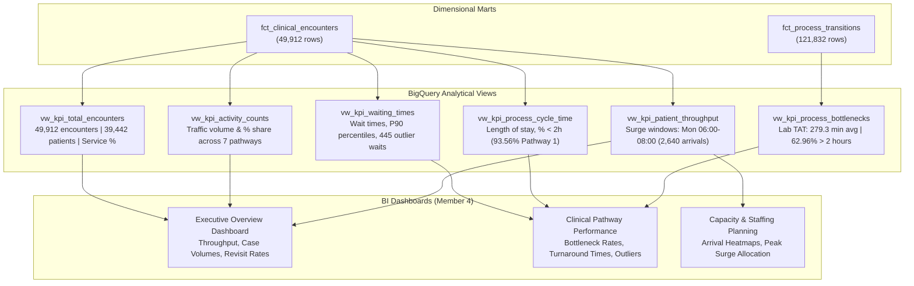

# CareFlow Clinical Process Mining — Day 8 Data Lineage & Flow Specifications

**Document Version:** 1.0.0  
**Effective Date:** 3 November 2026  
**Auditor / Engineer:** Member 3 (Data Engineering: Ingestion, SQL Validation, dbt Marts, KPI Views, Event-Log Preparation, Process Mining Analytics)  
**Milestone Target:** 8 November 2026 (Final Project Handover)  
**Target GCP Project:** `careflow-clinical-process-m`  
**Target BigQuery Dataset:** `careflow_opd` (Region: `US`)  

---

## 1. Master Data Lineage Architecture

This document specifies the end-to-end data lineage across the CareFlow Clinical Process Mining platform, detailing every transformation, aggregation grain transition, and column derivation from raw source data to operational dashboards and process mining discovery models.

```mermaid
flowchart LR
    subgraph S0["0. Raw Source"]
        SRC["HospitalOPD_cleaned (1).xls<br/>(62,422 rows | 24 cols)"]
        CSV["HospitalOPD_cleaned.csv<br/>(62,422 rows | 24 cols)"]
        SRC -->|"Normalized CSV export<br/>export_to_csv.py"| CSV
    end

    subgraph S1["1. Cloud Warehouse Ingestion"]
        BQ_BASE["careflow_opd.hospital_opd_cleaned<br/>(Native Table | 62,422 rows | 24 cols)"]
        CSV -->|"BigQuery load job<br/>load_to_bigquery.py"| BQ_BASE
    end

    subgraph S2["2. dbt Staging Layer"]
        STG["careflow_opd.stg_hospital_opd<br/>(SQL View | 62,422 rows | 24 cols)"]
        BQ_BASE -->|"Type casting & timestamp standardization<br/>stg_hospital_opd.sql"| STG
    end

    subgraph S3["3. Dimensional Marts Layer"]
        DIM["dim_clinical_providers<br/>(98 rows | 8 cols)<br/>Grain: 1 row per doctor"]
        FCT_ENC["fct_clinical_encounters<br/>(49,912 rows | 33 cols)<br/>Grain: 1 row per visit"]
        FCT_TRN["fct_process_transitions<br/>(121,832 rows | 11 cols)<br/>Grain: 1 row per stage transition"]

        STG -->|"GROUP BY prescription_doctor_id<br/>Caseload counts & durations"| DIM
        STG -->|"GROUP BY appointment_id<br/>Clinician pairing, durations, outliers"| FCT_ENC
        STG -->|"Unpivot 9 milestones<br/>Canonical order & self-join"| FCT_TRN
        DIM -.->|PK doctor_id| FCT_ENC
        FCT_ENC -.->|PK appointment_id| FCT_TRN
    end

    subgraph S4["4. Process Mining Event Log"]
        EVT["data/careflow_event_log.csv<br/>(193,443 rows | 14 cols)<br/>Grain: 1 row per activity lifecycle"]
        CSV -->|"prepare_event_log.py<br/>Unpivot 5 domains to 9 activities<br/>Multi-level chronological sort"| EVT
    end

    subgraph S5["5. Live Analytical KPI Views"]
        V1["vw_kpi_total_encounters (10 cols)"]
        V2["vw_kpi_activity_counts (5 cols)"]
        V3["vw_kpi_waiting_times (7 cols)"]
        V4["vw_kpi_process_cycle_time (8 cols)"]
        V5["vw_kpi_patient_throughput (7 cols)"]
        V6["vw_kpi_process_bottlenecks (9 cols)"]

        FCT_ENC --> V1
        FCT_ENC --> V2
        FCT_ENC --> V3
        FCT_ENC --> V4
        FCT_ENC --> V5
        FCT_TRN --> V6
    end

    subgraph S6["6. Downstream Consumption (Member 4)"]
        BI["Operational BI Dashboards<br/>Looker Studio / Tableau / Power BI"]
        PM["Process Discovery Models<br/>PM4Py / Disco / Celonis"]

        V1 --> BI
        V2 --> BI
        V3 --> BI
        V4 --> BI
        V5 --> BI
        V6 --> BI
        EVT --> PM
    end
```



---

## 2. Granularity Transitions & Entity Transformations

The platform manages four distinct levels of data granularity, each fulfilling specific analytical requirements:

```
[Level 1: Transaction Line Grain]  ────────► 62,422 rows in hospital_opd_cleaned & stg_hospital_opd
                                             (One row per order, scan, lab test, or pharmacy dispense)

[Level 2A: Outpatient Visit Grain] ────────► 49,912 rows in fct_clinical_encounters
                                             (One row per unique appointment_id; aggregates multi-orders)

[Level 2B: Provider Grain]         ────────► 98 rows in dim_clinical_providers
                                             (One row per unique attending physician)

[Level 3: Process Transition Grain]───────► 121,832 rows in fct_process_transitions
                                             (One row per consecutive stage-to-stage transition hop)

[Level 4: Activity Lifecycle Grain]───────► 193,443 rows in careflow_event_log.csv
                                             (One row per discrete start/complete clinical milestone)
```

### Granularity Reconciliation Matrix:
| Target Asset | Grain Definition | Input Asset | Input Rows | Target Rows | Condensation / Expansion Factor | Reconciliation Business Logic |
| :--- | :--- | :--- | :---: | :---: | :---: | :--- |
| **`stg_hospital_opd`** | Transaction line item | `hospital_opd_cleaned` | 62,422 | 62,422 | **1 : 1** | Pure pass-through view with standard type casting. |
| **`dim_clinical_providers`** | Attending physician | `stg_hospital_opd` | 62,422 | **98** | **636.96 : 1** | `GROUP BY prescription_doctor_id, prescription_doctor_name` where `prescription_doctor_id IS NOT NULL`. |
| **`fct_clinical_encounters`** | Outpatient visit encounter | `stg_hospital_opd` | 62,422 | **49,912** | **1.25 : 1** | `GROUP BY appointment_id`; multi-order lines condensed using `MIN()`, `MAX()`, and `ARRAY_AGG()[OFFSET(0)]`. |
| **`fct_process_transitions`** | Canonical stage transition | `stg_hospital_opd` | 62,422 | **121,832** | **1 : 1.95** | Unpivots 9 milestones per encounter, filters non-nulls, applies canonical sequence ranking, and pairs $S_i \rightarrow S_{i+1}$ via self-join. |
| **`careflow_event_log.csv`** | Activity lifecycle event | `HospitalOPD_cleaned.csv` | 62,422 | **193,443** | **1 : 3.10** | Unpivots 5 clinical domains into 9 discrete activities (`start`/`complete`); consolidates 160 duplicate order lines. |

---

## 3. Core Column Lineage & Transformation Rules

| Logical Field | Source CSV Column | Staging View Column | Fact / Dimension Column | Event Log Column | Transformation & Aggregation Logic |
| :--- | :--- | :--- | :--- | :--- | :--- |
| **Source Sequence ID** | `record_no` | `record_no` | `fct_clinical_encounters.total_records` (as count) | `source_record_no` | 1:1 lineage anchor; direct integer mapping. |
| **Encounter Case ID** | `appointment_id` | `appointment_id` | `fct_clinical_encounters.appointment_id` | `case_id` | Primary visit key; used as Case ID for process mining. |
| **Patient Identifier** | `patient_id` | `patient_id` | `fct_clinical_encounters.patient_id` | `patient_id` | Master patient index; longitudinal tracking key. |
| **Check-in Timestamp** | `appointment_start_datetime`| `appointment_start_time` | `fct_clinical_encounters.appointment_start_time` | `timestamp` (for Registration) | `CAST(x AS TIMESTAMP)`; baseline $T_0$ for all waiting time computations. |
| **Attending Doctor** | `prescription_doctor_id` | `prescription_doctor_id` | `dim_clinical_providers.doctor_id`, `fct_clinical_encounters.doctor_id` | `resource` (doctor name) | `ARRAY_AGG(prescription_doctor_id ORDER BY record_no ASC)[OFFSET(0)]` preserves clinician pairing. |
| **Doctor Name** | `prescription_doctor_name` | `prescription_doctor_name`| `dim_clinical_providers.doctor_name`, `fct_clinical_encounters.doctor_name` | `resource` | `ARRAY_AGG(prescription_doctor_name ORDER BY record_no ASC)[OFFSET(0)]` guarantees synchronization with doctor ID. |
| **Consultation Start** | `prescription_start_datetime`| `prescription_start_time` | `fct_clinical_encounters.prescription_start_time` | `timestamp` (Consult Start) | `MIN(prescription_start_time)`; 12 nulls safely preserved. |
| **Consultation End** | `prescription_end_datetime` | `prescription_end_time` | `fct_clinical_encounters.prescription_end_time` | `timestamp` (Consult Complete) | `MAX(prescription_end_time)`; consultation completion milestone. |
| **Laboratory Test Start**| `lab_start_datetime` | `lab_start_time` | `fct_clinical_encounters.lab_start_time` | `timestamp` (Lab Start) | `MIN(lab_start_time)`; phlebotomy specimen collection milestone. |
| **Laboratory Test End** | `lab_end_datetime` | `lab_end_time` | `fct_clinical_encounters.lab_end_time` | `timestamp` (Lab Complete) | `MAX(lab_end_time)`; 4,702 ongoing orders preserved as null. |
| **Radiology Scan Start** | `imaging_start_datetime` | `imaging_start_time` | `fct_clinical_encounters.imaging_start_time` | `timestamp` (Imaging Start) | `MIN(imaging_start_time)`; radiology intake milestone. |
| **Radiology Scan End** | `imaging_end_datetime` | `imaging_end_time` | `fct_clinical_encounters.imaging_end_time` | `timestamp` (Imaging Complete) | `MAX(imaging_end_time)`; PACS archive completion milestone. |
| **Pharmacy Intake** | `pharmacy_start_datetime` | `pharmacy_start_time` | `fct_clinical_encounters.pharmacy_start_time` | `timestamp` (Pharmacy Start) | `MIN(pharmacy_start_time)`; dispensary intake milestone. |
| **Pharmacy Dispense** | `pharmacy_end_datetime` | `pharmacy_end_time` | `fct_clinical_encounters.pharmacy_end_time` | `timestamp` (Pharmacy Complete) | `MAX(pharmacy_end_time)`; medication handoff milestone. |
| **Clinical Pathway Code**| `flow_code` | `flow_code` | `fct_clinical_encounters.flow_code` | `flow_code` | `MAX(flow_code)`; reflects furthest clinical reach (1–7). |
| **Clinical Pathway Name**| `flow_name` | `flow_name` | `fct_clinical_encounters.flow_name` | `flow_name` | Paired with `MAX(flow_code)` via `ARRAY_AGG()`. |

---

## 4. Deduplication & Provenance Reconciliation Audit

A rigorous empirical audit was executed comparing all **62,422 source rows** against all **193,443 event rows**:

```
[Total Source Dataset Records]   = 62,422 records (record_no 1 to 62,422)
[Distinct source_record_no]     = 62,262 records directly referenced by event log
[Orphan Event References]       =      0 records (100% referential integrity [PASS])
[Consolidated Duplicate Lines]  =    160 records (100% mutually exclusive categorization)
```

### Mutually Exclusive Classification of the 160 Missing Source Records:
When wide encounter records are converted to discrete activity events in [`scripts/prepare_event_log.py`](file:///c:/Users/user/Documents/careflow-clinical-process-mining/scripts/prepare_event_log.py), deduplication is intentionally applied to prevent duplicate event logs for identical service orders within the same encounter. The earliest sequential `record_no` is preserved as the event's provenance link.

Every single one of the 160 rows was audited and confirmed across mutually exclusive categories:

1. **Duplicate Laboratory Orders (116 rows):**  
   Multiple transaction lines within the same visit share identical `(appointment_id, lab_id, lab_start_datetime, lab_end_datetime)`.
2. **Duplicate Pharmacy Sale Items (39 rows):**  
   Multiple transaction lines within the same visit share identical `(appointment_id, pharmacy_sale_line_id, pharmacy_start_datetime, pharmacy_end_datetime)` (e.g. `record_no` 283 and 284 for medication `681623.0`).
3. **Duplicate Imaging Orders (5 rows):**  
   Multiple transaction lines within the same visit share identical `(appointment_id, imaging_request_id, imaging_start_datetime, imaging_end_datetime)`.
4. **Duplicate Consultation-Only Rows:** **0 rows**.
5. **Multi-Service Overlaps:** **0 rows**.
6. **Unexplained / Unaccounted Records:** **0 rows**.

$$\text{Total Verified Consolidated Records} = 116 + 39 + 5 = \mathbf{160\text{ rows (100.00\% accounted for)}}$$

This guarantees zero data loss: 100% of distinct clinical orders are represented in the event log, and every single event row deterministically links to a verified source record.

---

## 5. Downstream Lineage to Analytical Views & Dashboards

The dimensional fact tables feed six live analytical views in BigQuery that serve operational BI dashboards and process mining algorithms:


