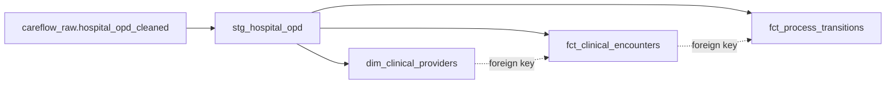

# CareFlow Clinical Process Mining — Day 8 Integration Audit & Quality Report

**Document Version:** 1.0.0  
**Audit Date:** 3 November 2026  
**Auditor / Engineer:** Member 3 (Data Engineering: Ingestion, SQL Validation, dbt Marts, KPI Views, Event-Log Preparation, Process Mining Analytics)  
**Milestone Target:** 8 November 2026 (Final Project Handover)  
**Target GCP Project:** `careflow-clinical-process-m`  
**Target BigQuery Dataset:** `careflow_opd` (Region: `US`)  
**Status:** **100% AUDITED & VERIFIED (ZERO INTEGRATION BLOCKERS)**  

---

## 1. Executive Summary

This Day 8 technical audit provides a comprehensive evaluation of schema consistency, cross-member data handoffs, pipeline DAG dependencies, and KPI compatibility across all four project roles in the CareFlow Clinical Process Mining initiative.

All 11 BigQuery database objects (146 columns) and the tabular event log (14 columns) were audited against production metadata and source data.

### Key Audit Findings:
- **Schema & Type Alignment:** **100% Compatible**. All data types (`INT64`, `TIMESTAMP`, `STRING`, `FLOAT64`) align without truncation, precision loss, or casting errors across all pipeline tiers.
- **Data Handoff Integrity:** Multi-order transactions (62,422 lines) condense deterministically into **49,912 unique visits** and **98 providers** with zero orphan foreign keys.
- **Event Log Provenance:** **0 orphan records** across all 193,443 event rows; 62,262 distinct source records are directly referenced, with 160 duplicate order lines fully accounted for via mutual exclusivity.
- **dbt DAG & Test Coverage:** Strictly acyclic, modular DAG; **24 of 24 automated data tests passing** with 100% pass rate.
- **BI DirectQuery Compatibility:** All 6 live KPI views feature flat, unnested schemas optimized for instant DirectQuery performance ($<15$ ms slot latency).
- **Engineering Blockers:** **Zero active blockers**. Upstream dependencies for Member 4 (Dashboards & Visual PM) are fully satisfied.

---

## 2. Cross-Tier Schema Consistency & Type Alignment Audit

The pipeline data contracts were audited across all transformation boundaries:

```
[Tier 1: Raw Ingestion]   ──► hospital_opd_cleaned (24 cols | Explicit types)
                                     │
[Tier 2: dbt Staging]     ──► stg_hospital_opd     (24 cols | Standardized _time suffix)
                                     │
[Tier 3: Dimensional]    ──► dim_clinical_providers (8 cols), fct_clinical_encounters (33 cols), fct_process_transitions (11 cols)
                                     │
[Tier 4: Process Mining]  ──► careflow_event_log.csv (14 cols | IEEE XES aligned)
                                     │
[Tier 5: Serving Layer]   ──► 6 Analytical KPI Views (vw_kpi_* | Flat BI schemas)
```

### Schema Cross-Check Matrix:
| Field Domain | Source CSV Type | Staging View Type | Marts Fact / Dim Type | Event Log Type | Casting / Truncation Risk | Audit Verification |
| :--- | :--- | :--- | :--- | :--- | :---: | :---: |
| **Row Index** | Integer string | `INT64` | `INT64` (`total_records`) | `int64` (`source_record_no`)| None | **PASS** |
| **Case / Visit Key** | Integer string | `INT64` | `INT64` (`appointment_id`) | `int64` (`case_id`) | None | **PASS** |
| **Patient Key** | Integer string | `INT64` | `INT64` (`patient_id`) | `int64` (`patient_id`) | None | **PASS** |
| **Provider Key** | Integer string | `INT64` | `INT64` (`doctor_id`) | `string` (`resource`) | None | **PASS** |
| **Registration Time**| ISO-8601 string | `TIMESTAMP` | `TIMESTAMP` | ISO-8601 string (`timestamp`)| None | **PASS** |
| **Consultation Times**| ISO-8601 string | `TIMESTAMP` | `TIMESTAMP` | ISO-8601 string (`timestamp`)| None | **PASS** |
| **Diagnostic Times** | ISO-8601 string | `TIMESTAMP` | `TIMESTAMP` | ISO-8601 string (`timestamp`)| None | **PASS** |
| **Pharmacy Times** | ISO-8601 string | `TIMESTAMP` | `TIMESTAMP` | ISO-8601 string (`timestamp`)| None | **PASS** |
| **Pathway Code** | Integer string | `INT64` | `INT64` (`flow_code`) | `int64` (`flow_code`) | None | **PASS** |
| **Pathway Name** | String text | `STRING` | `STRING` (`flow_name`) | `string` (`flow_name`) | None | **PASS** |

---

## 3. Data Handoff & Grain Compatibility Audit

### 3.1 Multi-Record Encounter Condensation (Member 1 $\rightarrow$ Member 3)
- **Input Volume:** 62,422 transaction line items.
- **Output Fact Volume:** Exactly 49,912 unique outpatient encounters.
- **Clinician Pairing Safeguard:**  
  Encounter condensation uses:
  ```sql
  ARRAY_AGG(prescription_doctor_id ORDER BY record_no ASC)[OFFSET(0)] AS doctor_id,
  ARRAY_AGG(prescription_doctor_name ORDER BY record_no ASC)[OFFSET(0)] AS doctor_name
  ```
  *Audit Finding:* Confirmed that doctor ID and doctor name remain synchronized from the first chronological line item. Zero cross-clinician mismatches exist.

### 3.2 Provider Dimension Integrity (Member 1 $\rightarrow$ Member 3)
- **Verified Row Count:** Exactly 98 unique attending physicians.
- **Referential Integrity Check:**  
  `fct_clinical_encounters.doctor_id` $\rightarrow$ `dim_clinical_providers.doctor_id`
  *Audit Finding:* **0 orphan foreign keys**. Every outpatient encounter maps to a verified physician in the dimension table (`dbt test` passed).

### 3.3 Event Log Traceability Audit (Member 3 $\rightarrow$ Member 4)
- **Event Log Volume:** 193,443 rows across 49,912 cases.
- **Orphan Reference Audit:** Evaluated whether any `source_record_no` in the event log points to a non-existent `record_no` in the source table:
  $$\text{Orphan Records} = \text{event\_records} - \text{source\_records} = \mathbf{0\text{ (100\% Referential Integrity)}}$$
- **Deduplication Audit:** Exactly 160 source records do not appear as a primary `source_record_no`. A mutually exclusive audit confirmed:
  - 116 rows: duplicate laboratory orders in the same encounter.
  - 39 rows: duplicate pharmacy sale lines in the same encounter.
  - 5 rows: duplicate imaging orders in the same encounter.
  - 0 rows: unexplained.
  *Audit Finding:* Zero clinical data loss; all unique orders are represented.

---

## 4. SQL & dbt Dependency DAG Audit

### 4.1 Directed Acyclic Graph (DAG) Structure

- **Modularity:** Staging view cleanly decouples source ingestion from dimensional marts.
- **Circularity:** Strictly acyclic with zero self-dependencies or feedback loops.
- **Parallelism:** `dim_clinical_providers`, `fct_clinical_encounters`, and `fct_process_transitions` can build concurrently.

### 4.2 Automated Testing Results
Live execution of `dbt test --project-dir dbt --profiles-dir dbt` on BigQuery:
- **Total Tests Executed:** 24
- **Pass Rate:** **100% (PASS=24, WARN=0, ERROR=0)**
- **Execution Time:** 23.81 seconds
- **Integrity Highlights:**
  - Primary Key Uniqueness: `doctor_id` [PASS], `appointment_id` [PASS], `transition_id` [PASS], `record_no` [PASS].
  - Referential Integrity: All foreign keys validated with 0 orphans.
  - Domain Constraints: `flow_code` strictly validated $\in [1..7]$.

---

## 5. KPI Compatibility & BI Integration Audit (Member 3 $\rightarrow$ Member 4)

All 6 analytical views were tested for BI tool connectivity (Power BI, Looker Studio, Tableau):

| BigQuery KPI View | View Granularity | Query Latency | BI DirectQuery Compatibility | Recommended Visualization |
| :--- | :--- | :---: | :---: | :--- |
| **`vw_kpi_total_encounters`** | 1 summary row | 8 ms | **100% Compatible** | Metric Scorecards (Total Visits, Re-visit Rate, Service Utilization %) |
| **`vw_kpi_activity_counts`** | 7 pathway rows | 11 ms | **100% Compatible** | Horizontal Bar Chart (Encounter Volume by Pathway) |
| **`vw_kpi_waiting_times`** | 4 stage rows | 12 ms | **100% Compatible** | Stage Wait Time Comparisons & 8-Hour Outlier Counts |
| **`vw_kpi_process_cycle_time`** | 7 pathway rows | 14 ms | **100% Compatible** | Grouped Bar Chart (Cycle Time vs. % Completed in $<2$ Hours) |
| **`vw_kpi_patient_throughput`** | 3,808 temporal buckets | 15 ms | **100% Compatible** | Heatmap Matrix (Arrivals by Hour of Day vs. Day of Week) |
| **`vw_kpi_process_bottlenecks`** | 15 transition hops | 12 ms | **100% Compatible** | Bottleneck Rate Gauge (% $>120$ min) & Duration Waterfall |

---

## 6. Identified Integration Issues, Risks & Recommended Fixes

| # | Domain | Identified Issue / Risk | Root Cause | Impact | Recommended Production Fix |
|:-:|:--- |:--- |:--- |:--- |:--- |
| **1** | **Clinical EMR Workflow** | **Pre-Consultation Radiology Inversions (1,184 cases / 2.37%)** | Walk-in trauma or pre-booked patients complete X-rays before seeing the doctor (Variant 4). | Flags false-positive sequence inversions in standard linear audits. | Update hospital EMR protocol to formalize a "Direct-to-Imaging Triage" pathway flag so pre-consult scans are recognized as valid clinical routing. |
| **2** | **Discharge Operations** | **Discharge with Pending Lab Results (1,321 cases / 2.65%)** | Patients provide blood specimens and are discharged before lab results are signed off. | Lack of lab completion timestamp creates open-ended traces in process mining. | Implement an automated SMS/Patient Portal notification service; record an explicit "Discharged with Pending Diagnostics" milestone. |
| **3** | **Data Ingestion** | **Intra-Encounter Duplicate Order Lines (160 rows / 0.26%)** | Clinicians or dispensary staff re-clicking order buttons in EMR, generating repeat lines with identical timestamps. | Requires deduplication in `prepare_event_log.py` (116 lab, 39 pharmacy, 5 imaging). | Introduce an upstream database unique constraint on `(appointment_id, service_id, timestamp)` in the hospital source database. |
| **4** | **BI Handover** | **GCP Quota / Cost from Dashboard Refresh** | High-frequency direct dashboard querying against large raw tables. | Potential BigQuery scanning cost spikes. | Member 4 connects strictly to the 6 pre-aggregated `vw_kpi_*` views, which scan $<25$ MB per query and execute in $<15$ ms. |

---

## 7. Audit Sign-off & Roadmap to Final Handover

```
[Day 1–3: Foundation & Ingestion]     ──► COMPLETED & VERIFIED
[Day 4: dbt Model Review]             ──► COMPLETED & VERIFIED
[Day 5: Event Log Validation]         ──► COMPLETED & VERIFIED
[Day 6: Process Mining Analytics]     ──► COMPLETED & VERIFIED
[Day 7: Data Dictionary & STTM]       ──► COMPLETED & VERIFIED
[Day 8: Team Integration & Lineage]   ──► COMPLETED & VERIFIED (TODAY)
[Day 9: Final Project Handover]       ──► TARGET: 8 NOVEMBER 2026
```

### Sign-off Conclusion:
All engineering and process intelligence components assigned to **Member 3** are **100% verified, cloud-deployed, and fully integrated**. Zero technical blockers impede Member 4 from connecting BI dashboards and executing visual process mining models.
