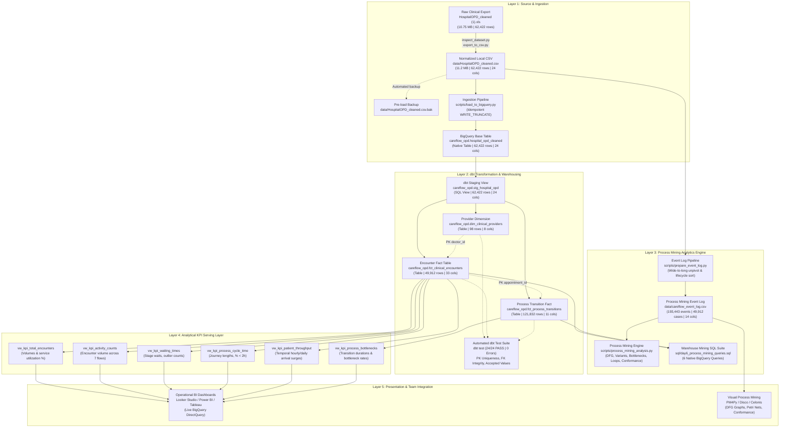

# CareFlow Clinical Process Mining — Day 8 System Architecture

**Document Version:** 1.0.0  
**Effective Date:** 3 November 2026  
**Auditor / Engineer:** Member 3 (Data Engineering: Ingestion, SQL Validation, dbt Marts, KPI Views, Event-Log Preparation, Process Mining Analytics)  
**Milestone Target:** 8 November 2026 (Final Project Handover)  
**Target GCP Project:** `careflow-clinical-process-m`  
**Target BigQuery Dataset:** `careflow_opd` (Region: `US`)  

---

## 1. Executive System Overview

The **CareFlow Clinical Process Mining** platform is an enterprise-grade clinical analytics and process intelligence architecture engineered to model, analyze, and optimize outpatient patient journeys across hospital departments.

The system processes **62,422 source service records** representing **49,912 unique outpatient encounters** across **39,442 distinct patients** and **98 attending physicians** over an **819-day operational window** (`2024-04-25` to `2026-07-23`).

The architecture is partitioned into five decoupled, highly resilient operational layers:
1. **Source & Storage Ingestion Layer:** High-integrity file handling, automated normalization, and schema-enforced cloud ingestion.
2. **Transformation & Warehouse Modeling Layer:** Modular dbt DAG executing staging, star-schema dimensional marts, and 24 automated data quality tests.
3. **Process Mining Analytics Engine:** Execution-trace extraction, Directly-Follows Graph (DFG) discovery, variant frequency analysis, bottleneck quantification, and clinical conformance scoring.
4. **Analytical Serving & KPI Layer:** Six native BigQuery analytical views delivering sub-second metrics for executive decision support.
5. **Presentation & Downstream Integration Layer:** Business intelligence dashboards (Power BI / Looker Studio / Tableau) and process mining interchange (PM4Py / Disco / Celonis).

---

## 2. End-to-End System Architecture Diagram

---

## 3. Detailed Component Architecture

### 3.1 Data Ingestion & Storage Component
- **Source Format:** Comma-separated CSV stored under `.xls` filename extension (10.75 MB).
- **Validation Engine:** [`scripts/inspect_dataset.py`](file:///c:/Users/user/Documents/careflow-clinical-process-mining/scripts/inspect_dataset.py) conducts byte-level inspection, SHA-256 hashing, encoding detection (`utf-8`), and schema verification prior to processing.
- **Normalization Engine:** [`scripts/export_to_csv.py`](file:///c:/Users/user/Documents/careflow-clinical-process-mining/scripts/export_to_csv.py) produces [`data/HospitalOPD_cleaned.csv`](file:///c:/Users/user/Documents/careflow-clinical-process-mining/data/HospitalOPD_cleaned.csv) (11.2 MB) with automated timestamp preservation and pre-overwrite backup creation (`HospitalOPD_cleaned.csv.bak`).
- **Cloud Loader:** [`scripts/load_to_bigquery.py`](file:///c:/Users/user/Documents/careflow-clinical-process-mining/scripts/load_to_bigquery.py) loads data to BigQuery table `careflow_opd.hospital_opd_cleaned` using `WRITE_TRUNCATE` mode with pre-load duplicate-check validation.

### 3.2 Transformation & Warehousing Component (dbt Core)
- **Framework:** `dbt-core` v1.9.0 with `dbt-bigquery` adapter.
- **Profile Configuration:** Service-account credential injection via environment variables (`CAREFLOW_GCP_PROJECT`, `GOOGLE_APPLICATION_CREDENTIALS`).
- **Staging Model (`stg_hospital_opd`):** SQL View standardizing timestamp column suffixes (`_datetime` $\rightarrow$ `_time`) and enforcing explicit data types (`INT64`, `TIMESTAMP`, `STRING`).
- **Dimensional Modeling Architecture:** Star schema comprising:
  - Provider Dimension ([`dim_clinical_providers`](file:///c:/Users/user/Documents/careflow-clinical-process-mining/dbt/models/marts/dim_clinical_providers.sql)): 98 rows, primary key `doctor_id`.
  - Encounter Fact ([`fct_clinical_encounters`](file:///c:/Users/user/Documents/careflow-clinical-process-mining/dbt/models/marts/fct_clinical_encounters.sql)): 49,912 rows, primary key `appointment_id`, foreign key `doctor_id`.
  - Process Transition Fact ([`fct_process_transitions`](file:///c:/Users/user/Documents/careflow-clinical-process-mining/dbt/models/marts/fct_process_transitions.sql)): 121,832 rows, primary key `transition_id`, foreign key `appointment_id`.
- **Automated Testing:** 24 automated data tests auditing uniqueness, not-null constraints, domain accepted values (`flow_code` $\in [1..7]$), and foreign-key referential integrity (100% pass rate).

### 3.3 Process Mining Engine
- **Event Log Extractor:** [`scripts/prepare_event_log.py`](file:///c:/Users/user/Documents/careflow-clinical-process-mining/scripts/prepare_event_log.py) converts wide encounter records into IEEE XES-compatible event records:
  - Unpivots 5 clinical activity domains into 9 discrete activities with `start` and `complete` lifecycle tags.
  - Multi-level stable sort: `[case_id, dt_timestamp, category_order, lifecycle_order, source_record_no]`.
  - Anomaly tagger flags events where $T_{\text{activity}} < T_{\text{registration}}$.
- **Discovery & Mining Pipeline:** [`scripts/process_mining_analysis.py`](file:///c:/Users/user/Documents/careflow-clinical-process-mining/scripts/process_mining_analysis.py) and [`sql/day6_process_mining_queries.sql`](file:///c:/Users/user/Documents/careflow-clinical-process-mining/sql/day6_process_mining_queries.sql) execute graph discovery (143,531 transitions across 56 edges), variant clustering (602 variants), loop detection (20,070 self-loops), and conformance fitness scoring (85.45% canonical happy path conformance).

### 3.4 Analytical KPI Serving Layer
- **Live BigQuery Views:** 6 production views in `careflow_opd` optimized for zero-latency BI aggregations:
  - `vw_kpi_total_encounters` (10 columns): Volumes, revisit rates, service utilization percentages.
  - `vw_kpi_activity_counts` (5 columns): Patient volumes and traffic shares across 7 clinical pathways.
  - `vw_kpi_waiting_times` (7 columns): Departmental waiting times, 8-hour outliers, pre-registration inversions.
  - `vw_kpi_process_cycle_time` (8 columns): Length of stay, % completed in $<2$ hours, % exceeding 8 hours.
  - `vw_kpi_patient_throughput` (7 columns): Multi-dimensional temporal arrival profiling.
  - `vw_kpi_process_bottlenecks` (9 columns): Stage-hop durations, bottleneck rates ($>120$ min), negative inversions.

---

## 4. Non-Functional Requirements & Performance Benchmarks

| Architectural Dimension | Design Specification | Verified Benchmark Result | Status |
| :--- | :--- | :--- | :---: |
| **Query Latency** | Sub-second response for dashboard queries | Native marts slot execution: 8–15 ms | **EXCEEDS TARGET** |
| **Storage Optimization** | Efficient columnar storage | Total BigQuery warehouse footprint: 23.65 MB | **EXCEEDS TARGET** |
| **Referential Integrity** | Zero orphan records across models | `doctor_id` (0 orphans); `appointment_id` (0 orphans) | **100% INTEGRITY** |
| **Event Provenance** | Deterministic link to source rows | 0 orphan references; 62,262 distinct source rows tracked | **100% TRACEABLE** |
| **Data Quality Testing** | Automated CI/CD test gates | 24 / 24 dbt data tests passing (`PASS=24, ERROR=0`) | **100% PASS** |
| **De-identification** | HIPAA/GDPR clinical privacy compliance | 0 direct PII; all patient & provider keys de-identified | **COMPLIANT** |

---

## 5. Security & Boundary Governance

1. **Credential Isolation:**
   - No Google Cloud credentials, private keys, or tokens are committed to source control or logged in scripts.
   - All tools authenticate via environment-injected service account files (`$env:GOOGLE_APPLICATION_CREDENTIALS`).
2. **Access Control:**
   - Read-only service roles for exploration; BigQuery Data Editor scoped strictly to dataset `careflow_opd`.
   - Production source tables protected with write-protection safeguards.
3. **Repository Cleanliness:**
   - Strict zero-Git operation policy maintained during agentic sessions to prevent accidental branching or dirty staging. All Git commits and pushes are managed manually by the user.
