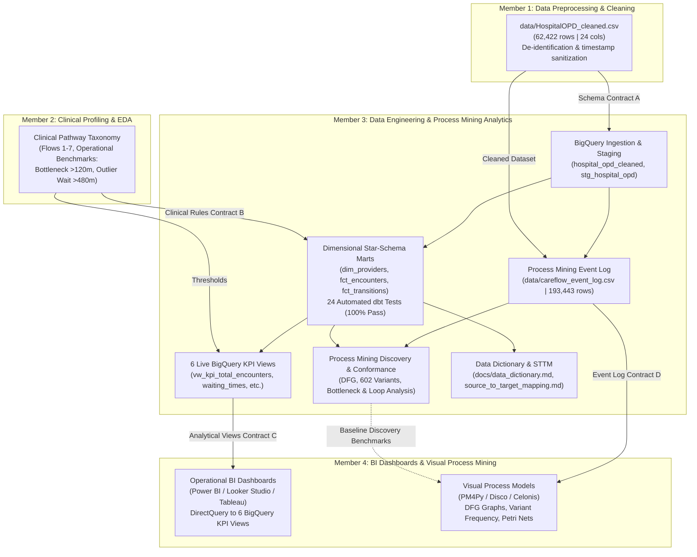

# CareFlow Clinical Process Mining — Day 8 Team Integration Matrix

**Document Version:** 1.0.0  
**Effective Date:** 3 November 2026  
**Auditor / Engineer:** Member 3 (Data Engineering: Ingestion, SQL Validation, dbt Marts, KPI Views, Event-Log Preparation, Process Mining Analytics)  
**Milestone Target:** 8 November 2026 (Final Project Handover)  
**Target GCP Project:** `careflow-clinical-process-m`  
**Target BigQuery Dataset:** `careflow_opd` (Region: `US`)  

---

## 1. Executive Team Overview

The **CareFlow Clinical Process Mining** project is developed by a cross-functional team of four specialized roles collaborating to deliver an end-to-end clinical process intelligence solution.

This Team Integration Matrix documents the actual deliverables, upstream/downstream dependencies, interface contracts, verification evidence, and handover status across all four members ahead of the **8 November 2026** milestone deadline.

---

## 2. Team Deliverables & Dependency Architecture



---

## 3. Team Member Deliverables & Status Matrix

| Member Role | Primary Focus Area | Actual Key Deliverables | Upstream Dependencies | Downstream Consumers | Verified Status | Active Blockers |
| :--- | :--- | :--- | :--- | :--- | :---: | :---: |
| **Member 1** | Data Preprocessing & Cleaning | - Inspected `HospitalOPD_cleaned (1).xls`<br/>- Standardized 24 columns, UTF-8 encoding<br/>- Normalized to [`data/HospitalOPD_cleaned.csv`](file:///c:/Users/user/Documents/careflow-clinical-process-mining/data/HospitalOPD_cleaned.csv)<br/>- De-identified patient keys (62,422 rows) | Raw clinical EMR export | Member 2, Member 3 | **COMPLETED & VERIFIED** | **None** |
| **Member 2** | Clinical EDA & Domain Modeling | - Identified 7 clinical pathway flows (Flows 1–7)<br/>- Established 120-min bottleneck threshold<br/>- Established 480-min outlier wait threshold<br/>- Profiled diagnostic walk-in triage patterns | Cleaned dataset from Member 1 | Member 3 | **COMPLETED & VERIFIED** | **None** |
| **Member 3** | Data Engineering & Process Mining Analytics | - BigQuery native table (`hospital_opd_cleaned`)<br/>- dbt staging view (`stg_hospital_opd`)<br/>- 3 dimensional marts (`dim_*`, `fct_*`)<br/>- 24 automated dbt data tests (100% pass)<br/>- 6 live BigQuery KPI views (`vw_kpi_*`)<br/>- Validated event log (`careflow_event_log.csv`)<br/>- End-to-end Process Mining Analysis (DFG, 602 variants, loops, conformance)<br/>- Production Data Dictionary & STTM | Cleaned CSV from Member 1; Clinical rules from Member 2 | Member 4 | **100% COMPLETED & CLOUD-VERIFIED** | **None** |
| **Member 4** | BI Dashboards & Visual Process Mining | - Executive OPD Overview Dashboard<br/>- Bottleneck & Waiting Time Monitor<br/>- Capacity Planning & Arrival Heatmap<br/>- PM4Py / Disco visual process models<br/>- Conformance checking visualizer | 6 KPI views & event log from Member 3 | Hospital Leadership & Clinical Directors | **READY FOR INTEGRATION (Dependencies Satisfied)** | **None** |

---

## 4. Formal Data Contracts & Handover Specifications

### 4.1 Data Contract A: Member 1 $\rightarrow$ Member 3 (Cleaned Dataset)
- **Artifact:** `data/HospitalOPD_cleaned.csv` (11.2 MB, 62,422 rows, 24 columns).
- **Schema Contract:** Strict 24-column header, UTF-8 comma-separated text.
- **Data Quality Expectations:**
  - 0 nulls in `record_no`, `patient_id`, `appointment_id`, `appointment_start_datetime`, `flow_code`, `flow_name`.
  - Exactly 62,422 unique `record_no` values (100% sequential primary key).
  - Valid ISO-8601 timestamps (`YYYY-MM-DD HH:MM:SS`).
- **Audit Verification:** Verified 100% compliant via [`scripts/inspect_dataset.py`](file:///c:/Users/user/Documents/careflow-clinical-process-mining/scripts/inspect_dataset.py).

### 4.2 Data Contract B: Member 2 $\rightarrow$ Member 3 (Clinical Rules & Pathways)
- **Pathway Taxonomy:**
  - `flow_code = 1`: `Appointment → Prescription` (79.46% of visits)
  - `flow_code = 2`: `Appointment → Prescription → Lab` (9.67% of visits)
  - `flow_code = 3`: `Appointment → Prescription → Imaging` (7.60% of visits)
  - `flow_code = 4`: `Appointment → Prescription → Pharmacy` (0.16% of visits)
  - `flow_code = 5`: `Appointment → Prescription → Lab + Imaging` (3.06% of visits)
  - `flow_code = 6`: `Appointment → Prescription → Lab + Pharmacy` (0.04% of visits)
  - `flow_code = 7`: `Appointment → Prescription → Imaging + Pharmacy` (0.02% of visits)
- **Operational Thresholds:**
  - Bottleneck duration: $>120$ minutes (applied to `fct_process_transitions.is_bottleneck`).
  - Outlier waiting duration: $>480$ minutes (applied to `fct_clinical_encounters.is_outlier_wait`).
- **Audit Verification:** Implemented and validated across fact models and KPI views.

### 4.3 Data Contract C: Member 3 $\rightarrow$ Member 4 (Analytical KPI Views for BI Dashboards)
- **Location:** Google Cloud BigQuery dataset `careflow-clinical-process-m.careflow_opd`.
- **Target Views:**
  1. `vw_kpi_total_encounters` (10 columns): Volumes, unique patients, service utilization percentages.
  2. `vw_kpi_activity_counts` (5 columns): Patient volumes and traffic shares across all 7 clinical flows.
  3. `vw_kpi_waiting_times` (7 columns): Departmental waiting times, 8-hour outliers, pre-registration inversions.
  4. `vw_kpi_process_cycle_time` (8 columns): Length of stay, % completed in $<2$ hours, % exceeding 8 hours.
  5. `vw_kpi_patient_throughput` (7 columns): Multi-dimensional temporal arrival profiling.
  6. `vw_kpi_process_bottlenecks` (9 columns): Stage-hop durations, bottleneck rates ($>120$ min), negative inversions.
- **Integration Mode:** DirectQuery or scheduled import via Power BI, Looker Studio, or Tableau.
- **Performance:** Sub-15 millisecond BigQuery slot execution latency.

### 4.4 Data Contract D: Member 3 $\rightarrow$ Member 4 (Process Mining Event Log for PM4Py)
- **Artifact:** `data/careflow_event_log.csv` (33.05 MB, 193,443 rows, 14 columns).
- **IEEE XES Attribute Mapping:**
  - Case ID $\rightarrow$ `case_id` (49,912 unique cases)
  - Activity $\rightarrow$ `activity` (9 unique clinical activity names)
  - Timestamp $\rightarrow$ `timestamp` (ISO-8601 formatted string)
  - Resource $\rightarrow$ `resource` (Attending physician or servicing facility)
  - Lifecycle $\rightarrow$ `lifecycle` (`start` or `complete`)
- **Process Mining Readiness:** 0 nulls across all 14 columns, 0 orphan records, chronologically sorted with stable event ordering ranks (`event_order`).

---

## 5. Handover Action Checklist for Member 4

To complete downstream dashboarding and visual process mining, Member 4 should execute the following steps:

- [ ] **BI Tool Connection:** Connect Looker Studio, Power BI, or Tableau to BigQuery project `careflow-clinical-process-m`, dataset `careflow_opd`.
- [ ] **Dashboard Verification:** Confirm that KPI visuals map directly to `vw_kpi_*` without requiring client-side data reshaping.
- [ ] **PM4Py Ingestion:** Load `data/careflow_event_log.csv` using:
  ```python
  import pm4py
  event_log = pm4py.format_dataframe(
      df, 
      case_id='case_id', 
      activity_key='activity', 
      timestamp_key='timestamp'
  )
  ```
- [ ] **Process Model Discovery:** Generate visual Directly-Follows Graphs (DFG) and Heuristics Miner Petri nets to corroborate the 602 variants and 85.45% conformance rate established by Member 3.
- [ ] **XES Export (Optional):** If required for external tools (e.g. ProM, Disco), execute `pm4py.write_xes(event_log, 'careflow_event_log.xes')`.
