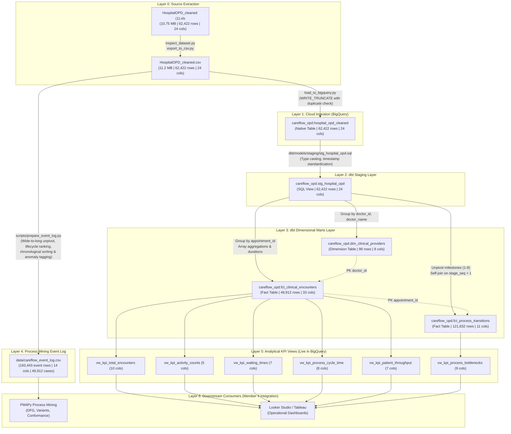
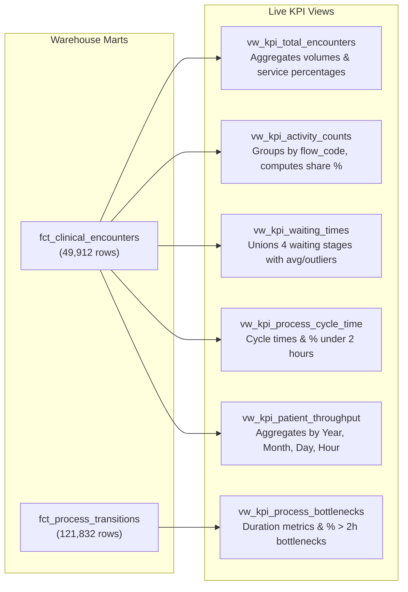

# CareFlow Clinical Process Mining — Source-to-Target Mapping (STTM)

**Document Version:** 1.0.0  
**Effective Date:** 2 November 2026  
**Auditor / Data Engineer:** Member 3 (Data Engineering: Ingestion, SQL Validation, dbt Marts, KPI Views, Event-Log Preparation)  
**Milestone Target:** 8 November 2026 (Final Project Handover)  
**Target GCP Project:** `careflow-clinical-process-m`  
**Target BigQuery Dataset:** `careflow_opd` (Region: `US`)  

---

## 1. Pipeline Architecture & Data Lineage

This Source-to-Target Mapping (STTM) document defines the end-to-end data lineage, transformation rules, business logic, and schema mappings from the raw source outpatient dataset through the dimensional warehouse marts, process mining event log, and analytical KPI views.

Across the production architecture, the pipeline maintains **11 Google Cloud BigQuery objects** (5 tables/marts and 6 analytical SQL views) containing **146 columns**, plus **1 local process mining event log** ([`data/careflow_event_log.csv`](file:///c:/Users/user/Documents/careflow-clinical-process-mining/data/careflow_event_log.csv), 14 columns), spanning **12 documented project entities (160 combined columns)**.

### 1.1 End-to-End Data Lineage Flow

### 1.2 Warehouse Dimensional Star-Schema (ER Diagram)

```mermaid
erDiagram
    dim_clinical_providers ||--o{ fct_clinical_encounters : "attends (doctor_id)"
    fct_clinical_encounters ||--o{ fct_process_transitions : "undergoes (appointment_id)"

    dim_clinical_providers {
        INT64 doctor_id PK "Physician Primary Key"
        STRING doctor_name "Physician Name"
        INT64 total_appointments "Visit Volume"
        INT64 total_encounter_records "Line Item Volume"
        INT64 total_patients_treated "Unique Patients"
        TIMESTAMP first_consultation_time "Earliest Consultation"
        TIMESTAMP last_consultation_time "Latest Consultation"
        FLOAT64 avg_consultation_duration_minutes "Mean Consultation Duration"
    }

    fct_clinical_encounters {
        INT64 appointment_id PK "Encounter Primary Key"
        INT64 patient_id FK "Patient Identifier"
        INT64 doctor_id FK "Attending Physician"
        STRING doctor_name "Attending Physician Name"
        TIMESTAMP appointment_start_time "Reception Check-in"
        TIMESTAMP prescription_start_time "Consultation Start"
        TIMESTAMP prescription_end_time "Consultation Complete"
        TIMESTAMP lab_start_time "Lab Specimen Drawn"
        TIMESTAMP lab_end_time "Lab Results Ready"
        TIMESTAMP imaging_start_time "Radiology Scan Start"
        TIMESTAMP imaging_end_time "Radiology Scan End"
        TIMESTAMP pharmacy_start_time "Pharmacy Intake"
        TIMESTAMP pharmacy_end_time "Pharmacy Dispensed"
        INT64 flow_code "Pathway Code (1-7)"
        STRING flow_name "Pathway Name"
        INT64 total_records "Condensed Record Count"
        INT64 has_lab "Lab Utilization Flag"
        INT64 has_imaging "Imaging Utilization Flag"
        INT64 has_pharmacy "Pharmacy Utilization Flag"
        INT64 total_lab_orders "Lab Order Count"
        INT64 total_imaging_orders "Imaging Order Count"
        INT64 total_pharmacy_lines "Pharmacy Item Count"
        INT64 wait_to_consultation_minutes "Reception Wait Duration"
        INT64 consultation_duration_minutes "Examination Duration"
        INT64 wait_to_lab_minutes "Wait to Lab Duration"
        INT64 lab_duration_minutes "Lab Turnaround Duration"
        INT64 wait_to_imaging_minutes "Wait to Imaging Duration"
        INT64 imaging_duration_minutes "Imaging Duration"
        INT64 wait_to_pharmacy_minutes "Wait to Pharmacy Duration"
        INT64 pharmacy_duration_minutes "Pharmacy Dispensing Duration"
        INT64 total_cycle_time_minutes "Encounter Total Length of Stay"
        INT64 has_timestamp_inversion "Sequence Inversion Flag"
        INT64 is_outlier_wait "Outlier Wait Flag (>480 min)"
    }

    fct_process_transitions {
        STRING transition_id PK "Surrogate Transition Key"
        INT64 appointment_id FK "Encounter Foreign Key"
        INT64 patient_id FK "Patient Identifier"
        INT64 transition_step "Step Number (1-based)"
        STRING from_stage "Origin Milestone"
        TIMESTAMP from_timestamp "Origin Milestone Timestamp"
        STRING to_stage "Destination Milestone"
        TIMESTAMP to_timestamp "Destination Milestone Timestamp"
        INT64 duration_minutes "Transition Duration"
        INT64 is_negative_transition "Negative Duration Inversion Flag"
        INT64 is_bottleneck "Bottleneck Flag (>120 min)"
    }
```

---

## 2. Layer-by-Layer Transformation Specifications

### 2.1 Stage 1: Raw CSV to BigQuery Base Table (`hospital_opd_cleaned`)
- **Source Artifact:** `data/HospitalOPD_cleaned.csv` (11.2 MB, 62,422 rows, 24 cols)
- **Target Object:** `careflow-clinical-process-m.careflow_opd.hospital_opd_cleaned`
- **Execution Script:** [`scripts/load_to_bigquery.py`](file:///c:/Users/user/Documents/careflow-clinical-process-mining/scripts/load_to_bigquery.py)
- **Ingestion Mode:** `WRITE_TRUNCATE` (idempotent overwrite with pre-load row count validation)

#### Column Transformation Table:
| # | Target BigQuery Column | Target Data Type | Source CSV Column | Transformation & Casting Logic | Default / Null Handling |
|:-:|:---|:---|:---|:---|:---|
| 1 | `record_no` | `INT64` | `record_no` | Cast integer string to INT64 | Cannot be NULL |
| 2 | `patient_id` | `INT64` | `patient_id` | Cast integer string to INT64 | Cannot be NULL |
| 3 | `appointment_id` | `INT64` | `appointment_id` | Cast integer string to INT64 | Cannot be NULL |
| 4 | `appointment_start_datetime` | `TIMESTAMP` | `appointment_start_datetime` | Parse ISO-8601 string to TIMESTAMP | Cannot be NULL |
| 5 | `prescription_doctor_id` | `INT64` | `prescription_doctor_id` | Cast integer string to INT64 | Cannot be NULL |
| 6 | `prescription_doctor_name` | `STRING` | `prescription_doctor_name` | Direct string load | Cannot be NULL |
| 7 | `prescription_order_id` | `INT64` | `prescription_order_id` | Cast integer string to INT64 | Cannot be NULL |
| 8 | `prescription_start_datetime`| `TIMESTAMP` | `prescription_start_datetime` | Parse ISO-8601 string to TIMESTAMP | Set to NULL if empty (12 nulls) |
| 9 | `prescription_end_datetime` | `TIMESTAMP` | `prescription_end_datetime` | Parse ISO-8601 string to TIMESTAMP | Set to NULL if empty (1 null) |
| 10| `lab_id` | `INT64` | `lab_id` | Cast float/int string to INT64 | Set to NULL if unpopulated (44,393 nulls) |
| 11| `lab_name` | `STRING` | `lab_name` | Direct string load | Set to NULL if unpopulated (44,393 nulls) |
| 12| `lab_start_datetime` | `TIMESTAMP` | `lab_start_datetime` | Parse ISO-8601 string to TIMESTAMP | Set to NULL if unpopulated (44,393 nulls) |
| 13| `lab_end_datetime` | `TIMESTAMP` | `lab_end_datetime` | Parse ISO-8601 string to TIMESTAMP | Set to NULL if unpopulated (49,095 nulls) |
| 14| `imaging_request_id` | `INT64` | `imaging_request_id` | Cast float/int string to INT64 | Set to NULL if unpopulated (56,899 nulls) |
| 15| `imaging_result_id` | `INT64` | `imaging_result_id` | Cast float/int string to INT64 | Set to NULL if unpopulated (56,899 nulls) |
| 16| `imaging_name` | `STRING` | `imaging_name` | Direct string load | Set to NULL if unpopulated (56,899 nulls) |
| 17| `imaging_start_datetime` | `TIMESTAMP` | `imaging_start_datetime` | Parse ISO-8601 string to TIMESTAMP | Set to NULL if unpopulated (56,899 nulls) |
| 18| `imaging_end_datetime` | `TIMESTAMP` | `imaging_end_datetime` | Parse ISO-8601 string to TIMESTAMP | Set to NULL if unpopulated (56,909 nulls) |
| 19| `pharmacy_sale_line_id` | `INT64` | `pharmacy_sale_line_id` | Cast float/int string to INT64 | Set to NULL if unpopulated (62,120 nulls) |
| 20| `medicine_name` | `STRING` | `medicine_name` | Direct string load | Set to NULL if unpopulated (62,120 nulls) |
| 21| `pharmacy_start_datetime` | `TIMESTAMP` | `pharmacy_start_datetime` | Parse ISO-8601 string to TIMESTAMP | Set to NULL if unpopulated (62,120 nulls) |
| 22| `pharmacy_end_datetime` | `TIMESTAMP` | `pharmacy_end_datetime` | Parse ISO-8601 string to TIMESTAMP | Set to NULL if unpopulated (62,120 nulls) |
| 23| `flow_code` | `INT64` | `flow_code` | Cast integer string to INT64 | Cannot be NULL (values: 1-7) |
| 24| `flow_name` | `STRING` | `flow_name` | Direct string load | Cannot be NULL |

---

### 2.2 Stage 2: Ingestion Table to dbt Staging View (`stg_hospital_opd`)
- **Source Object:** `careflow_opd.hospital_opd_cleaned`
- **Target Object:** `careflow_opd.stg_hospital_opd` (SQL View)
- **Model File:** [`dbt/models/staging/stg_hospital_opd.sql`](file:///c:/Users/user/Documents/careflow-clinical-process-mining/dbt/models/staging/stg_hospital_opd.sql)
- **Logic:** Renames datetime columns from `*_datetime` to `*_time` for standard dbt conventions; performs type casts.

#### Field-by-Field Mapping:
| Target Staging Column | Target Data Type | Source Column | Transformation Expression |
|:---|:---|:---|:---|
| `record_no` | `INT64` | `record_no` | `CAST(record_no AS INT64)` |
| `patient_id` | `INT64` | `patient_id` | `CAST(patient_id AS INT64)` |
| `appointment_id` | `INT64` | `appointment_id` | `CAST(appointment_id AS INT64)` |
| `appointment_start_time` | `TIMESTAMP` | `appointment_start_datetime` | `CAST(appointment_start_datetime AS TIMESTAMP)` |
| `prescription_doctor_id` | `INT64` | `prescription_doctor_id` | `CAST(prescription_doctor_id AS INT64)` |
| `prescription_doctor_name` | `STRING` | `prescription_doctor_name` | `CAST(prescription_doctor_name AS STRING)` |
| `prescription_order_id` | `INT64` | `prescription_order_id` | `CAST(prescription_order_id AS INT64)` |
| `prescription_start_time` | `TIMESTAMP` | `prescription_start_datetime` | `CAST(prescription_start_datetime AS TIMESTAMP)` |
| `prescription_end_time` | `TIMESTAMP` | `prescription_end_datetime` | `CAST(prescription_end_datetime AS TIMESTAMP)` |
| `lab_id` | `INT64` | `lab_id` | `CAST(lab_id AS INT64)` |
| `lab_name` | `STRING` | `lab_name` | `CAST(lab_name AS STRING)` |
| `lab_start_time` | `TIMESTAMP` | `lab_start_datetime` | `CAST(lab_start_datetime AS TIMESTAMP)` |
| `lab_end_time` | `TIMESTAMP` | `lab_end_datetime` | `CAST(lab_end_datetime AS TIMESTAMP)` |
| `imaging_request_id` | `INT64` | `imaging_request_id` | `CAST(imaging_request_id AS INT64)` |
| `imaging_result_id` | `INT64` | `imaging_result_id` | `CAST(imaging_result_id AS INT64)` |
| `imaging_name` | `STRING` | `imaging_name` | `CAST(imaging_name AS STRING)` |
| `imaging_start_time` | `TIMESTAMP` | `imaging_start_datetime` | `CAST(imaging_start_datetime AS TIMESTAMP)` |
| `imaging_end_time` | `TIMESTAMP` | `imaging_end_datetime` | `CAST(imaging_end_datetime AS TIMESTAMP)` |
| `pharmacy_sale_line_id` | `INT64` | `pharmacy_sale_line_id` | `CAST(pharmacy_sale_line_id AS INT64)` |
| `medicine_name` | `STRING` | `medicine_name` | `CAST(medicine_name AS STRING)` |
| `pharmacy_start_time` | `TIMESTAMP` | `pharmacy_start_datetime` | `CAST(pharmacy_start_datetime AS TIMESTAMP)` |
| `pharmacy_end_time` | `TIMESTAMP` | `pharmacy_end_datetime` | `CAST(pharmacy_end_datetime AS TIMESTAMP)` |
| `flow_code` | `INT64` | `flow_code` | `CAST(flow_code AS INT64)` |
| `flow_name` | `STRING` | `flow_name` | `CAST(flow_name AS STRING)` |

---

### 2.3 Stage 3A: Staging View to Provider Dimension (`dim_clinical_providers`)
- **Source Object:** `stg_hospital_opd`
- **Target Object:** `dim_clinical_providers` (Native Table, 98 rows, 8 cols)
- **Model File:** [`dbt/models/marts/dim_clinical_providers.sql`](file:///c:/Users/user/Documents/careflow-clinical-process-mining/dbt/models/marts/dim_clinical_providers.sql)
- **Aggregation Grain:** Grouped by `prescription_doctor_id, prescription_doctor_name` where `prescription_doctor_id IS NOT NULL`.

#### Mapping Table:
| Target Column | Target Data Type | Source Field(s) | Transformation Expression & Business Rules |
|:---|:---|:---|:---|
| `doctor_id` | `INT64` | `prescription_doctor_id` | `prescription_doctor_id` (Group key) |
| `doctor_name` | `STRING` | `prescription_doctor_name` | `prescription_doctor_name` (Group key) |
| `total_appointments` | `INT64` | `appointment_id` | `COUNT(DISTINCT appointment_id)` |
| `total_encounter_records` | `INT64` | `*` | `COUNT(*)` |
| `total_patients_treated` | `INT64` | `patient_id` | `COUNT(DISTINCT patient_id)` |
| `first_consultation_time` | `TIMESTAMP` | `prescription_start_time` | `MIN(prescription_start_time)` |
| `last_consultation_time` | `TIMESTAMP` | `prescription_start_time` | `MAX(prescription_start_time)` |
| `avg_consultation_duration_minutes` | `FLOAT64` | `prescription_start_time`, `prescription_end_time` | `ROUND(AVG(CASE WHEN prescription_start_time IS NOT NULL AND prescription_end_time IS NOT NULL AND prescription_end_time >= prescription_start_time THEN TIMESTAMP_DIFF(prescription_end_time, prescription_start_time, MINUTE) ELSE NULL END), 2)` |

---

### 2.4 Stage 3B: Staging View to Encounter Fact (`fct_clinical_encounters`)
- **Source Object:** `stg_hospital_opd`
- **Target Object:** `fct_clinical_encounters` (Native Table, 49,912 rows, 33 cols)
- **Model File:** [`dbt/models/marts/fct_clinical_encounters.sql`](file:///c:/Users/user/Documents/careflow-clinical-process-mining/dbt/models/marts/fct_clinical_encounters.sql)
- **Aggregation Grain:** Grouped by `appointment_id` (condenses 62,422 source rows into 49,912 visit-level encounters).
- **Clinician Pairing Safeguard:** Uses `ARRAY_AGG(prescription_doctor_id ORDER BY record_no ASC)[OFFSET(0)]` and `ARRAY_AGG(prescription_doctor_name ORDER BY record_no ASC)[OFFSET(0)]` to guarantee that doctor ID and doctor name are perfectly matched from the first chronologically recorded transaction line.

#### Full Column Mapping Table:
| # | Target Fact Column | Type | Source Staging Field(s) | Transformation Expression / SQL Logic |
|:-:|:---|:---|:---|:---|
| 1 | `appointment_id` | `INT64` | `appointment_id` | `appointment_id` (Group by key) |
| 2 | `patient_id` | `INT64` | `patient_id` | `MIN(patient_id)` |
| 3 | `doctor_id` | `INT64` | `prescription_doctor_id` | `ARRAY_AGG(prescription_doctor_id ORDER BY record_no ASC)[OFFSET(0)]` |
| 4 | `doctor_name` | `STRING` | `prescription_doctor_name` | `ARRAY_AGG(prescription_doctor_name ORDER BY record_no ASC)[OFFSET(0)]` |
| 5 | `appointment_start_time` | `TIMESTAMP` | `appointment_start_time` | `MIN(appointment_start_time)` |
| 6 | `prescription_start_time` | `TIMESTAMP` | `prescription_start_time` | `MIN(prescription_start_time)` |
| 7 | `prescription_end_time` | `TIMESTAMP` | `prescription_end_time` | `MAX(prescription_end_time)` |
| 8 | `lab_start_time` | `TIMESTAMP` | `lab_start_time` | `MIN(lab_start_time)` |
| 9 | `lab_end_time` | `TIMESTAMP` | `lab_end_time` | `MAX(lab_end_time)` |
| 10| `imaging_start_time` | `TIMESTAMP` | `imaging_start_time` | `MIN(imaging_start_time)` |
| 11| `imaging_end_time` | `TIMESTAMP` | `imaging_end_time` | `MAX(imaging_end_time)` |
| 12| `pharmacy_start_time` | `TIMESTAMP` | `pharmacy_start_time` | `MIN(pharmacy_start_time)` |
| 13| `pharmacy_end_time` | `TIMESTAMP` | `pharmacy_end_time` | `MAX(pharmacy_end_time)` |
| 14| `flow_code` | `INT64` | `flow_code` | `MAX(flow_code)` |
| 15| `flow_name` | `STRING` | `flow_name`, `flow_code` | `ARRAY_AGG(flow_name ORDER BY flow_code DESC, record_no ASC)[OFFSET(0)]` |
| 16| `total_records` | `INT64` | `*` | `COUNT(*)` |
| 17| `has_lab` | `INT64` | `lab_id` | `MAX(CASE WHEN lab_id IS NOT NULL THEN 1 ELSE 0 END)` |
| 18| `has_imaging` | `INT64` | `imaging_request_id` | `MAX(CASE WHEN imaging_request_id IS NOT NULL THEN 1 ELSE 0 END)` |
| 19| `has_pharmacy` | `INT64` | `pharmacy_sale_line_id`| `MAX(CASE WHEN pharmacy_sale_line_id IS NOT NULL THEN 1 ELSE 0 END)` |
| 20| `total_lab_orders` | `INT64` | `lab_id` | `COUNT(DISTINCT lab_id)` |
| 21| `total_imaging_orders` | `INT64` | `imaging_request_id` | `COUNT(DISTINCT imaging_request_id)` |
| 22| `total_pharmacy_lines` | `INT64` | `pharmacy_sale_line_id`| `COUNT(DISTINCT pharmacy_sale_line_id)` |
| 23| `wait_to_consultation_minutes` | `INT64` | `prescription_start_time`, `appointment_start_time` | `TIMESTAMP_DIFF(prescription_start_time, appointment_start_time, MINUTE)` |
| 24| `consultation_duration_minutes`| `INT64` | `prescription_end_time`, `prescription_start_time` | `TIMESTAMP_DIFF(prescription_end_time, prescription_start_time, MINUTE)` |
| 25| `wait_to_lab_minutes` | `INT64` | `lab_start_time`, `appointment_start_time` | `TIMESTAMP_DIFF(lab_start_time, appointment_start_time, MINUTE)` |
| 26| `lab_duration_minutes` | `INT64` | `lab_end_time`, `lab_start_time` | `TIMESTAMP_DIFF(lab_end_time, lab_start_time, MINUTE)` |
| 27| `wait_to_imaging_minutes` | `INT64` | `imaging_start_time`, `appointment_start_time` | `TIMESTAMP_DIFF(imaging_start_time, appointment_start_time, MINUTE)` |
| 28| `imaging_duration_minutes` | `INT64` | `imaging_end_time`, `imaging_start_time` | `TIMESTAMP_DIFF(imaging_end_time, imaging_start_time, MINUTE)` |
| 29| `wait_to_pharmacy_minutes` | `INT64` | `pharmacy_start_time`, `appointment_start_time` | `TIMESTAMP_DIFF(pharmacy_start_time, appointment_start_time, MINUTE)` |
| 30| `pharmacy_duration_minutes` | `INT64` | `pharmacy_end_time`, `pharmacy_start_time` | `TIMESTAMP_DIFF(pharmacy_end_time, pharmacy_start_time, MINUTE)` |
| 31| `total_cycle_time_minutes` | `INT64` | All completion timestamps | `TIMESTAMP_DIFF(GREATEST(COALESCE(prescription_end_time, appointment_start_time), COALESCE(lab_end_time, appointment_start_time), COALESCE(imaging_end_time, appointment_start_time), COALESCE(pharmacy_end_time, appointment_start_time)), appointment_start_time, MINUTE)` |
| 32| `has_timestamp_inversion` | `INT64` | All stage timestamps | `CASE WHEN prescription_start_time < appointment_start_time OR lab_start_time < appointment_start_time OR imaging_start_time < appointment_start_time OR prescription_end_time < prescription_start_time THEN 1 ELSE 0 END` |
| 33| `is_outlier_wait` | `INT64` | `wait_to_consultation_minutes` | `CASE WHEN TIMESTAMP_DIFF(prescription_start_time, appointment_start_time, MINUTE) > 480 THEN 1 ELSE 0 END` |

---

### 2.5 Stage 3C: Staging View to Process Transitions Fact (`fct_process_transitions`)
- **Source Object:** `stg_hospital_opd`
- **Target Object:** `fct_process_transitions` (Native Table, 121,832 rows, 11 cols)
- **Model File:** [`dbt/models/marts/fct_process_transitions.sql`](file:///c:/Users/user/Documents/careflow-clinical-process-mining/dbt/models/marts/fct_process_transitions.sql)
- **Transformation Architecture:**
  1. **Encounter Milestone Extraction:** Extracts the 9 possible milestone timestamps for each `appointment_id`.
  2. **Canonical Stage Unpivot:** Unpivots non-null milestones with explicit clinical pathway sequence ranks:
     - `Registration` (Rank 1)
     - `Consultation Start` (Rank 2)
     - `Consultation Complete` (Rank 3)
     - `Lab Start` (Rank 4)
     - `Lab Complete` (Rank 5)
     - `Imaging Start` (Rank 6)
     - `Imaging Complete` (Rank 7)
     - `Pharmacy Start` (Rank 8)
     - `Pharmacy Complete` (Rank 9)
  3. **Sequential Windowing:** Applies `ROW_NUMBER() OVER (PARTITION BY appointment_id ORDER BY stage_order ASC)` as `stage_seq`.
  4. **Self-Join Transition Pairing:** Joins `s1` with `s2` where `s1.appointment_id = s2.appointment_id AND s2.stage_seq = s1.stage_seq + 1`.

#### Column Mapping Table:
| # | Target Column | Target Type | Source Field / Expression | Transformation Logic |
|:-:|:---|:---|:---|:---|
| 1 | `transition_id` | `STRING` | `s1.appointment_id`, `s1.stage_seq` | `CONCAT(CAST(s1.appointment_id AS STRING), '_step_', CAST(s1.stage_seq AS STRING))` |
| 2 | `appointment_id` | `INT64` | `s1.appointment_id` | Encounter identifier (Foreign key) |
| 3 | `patient_id` | `INT64` | `s1.patient_id` | Patient identifier |
| 4 | `transition_step` | `INT64` | `s1.stage_seq` | Step sequence counter within visit |
| 5 | `from_stage` | `STRING` | `s1.stage_name` | Milestone name of origin stage |
| 6 | `from_timestamp` | `TIMESTAMP` | `s1.stage_time` | Timestamp of origin stage |
| 7 | `to_stage` | `STRING` | `s2.stage_name` | Milestone name of destination stage |
| 8 | `to_timestamp` | `TIMESTAMP` | `s2.stage_time` | Timestamp of destination stage |
| 9 | `duration_minutes` | `INT64` | `s1.stage_time`, `s2.stage_time` | `TIMESTAMP_DIFF(s2.stage_time, s1.stage_time, MINUTE)` |
| 10| `is_negative_transition`| `INT64` | `s1.stage_time`, `s2.stage_time` | `CASE WHEN s2.stage_time < s1.stage_time THEN 1 ELSE 0 END` |
| 11| `is_bottleneck` | `INT64` | `duration_minutes` | `CASE WHEN TIMESTAMP_DIFF(s2.stage_time, s1.stage_time, MINUTE) > 120 THEN 1 ELSE 0 END` |

---

### 2.6 Stage 4: Raw CSV to Process Mining Event Log (`careflow_event_log.csv`)
- **Source Artifact:** `data/HospitalOPD_cleaned.csv` (62,422 rows, 24 cols)
- **Target Artifact:** `data/careflow_event_log.csv` (193,443 rows, 14 cols, 49,912 cases)
- **Execution Script:** [`scripts/prepare_event_log.py`](file:///c:/Users/user/Documents/careflow-clinical-process-mining/scripts/prepare_event_log.py)
- **Transformation Rules:**
  - Unpivots 5 clinical activity domains into discrete event rows:
    1. `Appointment Registration` (1 event per distinct appointment, lifecycle `complete`) $\rightarrow$ 49,494 events.
    2. `Prescription Consultation Started` & `Prescription Consultation Completed` $\rightarrow$ 50,556 start + 50,567 complete events.
    3. `Lab Test Started` & `Lab Test Completed` $\rightarrow$ 17,848 start + 13,203 complete events.
    4. `Imaging Started` & `Imaging Completed` $\rightarrow$ 5,421 start + 5,412 complete events.
    5. `Pharmacy Dispensation Started` & `Pharmacy Dispensation Completed` $\rightarrow$ 262 start + 262 complete events.
  - Multi-tier intra-case sorting logic:
    `ORDER BY case_id ASC, dt_timestamp ASC, category_order ASC, lifecycle_order ASC, source_record_no ASC`
    *(Ensures registration precedes consult start, start precedes complete, and orders within the same second have stable ordering).*
  - `event_order`: Generated via `.groupby('case_id').cumcount() + 1` (1-based chronological index within case).
  - `timestamp_anomaly_flag`: Evaluated as `dt_timestamp < dt_appointment_start`.

#### Event Log Field Mapping Table:
| # | Target Event Field | Type | Source Field(s) | Transformation Logic | Sample Value |
|:-:|:---|:---|:---|:---|:---|
| 1 | `case_id` | `int64` | `appointment_id` | Encounter identifier | `1001` |
| 2 | `patient_id` | `int64` | `patient_id` | Patient identifier | `132644` |
| 3 | `activity` | `string` | Dynamic | Explicit activity label (9 unique) | `Appointment Registration` |
| 4 | `activity_category` | `string` | Dynamic | Domain: `Registration`, `Consultation`, `Laboratory`, `Imaging`, `Pharmacy` | `Registration` |
| 5 | `lifecycle` | `string` | Dynamic | Lifecycle state: `start` or `complete` | `complete` |
| 6 | `timestamp` | `string` | Various | Formatted ISO-8601 string (`YYYY-MM-DD HH:MM:SS`) | `2024-04-25 11:12:00` |
| 7 | `resource` | `string` | `prescription_doctor_name` / Department | Doctor name for consultation; Department name for diagnostic units | `Reception / OPD Clinic` |
| 8 | `service_id` | `float64`| Service ID fields | `appointment_id`, `prescription_order_id`, `lab_id`, `imaging_request_id`, or `pharmacy_sale_line_id` | `1001` |
| 9 | `service_name` | `string` | Service name fields | `lab_name`, `imaging_name`, `medicine_name`, or default clinical label | `OPD Registration` |
| 10| `flow_code` | `int64` | `flow_code` | Numeric pathway code (1-7) | `2` |
| 11| `flow_name` | `string` | `flow_name` | Pathway description string | `Appointment → Prescription → Lab` |
| 12| `source_record_no` | `int64` | `record_no` | Source row lineage link (100% traceable) | `1` |
| 13| `timestamp_anomaly_flag`| `bool` | `timestamp`, `appointment_start_datetime`| `dt_timestamp < dt_appt` | `False` |
| 14| `event_order` | `int64` | Dynamic | Sequential event counter within case (1 to 57) | `1` |

---

### 2.7 Stage 5: Warehouse Marts to Analytical KPI Views
- **Source Objects:** `fct_clinical_encounters`, `fct_process_transitions`
- **Target Objects:** 6 Live BigQuery Views in `careflow-clinical-process-m.careflow_opd`
- **SQL Source:** [`sql/kpi_analysis_views.sql`](file:///c:/Users/user/Documents/careflow-clinical-process-mining/sql/kpi_analysis_views.sql)

#### Summary of KPI View Derivations:

1. **`vw_kpi_total_encounters`:**
   - Source: `fct_clinical_encounters`
   - Total Encounters: `COUNT(DISTINCT appointment_id)` = **49,912**
   - Total Unique Patients: `COUNT(DISTINCT patient_id)` = **39,442**
   - Lab Utilization: `COUNTIF(has_lab = 1) * 100.0 / total_encounters` = **12.76%**
   - Imaging Utilization: `COUNTIF(has_imaging = 1) * 100.0 / total_encounters` = **10.66%**
   - Pharmacy Utilization: `COUNTIF(has_pharmacy = 1) * 100.0 / total_encounters` = **0.22%**
2. **`vw_kpi_activity_counts`:**
   - Source: `fct_clinical_encounters`
   - Grouping: `flow_code, flow_name`
   - Share Percentage: `ROUND(COUNT(DISTINCT appointment_id) * 100.0 / SUM(COUNT(DISTINCT appointment_id)) OVER(), 2)`
3. **`vw_kpi_waiting_times`:**
   - Source: `fct_clinical_encounters`
   - Structure: `UNION ALL` across the 4 clinical wait stages
   - Metrics: `AVG(wait)`, `MIN(wait)`, `MAX(wait)`, `COUNTIF(wait > 480)`, `COUNTIF(wait < 0)`
4. **`vw_kpi_process_cycle_time`:**
   - Source: `fct_clinical_encounters`
   - Grouping: `flow_code, flow_name`
   - Metrics: `AVG(total_cycle_time_minutes)`, `COUNTIF(total_cycle_time_minutes > 480)`, `COUNTIF(total_cycle_time_minutes <= 120)`
5. **`vw_kpi_patient_throughput`:**
   - Source: `fct_clinical_encounters`
   - Grouping: `EXTRACT(YEAR)`, `EXTRACT(MONTH)`, `EXTRACT(DAYOFWEEK)`, `EXTRACT(HOUR)`
   - Metrics: `COUNT(DISTINCT appointment_id)`, `COUNT(DISTINCT patient_id)`
6. **`vw_kpi_process_bottlenecks`:**
   - Source: `fct_process_transitions`
   - Grouping: `from_stage, to_stage`
   - Metrics: `AVG(duration_minutes)`, `COUNTIF(is_bottleneck = 1)`, `ROUND(bottleneck_rate_pct, 2)`, `COUNTIF(is_negative_transition = 1)`

---

## 3. Data Cleansing, Business Rules & Exception Handling

| Issue / Anomaly Type | Empirical Frequency | Source Root Cause | Cleansing & Handling Strategy in Warehouse Pipeline |
| :--- | :---: | :--- | :--- |
| **Missing Consultation Start Timestamps** | 12 rows (0.02%) | Rapid emergency consultation or system bypass at physician workstation. | Preserved as NULL in staging and encounter facts; excluded from duration averages via `IS NOT NULL` checks to avoid skewed metrics. |
| **Pending / Incomplete Laboratory Tests** | 4,702 tests (26.08% of lab orders) | Blood drawn at clinic, but patient discharged before lab result was finalized. | `lab_end_time` preserved as NULL. In event log, `Lab Test Started` is logged without a synthetic `Lab Test Completed` event (zero timestamp fabrication). |
| **Incomplete Imaging Scans** | 10 scans (0.18% of imaging orders) | Scan initiated without recorded exit timestamp. | `imaging_end_time` preserved as NULL; event log includes `Imaging Started` only. |
| **Pre-Registration Diagnostic Starts (Negative Inversions)** | 418 encounters (0.84%) | Patient sent directly to trauma X-ray or phlebotomy prior to desk reception. | Retained with exact historical timestamps; flagged in fact tables (`has_timestamp_inversion = 1`, `is_negative_transition = 1`) and event log (`timestamp_anomaly_flag = True`). |
| **Multi-Order Diagnostic Concurrency** | 14,481 instances sharing `(case_id, activity, timestamp)` | Physician ordering multiple lab tests (e.g. CBC + LFT) at the same second. | Valid clinical parallelism. Differentiated in event log by unique `service_id` and distinct `source_record_no` provenance links. |
| **Outlier Waiting Times** | 445 encounters ($>8$ hours wait) | Heavy morning arrival surges (e.g. 2,640 arrivals between 06:00 and 08:00 Mondays). | Flagged explicitly via `is_outlier_wait = 1` for specialized operational exception monitoring. |
| **Intra-Encounter Duplicate Service Orders** | 160 rows (0.26% of source) | Duplicate service lines within an encounter sharing identical service ID and timestamps (116 lab orders, 39 pharmacy lines, 5 imaging scans). | Consolidated during wide-to-long unpivoting in `scripts/prepare_event_log.py`; the earliest sequential `record_no` is preserved as the event provenance link, yielding 62,262 distinct source rows referenced with 0 orphans. |

---

## 4. End-to-End Provenance & Traceability Matrix

Every downstream entity and metric in the CareFlow project can be deterministically audited back to its underlying source record:

| Analytical Asset | Primary Entity | Foreign Key Link to Upstream | Traceability to Source Line Item |
| :--- | :--- | :--- | :--- |
| **Looker / Tableau KPIs** | `vw_kpi_*` | Query `fct_clinical_encounters` or `fct_process_transitions` | Traceable via `appointment_id` |
| **Transition Bottlenecks** | `fct_process_transitions` | `appointment_id` $\rightarrow$ `fct_clinical_encounters` | Traceable via `appointment_id` |
| **Physician Performance** | `dim_clinical_providers` | `doctor_id` $\leftarrow$ `fct_clinical_encounters` | Traceable via `prescription_doctor_id` |
| **Encounter Metrics** | `fct_clinical_encounters` | `appointment_id` $\rightarrow$ `stg_hospital_opd` | Traceable via `appointment_id` |
| **Process Mining Event Log** | `careflow_event_log.csv` | Direct field `source_record_no` | Zero orphan references (100% referential integrity to `hospital_opd_cleaned.record_no`); references 62,262 distinct source rows (99.74% of source dataset), with 160 intra-encounter duplicate order lines consolidated. |
| **Staging Layer** | `stg_hospital_opd` | Direct field `record_no` | **Direct 1:1 trace to `hospital_opd_cleaned.record_no`** |
